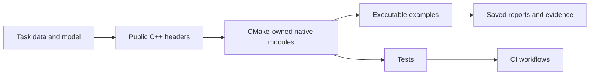

<a name="controlled-systems-lab"></a>

# Reachability and predictive control in C++

Use CSL to compute reachable sets for constrained discrete-time systems and
compare controllers on the same model, cost, and constraints. The examples give
students and control engineers a starting point for inspecting trajectories and
trying the same calculation with a different model or controller.

**Try it in your browser.** [See when a new state observation changes the next
control action](https://butahlecoq.github.io/controlled-systems-lab/examples/discrete-mpc-2d.html).
The two-state example compares a plan computed once with a controller that
replans from the observed state. Both policies agree when the forecast matches
the replay. After a disturbance, the controller chooses a different later
action. The page shows the trajectories and the model assumptions.

[Run this example](#quick-start) ·
[Learn the methods](https://butahlecoq.github.io/controlled-systems-lab/learn/) ·
[Explore the visual examples](https://butahlecoq.github.io/controlled-systems-lab/examples/)

The [standalone C++ SDK](https://github.com/butahlecoq/csl-sdk) contains the native package, tests and runnable examples. This research repository hosts the comparison drivers, learning book, and historical results. [Build a research driver against the pinned SDK](CONTRIBUTING.md#run-a-research-driver-against-an-installed-sdk).

## Quick start

Build from the [current C++ SDK](https://github.com/butahlecoq/csl-sdk#quick-start) or choose a tagged version from [SDK releases](https://github.com/butahlecoq/csl-sdk/releases). The first version, [v0.1.0](https://github.com/butahlecoq/controlled-systems-lab/releases/tag/v0.1.0), is available here alongside the [research evidence releases](https://github.com/butahlecoq/controlled-systems-lab/releases).

Requires Git, CMake/CTest 3.31 or newer and a C++20 compiler (MSVC 2022, GCC 13 or Clang 18 are CI toolchains). Put CMake on PATH; on Windows a Visual Studio developer shell with its CMake component installed provides the tools. Run from the repository root and stop on any nonzero exit. The first configure downloads the existing pinned dependencies; no Python is needed with `BUILD_TESTING=OFF`. Installation is a local development check, not a binary distribution license grant.

These commands work in PowerShell and a POSIX shell; `$PWD` supplies an absolute install prefix. `--config Release` selects Release for multi-configuration generators, and `CMAKE_BUILD_TYPE` selects it for single-configuration generators.

```sh
cmake -S . -B build/quickstart -DBUILD_TESTING=OFF -DCMAKE_BUILD_TYPE=Release
cmake --build build/quickstart --config Release --parallel 4
cmake --install build/quickstart --config Release --prefix build/quickstart/install
cmake -S examples -B build/examples -DCMAKE_BUILD_TYPE=Release "-DCMAKE_PREFIX_PATH=$PWD/build/quickstart/install"
cmake --build build/examples --config Release --target discrete_mpc_2d --parallel 4
ctest --test-dir build/examples -C Release -R '^discrete_mpc_2d_matched_open_loop_and_feedback$' --no-tests=error -V
```

Expect one passing test. In the published example, the first control coordinate
differs for the first time at stage 4. It is 0 for the open-loop plan and about
1.05 for observed-state MPC. The state and control histories are in
`build/examples/discrete-mpc-2d-test-output/episode.csv`. This is a numerical
check on the example's eight-stage task.

To try another forecast or disturbance, edit `make_task` in the
[example source](examples/discrete_mpc_2d.cpp). To supply your own
model and bounds, use the public
[`NominalMpcTask` fields](include/csl/controllers/discrete_mpc.hpp). The source
data section shows the model and bounds used in this
[example page](https://butahlecoq.github.io/controlled-systems-lab/examples/discrete-mpc-2d.html).

### More examples

Build and run the full installed example suite when you want to explore more
operations.

```sh
cmake --build build/examples --config Release --parallel 4
ctest --test-dir build/examples -C Release --output-on-failure --no-tests=error
```

The example suite covers both real feasibility backends and rejected unknown backends/missing or malformed files. [The standalone CMake project](examples/CMakeLists.txt) uses only `find_package(CSL CONFIG)` and installed public targets. The existing installed-consumer CI gate copies and builds the same examples independently of repository headers.

| Executable/source | What it actually does | Expected numerical output |
| --- | --- | --- |
| [registered_lp](examples/registered_lp.cpp) | Selects and runs registered HiGHS on a triangle LP with offset | `x=0 y=1 original_cost=5` |
| [registered_convex](examples/registered_convex.cpp) | Minimizes original `||(x-3,4)||` on `[0,2]` through the convex port | `x=2 original_cost=4.123105626 squared_cost=17` |
| [resolved_scenario](examples/resolved_scenario.cpp) | Constructs and publishes a two-stage model; evaluates stated controls | `states=0,0.25,1 controls=0.25,0.75 original_cost=0` |
| [scenario_file](examples/scenario_file.cpp) | Loads the [JSON template](examples/scenarios/two-stage-integrator.json) into the actual immutable problem and evaluates the same stated history | Same history/cost, plus mathematical identity and separate source digest |
| [scenario_cli](examples/scenario_cli.cpp) | Validates without solvers or runs the guarded paired application for supported T-S01/T-S02 profiles | validation-only result or per-strategy outcomes and witness checks |
| [backend_substitution](examples/backend_substitution.cpp) | Runs one unchanged zero-objective equality/nonnegative LP through either `csl.lp.highs` or `phase-one-bland` | Nonnegative `u0,u1`, `sum=1 original_cost=0`; the chosen witness can differ |
| [scenario_backend_substitution](examples/scenario_backend_substitution.cpp) | Reads `run.backends.lp` from two copies of the same supported two-stage integrator scenario and saves each provider's feasibility result | Same `ProblemId`, effective backend/version, and a checked `u0+u1=1` witness |

Visual Studio executables are under `build/examples/Release/<name>.exe`; single-configuration generators put them under `build/examples/<name>` (with `.exe` on Windows). For example, in PowerShell with Visual Studio:

```powershell
./build/examples/Release/registered_lp.exe
./build/examples/Release/registered_convex.exe
./build/examples/Release/resolved_scenario.exe
./build/examples/Release/scenario_file.exe examples/scenarios/two-stage-integrator.json
./build/examples/Release/scenario_cli.exe --validate-only examples/scenarios/two-stage-integrator.json
./build/examples/Release/scenario_cli.exe --run examples/scenarios/two-stage-integrator.json --profile ts01_exact_integrator --seed 31 --threads 1
./build/examples/Release/backend_substitution.exe csl.lp.highs
./build/examples/Release/backend_substitution.exe phase-one-bland
./build/examples/Release/scenario_backend_substitution.exe examples/scenarios/two-stage-integrator-highs.json build/two-stage-highs.json
./build/examples/Release/scenario_backend_substitution.exe examples/scenarios/two-stage-integrator-phase-one.json build/two-stage-phase-one.json
```

The validation-only CLI checks scenario parsing and canonical model resolution without invoking solvers. Run mode sends the same resolved problem to the installed paired application API, which admits the reach-back and direct-joint strategies, selects witnesses from complete T-S01/T-S02 families, and independently checks those witnesses against the original problem. The initial profile defaults to T-S01. The `--profile`, `--lp`, `--convex`, `--seed`, and `--threads` options override run settings. The scenario's `run.resources` sets its resource policy. Input and capability failures retain actionable diagnostics.

Use `--output-dir <directory>` to save one versioned run artifact per strategy through the artifact API after both strategies return complete-family results with completed optimal outcomes and every selected witness passes its numerical checks. The `csl.run-statistics/7` records retain complete-family claims as unverified data; decoding them does not grant proof authority. The two files are separate run records, not a paired comparison record. If either strategy or witness check fails, the CLI returns before artifact publication. Without `--output-dir`, the CLI prints results and saves no artifacts. Witness checks do not prove optimality or general family completeness.

The CLI's `--lp` and `--convex` options take registry IDs and default to HiGHS. Selection prints the chosen ID and version; an unknown ID exits with a registry diagnostic. The separate `backend_substitution` example takes its backend ID as a positional argument. `scenario_backend_substitution` instead reads the authored LP backend from each scenario and writes a JSON record per run. It accepts only the exact two-stage scalar integrator fixture: the LP checks terminal reachability `u0+u1=1` under `0<=u0,u1<=1`. Both runs report numerical feasibility only; Phase I is not presented as a general optimizer or control-synthesis strategy, and the records claim neither a certified bound nor a complete optimal family. Changed model data is rejected with a `/scenario/model` diagnostic.

The file template uses `0.5*x'Q*x + q'x + c`, here `Q=2`, `q=-2`, `c=1`, so the original terminal cost is `(x2-1)^2`. Its default comparison request is intent only: no synthesis strategy is selected or executed. The history `(u0,u1)=(0.25,0.75)` is supplied by the example, not found by a solver. This small reader is not a general scenario runner or independent constraint verifier.

The [registered synthesis comparison example](examples/registered_synthesis_comparison.cpp) provides a functional comparison bounded to the two-stage integrator and exact T-S01 request. It runs both registered strategies against the same immutable problem, selects witness histories, and reports independent checks against the original problem data. Its JSON summary identifies the shared problem/request and each strategy, outcome, selected witnesses, and original-data verification status/residuals; the example does not serialize the live optimal-family relation or proof payload. Its functional output and CTest duration are not performance evidence. The [saved paired T-S01 report](reports/algorithm-results/syn-ts01-paired-20261014-b7f1ac0/index.html) supplies HTML and raw records for this tiny fixture; its performance conclusion is inconclusive and establishes no general strategy ranking. Broader comparisons follow the [published-results policy](docs/architecture/published-algorithm-results.md).

## Implementation scope

CSL (Controlled Systems Lab) is a C++20 SDK and research repository. It provides
immutable affine models and problem data, JSON scenario intake, registered
LP and convex backends, phase-I feasibility, execution, and numerical reporting.

Strategy A combines reachability, terminal minimization, and backward recovery.
Strategy B optimizes jointly across the control history. CSL implements both,
plus witness selection and independent trajectory verification. Profile-specific
verifiers support complete optimal families for T-S01/T-S02/T-S03. Strategy A
also has a bounded finite-horizon nominal linear profile whose verifier checks
represented binary64 inputs as exact dyadics. Verifier scope is specific to
each profile. General family coverage, certification of numerical producers,
and trusted proof serialization remain open.

## Repository map

Follow this map from the mathematical task to the implementation and the evidence that checks or describes it. The arrows show a reader path, not the complete runtime dependency graph.



| If you want to… | Start here | Next step |
| --- | --- | --- |
| Run a supported consumer example | [Quick start](#quick-start), [installed examples](examples/CMakeLists.txt) | Direct examples need no scenario file; for a file-driven example, choose a [scenario](examples/scenarios/) and its [schema](schemas/scenario/). Where a visual case is available, inspect the [minimal 2D visual examples](https://butahlecoq.github.io/controlled-systems-lab/examples/), then follow each result's scope and evidence limits. |
| Find a model, algorithm or public type | [Public headers](include/csl/), [native source](src/) | The ordered module list is in [CMakeLists.txt](CMakeLists.txt); each module owns build declarations and focused tests in `src/<module>/Module.cmake` and `src/<module>/Tests.cmake`. |
| Change or verify native behavior | [Module declarations](src/), [tests](tests/) | Follow the owning module's `Tests.cmake`, then the relevant [native CI workflow](.github/workflows/native.yml). Tests are also grouped by unit, contract and integration scope. |
| Learn a topic or inspect its task contract | [Learning-book catalogue](docs/catalogue/learning-book-v1.json), [chapter pages](docs/examples/learning/chapters/), [closed-loop task contracts](docs/contracts/closed-loop/) | Compare the documented model and capability with an executable example before interpreting a result. |
| Reproduce or interpret a numerical result | [Benchmark/reporting tools](benchmarks/reporting/), [report reproduction scripts](scripts/reports/), [saved report index](reports/algorithm-results/index.html) | Read the report's source and scope, then apply the [published-results evidence rules](docs/architecture/published-algorithm-results.md). |
| Understand package and contribution policy | [CMake package setup](cmake/Package.cmake), [test catalogue](cmake/TestCatalog.cmake), [delivery guidance](docs/agents/delivery.md) | The numbered [architecture decisions](docs/architecture/decisions/) record accepted design constraints. |

**Use path:** start with the Quick start, select an installed example (and a scenario if it is file-driven), view an illustration where available, then follow its output or report to the evidence limits.

**Extend and verify path:** locate the public header, follow CMake's module entry to `src/<module>/`, run that module's focused tests, and check the applicable CI and evidence rules.

## Algorithm topic map

The [four-group module inventory](docs/catalogue/module-composition-inventory-v1.json) is the source for stable method IDs, roles, inputs and outputs, source paths, assurance and build requirements. The [native capability catalogue](docs/catalogue/closed-loop-native-capabilities-v1.json) and [closed-loop composition catalogue](docs/catalogue/closed-loop-native-compositions-v1.json) describe request-specific support. They do not imply that every combination is implemented. Generated lesson pages link their source paths, module checks, figures and evidence class.

| Topic | C++ interface and source | Lesson, example and checks |
| --- | --- | --- |
| **1. Vertex LP/simplex and hull methods** | `HullReducerPort` and its LP dependency in [hull reducer](include/csl/geometry/hull_reducer.hpp); LP backends in [lp_backend](include/csl/optimization/lp_backend.hpp); source-index methods in [SourceIndexHullPort](include/csl/geometry/source_index_hull.hpp). The **legacy source-index geometry routines** (historical `BTULSHOR`) expose the **simplex pivot oracle** (`MODIF`), **candidate-elimination hull reducer** (`KPABEP`) and **affine reachability vertex generator** (`REACH`) as direct calls in [legacy_btulshor](include/csl/geometry/legacy_btulshor.hpp). The inventory distinguishes them from registered providers such as `csl.hull.lp-membership`, `phase-one-bland`, `csl.hull.source.quickhull-2d` and the stable `csl.hull.source.btulshor-kpabep` compatibility ID. The [display-name/alias map](docs/catalogue/source-index-geometry-names.json) is the naming reference; IDs, symbols and paths do not change. | [Vertex membership](docs/examples/learning/chapters/vertex-membership.html) and [simplex/comparators](docs/examples/learning/chapters/simplex-and-comparators.html); 2D [source-index example](examples/source_index_geometry_2d.cpp) and [figure](docs/examples/source-index-geometry-2d.html); [geometry tests](src/geometry/Tests.cmake) and [simplex contract tests](tests/contract/phase_one/simplex_tests.cpp). |
| **2. Reachable-set representations** | [H/V representation types](include/csl/sets/data.hpp), [approximation interface](include/csl/geometry/approximation.hpp), and fixed-plan APIs in [reachability](include/csl/reachability/). The catalogue records polytope, zonotope, parallelotope, ellipsoid and box methods with their relation and assurance. | [Five forms on one square](docs/examples/learning/chapters/same-geometry-five-representations.html) is an analytic illustration; [native representation consumers](docs/examples/learning/chapters/representation-consumers.html) exercises installed APIs. Checks are owned by [geometry](src/geometry/Tests.cmake) and [reachability](src/reachability/Tests.cmake). |
| **3. Reachability controllers and MPC** | `StrategyRegistration` and its registry in [registry contracts](include/csl/registry/registry.hpp), strategy IDs in the [strategy catalogue](include/csl/registry/strategy_catalogue.hpp), finite feedback in [FiniteFeedbackPort](include/csl/reachability/finite_feedback_port.hpp), and MPC contracts in [discrete MPC](include/csl/controllers/discrete_mpc.hpp). Controller and MPC routes have distinct IDs and semantics in the inventory. | [Controller composition](docs/examples/learning/chapters/controller-composition.html) and [finite-controller consumers](docs/examples/learning/chapters/finite-controller-consumers.html); runnable [registered comparison](examples/registered_synthesis_comparison.cpp) and [2D MPC](examples/discrete_mpc_2d.cpp); focused [synthesis](src/synthesis/Tests.cmake), [reachability](src/reachability/Tests.cmake) and [controller](src/controllers/Tests.cmake) checks. Claims stay within each profile's stated verifier and evidence scope. |
| **4. Conversions, set operations, approximations and optimizers** | Actual substitution seams are `ConversionPort`, `GeometryPort`, `ApproximationPort`, `LPPort` and `ConvexPort` in [registry contracts](include/csl/registry/registry.hpp); whole-history optimization uses [HistoryOptimizerPort](include/csl/optimization/history_optimizer.hpp). Direct public functions remain identified as such in the inventory. | [Set operations](docs/examples/learning/chapters/set-operations.html), [optimization backends](docs/examples/learning/chapters/optimization-backends.html) and [terminal optimization](docs/examples/learning/chapters/terminal-optimization.html). The [scenario substitution example](examples/scenario_backend_substitution.cpp) and its [saved-output check](examples/scenario_backend_substitution_check.cmake) change only the LP provider for the same two-stage integrator request (`csl.lp.highs` / `phase-one-bland`); the result establishes numerical feasibility only. |

Use the generated [module catalogue](https://butahlecoq.github.io/controlled-systems-lab/learn/module-catalogue.html) to follow each inventory ID to its implementation and lesson. Read [published-result evidence rules](docs/architecture/published-algorithm-results.md) before treating an educational figure, numerical run or validation result as interchangeable evidence.

## Current numerical reports

Browse the [published numerical report archive](https://butahlecoq.github.io/controlled-systems-lab/).

The repository also contains a [saved five-family feedback example](examples/feedback_geometry_2d.html)
with its provider calls, independent checks, and source-qualified raw record.

Open the published [reference LP report](https://butahlecoq.github.io/controlled-systems-lab/lp-20261012T000346Z-ee5e9193b7a5/index.html) and [reference convex report](https://butahlecoq.github.io/controlled-systems-lab/convex-20261012T041854Z-4d54a407c9b2/index.html), including raw records, figures and source provenance. These are single-adapter measurements on analytic fixtures. The [paired T-S01 report](reports/algorithm-results/syn-ts01-paired-20261014-b7f1ac0/index.html) records the guarded two-strategy experiment with an inconclusive performance result; it establishes no speedup or general ranking. [Repository copies and offline ZIPs](reports/algorithm-results/index.html) remain available. Example test durations, including the functional synthesis example, are not benchmarks.

## Research and contracts

Scientific corrections, reproduction reports and algorithm proposals are tracked in [GitHub issues](https://github.com/butahlecoq/controlled-systems-lab/issues). This repository preserves the implementation, published reports, machine-readable records and cited source identifiers. Original source material and local research notes are not a substitute for versioned evidence.

## Current conclusions

The reusable core represents affine discrete-time models, time-dependent constraints, uncertainty semantics, terminal objectives and set data. Each implemented algorithm has its own supported profile; representable problem data does not imply an available solver or guarantee.

The archive's finite-action minimax solver enumerates control sequences; changing language alone will not remove exponential growth. Exact polytope operations, support-function methods, constrained zonotopes, and structured optimization deserve separate backends.

Published experiments are the starting baselines, as requested by the research owner. Their numbers are recorded as reported results, not new reproductions. Several source and implementation inconsistencies must be resolved before they become acceptance criteria.

The project uses C++20 as its main implementation language and Python for independent verification. Implemented profiles state their supported inputs and guarantees; the [published-results evidence gates](docs/architecture/published-algorithm-results.md) govern numerical claims.

## Evidence and preservation

Published reports retain their own versioned evidence bundles and provenance. Historical source and local-only working notes are not presented as current project documentation.
