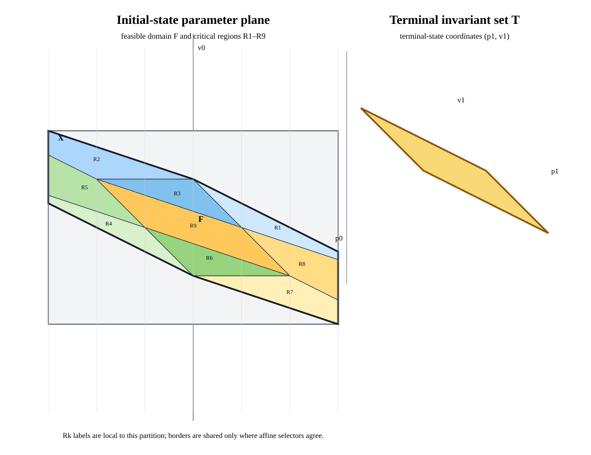

# MPC-08 exact explicit pilot

This is a bounded pilot for [issue #604](https://github.com/butahlecoq/controlled-systems-lab/issues/604), not a complete comparison-program result. It gives an exact parametric reference for one double-integrator step, separately identifies the invariant terminal set, and records fixed-initial CSL candidate checks and a condensed online-QP baseline.

Saved HTML report and offline bundle: [MPC-08 explicit pilot](../../../reports/algorithm-results/mpc08-explicit-pilot-v1/index.html). Its public Pages route is pending merge and deployment.

The products stay separate: `F` ranges over initial states; `T` is invariant under its named terminal feedback; `u*` and `V1` are explicit functions of one initial state; each CSL run returns a candidate relation for one fixed initial state. A reachable terminal set and a complete joint optimal relation are not inferred from these outputs.



## Fixture

The state is `(p,v)`, the input is `u`, and the one-step dynamics are

```text
p1 = p + v
v1 = v + u
u in [-1, 1]
X = [-3, 3] x [-2, 2]
T = { (p1,v1) : |p1+2v1| <= 1, |p1+v1| <= 1 }
J = p1^2 + v1^2
```

`T` is an invariant terminal set under `u = -p1 - 2v1`: the feedback respects the input bound on all four vertices, and the closed-loop matrix squares to zero. This does not claim that `T` is a maximal controlled invariant set.

For an initial state `(p,v)`, terminal and input constraints give

```text
L = max(-1, -1-p-2v, (-1-p-3v)/2)
U = min( 1,  1-p-2v, ( 1-p-3v)/2)
F = { (p,v) in X : L <= U }
u*(p,v) = clamp(-v, L, U)
```

Exact `Fraction` clipping produces `F` and nine closed critical regions. The generated JSON retains their rational vertices, affine controls, terminal maps, value polynomials, areas, and solver-validation points. It verifies exact area coverage, zero positive-area overlap, and agreement of active control formulas on shared boundaries. The feasible polygon area and the sum of region areas are both `21/2`.

The figure uses the initial coordinates `(p0,v0)` on the left and terminal coordinates `(p1,v1)` on the right. `X` is the initial parameter box, the black outline is `F`, the colored polygons are regions `R1`–`R9`, and the gold polygon is the distinct terminal set `T`.

## Fixed-initial observations

The C++ runner checks 45 exact points: a centroid, every vertex, and every edge midpoint from each region. It runs five measured repetitions per method and point, alternates the order, and retains one warmup per method and point. All 45 exact points were contained by both Strategy A and Strategy B candidate relations. That is a sampled membership check; neither candidate is treated as a complete parametric family.

The third path condenses the fixed-initial problem to a scalar convex QP over `[L,U]` and solves it with the same HiGHS convex adapter. Its first action matched the exact rational action at all 45 points and all 225 measured attempts.

| Path | Measured calls | Median elapsed | Range | Outcome |
|---|---:|---:|---:|---|
| Strategy A reach-back candidate | 225 | 2.043 ms | 1.922–2.416 ms | Candidate included the analytic history in every run |
| Strategy B direct-joint candidate | 225 | 0.472 ms | 0.381–0.550 ms | Candidate included the analytic history in every run; 5 measured QP terminations were numerical failures at `Q017` |
| Condensed online scalar QP | 225 | 0.321 ms | 0.302–0.359 ms | Optimal status, exact-reference first action, and analytically recomputed value in every run |

The Strategy B failure is retained in `generated/csl-candidate-observations.jsonl`: at `(p,v)=(-1,0)`, HiGHS returns a numerical-failure termination for the joint QP even though the feasible candidate relation contains the exact history. The corresponding Strategy A and condensed-QP runs complete. No control regularizer was added to mask the failure.

These timings are descriptive, not a speedup claim. Strategy A/B return candidate relations and the timing includes problem resolution, strategy preparation, execution, and candidate-membership checking. The condensed QP returns only one input and includes problem resolution, scalar-program construction, backend preparation, execution, and action/value checking. These products do different work. The solver's objective bounds were unavailable, so the reported online value is recomputed independently from its primal input and the analytic dynamics. The exact-rational script measured region construction and verification at 79.3 ms in one run; point location over 191 grid points had a 108.8 ms median across seven rounds (106.1–112.2 ms, or 0.570 ms per query). This Python `Fraction` implementation is not compared with the binary64 C++ timings. A source profiler was unavailable, so the limiting code path is unverified. Load was not isolated or captured for the measured run; no fastest-method verdict is drawn. The C++ run used Release mode, one HiGHS worker, and an eight-core machine.

## Nonunique two-step continuation

The companion exact reference `explicit_nonunique_double_integrator.py` uses
`p_next=p+v`, `v_next=v+u`, controls in `[-1,1]`, and minimizes terminal
velocity squared after two steps. For every initial state in
`[-3,3] × [-2,2]`, the exact minimum is zero and the complete optimal family is

```text
u0 ∈ [-1,1] ∩ [-v0-1, -v0+1]
u1 = -v0-u0
```

The reference separately chooses the minimum-norm selector
`u0=u1=-v0/2`. Its figure shows the full initial-state rectangle and selector
color map, then the complete two-control fiber for `(p0,v0)=(0,0)` with the
selector marked. The JSON keeps the symbolic full-domain formula separate from
the 15 sampled initial states and 45 endpoint/midpoint control histories.

The C++ runner accepts this ten-column query format as well as the original
seven-column unique-case format. In the new 225 measured calls per path,
Strategy A returned a candidate containing every sampled optimal history but
stopped on the rank-deficient quadratic (`operation_rejected`: HiGHS reported a
coefficient at or below its native-removal threshold). Strategy B also
contained every sampled history; 210 calls completed and 15 were noncompleted,
all with undetermined mathematical outcome. The online two-control QP had an
optimal status, respected both control bounds, and attained exact-reference
value zero in all 225 measured calls. Its solver-selected controls are checked
for optimality and feasibility, not equality to the minimum-norm tie-break.
These are candidate-membership samples and solver observations: they do not
prove equality of Strategy A/B families with the complete analytic relation.
The captured times are descriptive and do not support a winner claim.

To regenerate and run the nonunique fixture:

```sh
python3 benchmarks/reporting/mpc08_explicit/explicit_nonunique_double_integrator.py
build/mpc08-nonunique/csl_mpc08_explicit_compare \
  benchmarks/reporting/mpc08_explicit/generated/explicit-nonunique-queries.csv \
  > benchmarks/reporting/mpc08_explicit/generated/csl-nonunique-observations.jsonl
```

The saved region JSON is 14,782 bytes with 34 total polygon edges across nine regions; the SVG is 4,274 bytes. Raw query and candidate-observation data remain alongside them. This is an optional non-installed report target and adds no public API, runtime dependency, or package-release impact.

## Reproduce

From the repository root, generate the exact reference and figure:

```sh
python3 benchmarks/reporting/mpc08_explicit/explicit_double_integrator.py
```

Build the optional C++ runner with the repository's pinned HiGHS and Qhull dependencies:

```sh
cmake -S . -B build/mpc08 -G Ninja \
  -DCMAKE_BUILD_TYPE=Release -DBUILD_TESTING=OFF \
  -DCSL_ENABLE_HIGHS=ON -DCSL_ENABLE_QHULL=ON \
  -DCSL_BUILD_MPC08_REPORT=ON
cmake --build build/mpc08 --target csl_mpc08_explicit_compare --parallel 4
build/mpc08/csl_mpc08_explicit_compare \
  benchmarks/reporting/mpc08_explicit/generated/explicit-double-integrator-queries.csv \
  > benchmarks/reporting/mpc08_explicit/generated/csl-candidate-observations.jsonl
```

The preserved build used GCC 16.2.1, CMake 3.31.6, Ninja 1.12.1, HiGHS 1.11.0, and Qhull 8.0.2. Strategy and online-QP records carry individual nanosecond durations, solver status, candidate containment, row counts, failure details, and repetition order.

## Scope still open

This pilot does not provide a MPT3/PPOPT replay, a general multiparametric-QP implementation, a complete-family CSL proof, a nonunique optimum for the new two-state fixture, a feasible-set equality checker for general cases, region-count/resource growth, or minimax/feedback/disturbance comparisons. The new fixture has a strictly convex scalar control objective and unique first action; its tied active formulas agree on shared boundaries. The existing T-S01 complete relation remains the separate nonunique-history reference, but was not rerun by this pilot. Approximate representation comparisons and shared set-inclusion infrastructure remain dependencies of other issues. Keep #604 open until its remaining acceptance and dependency work is complete.
