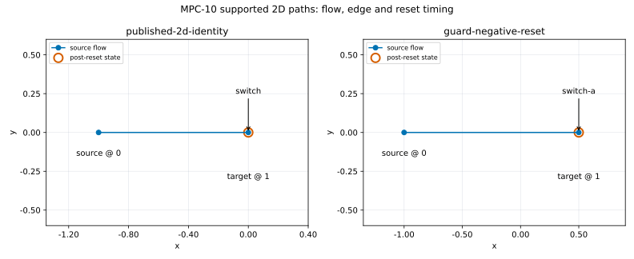
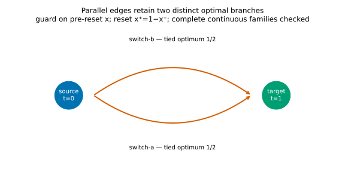

# MPC-10 bounded finite, mixed and hybrid comparison

The clean capture `525871ea` contains 26 authored fixtures: finite and mixed
horizon ladders 0–3, the supported 2D identity-switch example, guarded/reset
paths, parallel ties, failure/budget/cancellation cases and two unsupported
external-encoding declarations. The physical dimension is two with an exact
`y=0` invariant and one active scalar coordinate. These are synthetic nominal
profiles, without a general hybrid/robust/scalability claim.

All 52 native/reference worker processes completed, preserving logical
refusals/unsupported outcomes. The saved checker validates 119 actual CSL
fixed-branch LPs, 24 unrestricted SCIP models and 131 additional fixed-history
SCIP models. One extra SCIP model records actual node-limit termination with
no incumbent. The reference uses native indicators and no guessed big-M.
Native branch LP rows/objectives are independently reconstructed exactly;
feasibility/minima/all ties follow from exact interval propagation and inverse
witness construction. SCIP submitted models and raw solution associations are
checked separately. Actual native family verification is retained literally.

| Product / T | CSL evaluated branches | Exact optimum | Tied histories | SCIP variables / constraints | Numerical SCIP gap |
| --- | ---: | ---: | ---: | ---: | ---: |
| finite / 1 | 3 | 0 | 2 | 6 / 3 | 0.0 |
| finite / 2 | 9 | 0 | 4 | 11 / 5 | 0.0 |
| finite / 3 | 27 | 0 | 6 | 16 / 7 | 0.0 |
| mixed / 1 | 3 | 0 | 3 | 6 / 3 | 0.0 |
| mixed / 2 | 9 | 0 | 9 | 11 / 5 | 0.0 |
| mixed / 3 | 27 | 0 | 27 | 16 / 7 | 0.0 |
| hybrid / 1 | 3 | -1 | 1 | 58 / 97 | 0.0 |
| hybrid / 2 | 7 | -1 | 1 | 104 / 175 | 0.0 |
| hybrid / 3 | 17 | -1 | 9 | 150 / 253 | 0.0 |

The SCIP rows/variables include indicator auxiliaries; `y=0` is eliminated
exactly. Additional fixed-history solves establish branch correspondence and
are separate from the unrestricted model. A numerical incumbent/gap is not a
complete continuous optimal family.

Initial observed cost examples follow, in seconds, one capture per case. These
scopes differ: HiGHS load/run totals cover every enumerated branch; the SCIP
columns cover one unrestricted model. They do not support a timing ratio or
winner. All setup/enumeration/provider/family/replay/process scopes and raw
counts are retained in metrics.json.

| Product / T | CSL formulation | HiGHS load sum | HiGHS run sum | SCIP model setup | SCIP optimization |
| --- | ---: | ---: | ---: | ---: | ---: |
| finite / 3 | 0.0009143 | 0.000308903 | 0.00658071 | 0.00339048 | 0.00428459 |
| mixed / 3 | 0.00109072 | 0.00032449 | 0.0072438 | 0.00345738 | 0.00397729 |
| hybrid / 3 | 0.0045407 | 0.000352212 | 0.00811221 | 0.00509022 | 0.0727942 |

CSL hybrid formulation includes internal path enumeration; its independent
path-enumeration probe is separately labelled. Finite/mixed history enumeration
is separately timed. Portfolio wrapper time includes provider preparation,
workspace/run and record handling; inner HiGHS load/run is extracted from the
actual native diagnostics and checked against its enclosing span. Whole worker
clocks include startup and serialization. Fixed-history SCIP reference costs
and offline saved-data checks are separate. There are no repeated timing or
limiter measurements, so comparative performance remains inconclusive.

The forbidden-transition case has an independently empty graph inventory and
retains CSL's actual `hybrid.portfolio.paths` no-path refusal (`invalid_claim`).
Source/pre invariant, guard and destination failures remain infeasible branches;
a diagnostic infeasible iterate is not promoted to a feasible witness. The
finite catalogue is empty at T=1; T=0 still has one empty history. The history
prefix remains incomplete, hybrid path budget/cancellation remain transactional
refusals, and unknown interruption bounds/gaps remain unavailable.

Complete native hybrid families are established on the one-step and flat
profiles. T=2/3 native exact-inclusion proofs remain unsupported. The independent
checker separately verifies candidate H faces as the complete original relation
plus the exact global-value equality. This does not rewrite the native API's
proof status or turn SCIP points into continuous families.

The original T=3 raw global coverage `refuted` (2), with unsupported branch
proofs, is retained under original-core-before-fix in the ZIP. The qualified
capture contains the corrected `unsupported` (3) outcome from #910 / PR #912.
A later precise branch-refutation priority refinement is separately recorded;
its new predicate is false on all ten saved family reports. Measured clocks
remain observations of the original capture source and are never rewritten.

`paths.svg/png` and `branches.svg/png` are saved-data figures using pinned
Matplotlib 3.11.2 and the shared quantitative style. The identity tuple is
(-1,0,1,0,0,0,0). On the selected negative-reset optimum the pre/post states
coincide at its fixed point 1/2; the reset formula and distinct edge identities
remain labelled. Rendering twice produced byte-identical files.

Verify SHA256SUMS, extract capture.zip into a new directory and verify its inner
SHA256SUMS. In the qualified existing PySCIPOpt environment, from this checkout:

```sh
<SCIP_PYTHON> -m benchmarks.reporting.mpc10.check \
  --bundle <EXTRACT>/capture --output <NEW_VERIFICATION_JSON>
<PLOT_PYTHON> -m benchmarks.reporting.mpc10.figures \
  --bundle <EXTRACT>/capture --verification <VERIFICATION_JSON> \
  --output <NEW_FIGURES_DIRECTORY>
```

Capture source snapshots are checked against both recorded digests and Git
objects. Current reading/plotting scripts are separately fingerprinted. The
renderer checks source/receipt bindings before use and never renews the raw
capture inventory. Source/receipt mutations, wrong LP rows despite a feasible
anchor, omitted parallel ties, wrong face cuts, impossible clock spans and
empty failed worker output have regression coverage. Seventeen focused tests
pass in the actual optional environments.

The ZIP preserves every engineering smoke/refusal/failure log, the unchanged
qualified capture, source/reading layers, model/native streams, core regression
records and environment/build qualification. Earlier engineering attempts have
only their recorded provenance and are excluded from the qualified numbers.
Linux/GCC Release, existing HiGHS/PySCIPOpt/SCIP and POSIX caps are qualified;
Windows/macOS capture is not. No dependency installation, solver binary
redistribution, required API/package change or standalone library release is
introduced. Source/report delivery is appropriate. Keep #606 open pending
independent review, current CI, managed publication/live verification and the
completion audit. Shared Pages files remain root-owned.




