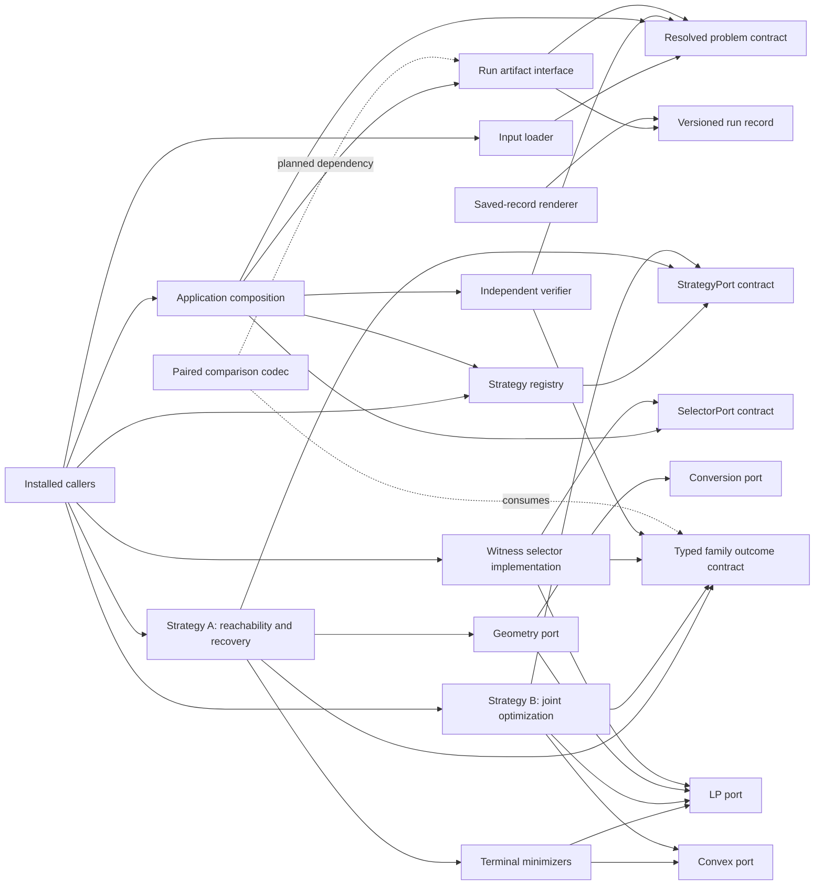

# Current framework composition

Start with the [development entry point](../build/development.md), the
[installed-package examples](../../README.md#quick-start) and canonical
[glossary](../research/glossary.md). This page describes current implementation;
the [optimal-family architecture](modular-algorithms-and-solution-sets.md) retains
the wider mathematical requirements.

## Modules and public seams

The arrows below point from a module to a dependency. Solid edges are current
dependencies; dashed edges mark a planned composition seam. Strategy behavior
is still profile-bounded as described below.

| Responsibility | Public targets / interface | Owning implementation | Depends on / replaceable seam |
| --- | --- | --- | --- |
| Immutable numeric, model and set data | `CSL::numeric`, `CSL::model`, `CSL::sets` | `src/numeric`, `src/model`, `src/sets` | Value contracts compose upward; alternative storage is not currently an exposed adapter seam. |
| Domains, objectives and resolved identity | `CSL::problem`, `CSL::objectives`, `CSL::resolved_core`, `CSL::resolved_problem` | `src/problem`, `src/optimization` | Uses model/set values; `ResolvedProblem` is the immutable handoff to input and application callers. The additive EXT-03 one-step slew transform is linked through `CSL::resolved_problem`; it does not imply Strategy A admission. |
| JSON scenario intake | `CSL::input`, `load_scenario_file` | `src/input` | Produces the same problem value consumed by examples and application code; schema-versioned loader is the input-format seam. |
| Capability selection, compiled verifiers and retained providers | `CSL::registry`, `CSL::verifiers`, `StrategyRegistry`, provider ports | `src/registry` | Strategies declare port requirements; registered implementations are selected by identity/version and retained through prepared handles. |
| LP / convex programs and native adapters | `CSL::optimization`, `CSL::convex`, `CSL::highs_lp`, `CSL::highs_convex`, `CSL::phase_one` | `src/optimization`, `src/adapters` | `LPPort` and `ConvexPort`; backend changes are registry selections and keep caller-owned problem requests unchanged. |
| Geometry, generators, approximation and conversion | `CSL::hull`, `CSL::quickhull_2d`, `CSL::polyhedral`, `CSL::affine_sum`, `CSL::geometry_generators`, `CSL::generator_adapter`, `CSL::approximation`, `CSL::qhull_conversion`, `CSL::geometry::lazy` | `src/geometry`, `src/adapters/polyhedral` | `GeometryPort` and `ConversionPort`; selected operations consume the registered LP provider where needed. QuickHull is a standalone 2D utility; generator, lazy-geometry and approximation adapters are separate from the nominal exact H-polytope path. |
| Forward reachability and terminal minimizers | `CSL::nominal_forward`, `CSL::terminal_minimizers` | `src/reachability`, `src/synthesis` | Consume immutable problem data, registered geometry and both LP/convex optimization ports; profile capability admission is explicit. |
| Backward recovery and direct joint solve | `CSL::control_recovery`, `CSL::strategy_a`, `CSL::strategy_b` | `src/synthesis/strategy_a`, `strategy_b` | Two replaceable `StrategyPort` registrations share the application request; A composes reachability/recovery, B builds the joint program. |
| Analytic exact-profile strategy | `CSL::strategy_ts01` | `src/synthesis/strategy_ts01` | Separate narrow `StrategyPort` registration for the reviewed T-S01 relation; not a general fallback. |
| Directional witness selection | `CSL::witness_selector`, registered `SelectorPort` | `src/synthesis/witness_selector.cpp` | `SelectorPort` plus selected membership `LPPort`; accepts only admitted complete families and returns source-bound witnesses. |
| Original-problem trajectory checks | `CSL::verification`, `verify_trajectory` | `src/verification` | Consumes original immutable problem and witness values, independent of the strategy's solver result. |
| Execution and portable records | `CSL::execution`, `CSL::artifacts` | `src/execution`, `src/artifacts` | Task/executor policy is the resource and cancellation seam; versioned artifact codecs own persisted record contracts. |
| Scenario sweeps | `CSL::experiments`, `run_sweep` | `src/experiments` | Dispatches one complete prepared strategy per scenario/configuration through one executor. Results retain IDs, selection settings, failures and executor resource observations in input order. |
| Guarded paired application flow | `CSL::application`, `prepare_comparison`, `run_comparison` | `src/application` | Composes strategy, selector and verification interfaces; both strategy preparations must be admitted before execution. |
| Numerical report tooling | saved-record validation and rendering | `benchmarks/reporting`, `scripts/reports` | Reads saved records and renders without solver calls; no strategy-specific serialization logic belongs in the renderer. |

### Implemented modules outside the first nominal synthesis path

These installed modules are real capabilities, but the exact T-S01 paired
workflow above does not compose them. Their presence does not imply support by
Strategy A, Strategy B, or a general controller.

| Public targets / interface | Responsibility and dependencies | Replaceable seam and scope |
| --- | --- | --- |
| `CSL::contracts`, `CSL::verifiers` | Validate shared value/result contracts and compiled profile evidence; consume core values, resolved problem data and set handles. | Contract validators and verifier registrations; compiled family verifiers remain profile-specific. |
| `CSL::fixed_plan_disturbance` | Propagate one fixed control plan over bounded initial/disturbance sets and stage-safe sets; depends on `CSL::model` and `CSL::sets`. | Function-level operation today; finite-point/V-description limits and numerical evidence are explicit. |
| `CSL::finite_feedback`, `CSL::finite_feedback_port` | Solve a finite transition game for robustly winning states and admissible causal actions; the port wrapper adds registry admission. | `FiniteFeedbackPort`; finite states/actions/disturbances only, with no cost-optimality claim. |
| `CSL::worst_case_vertex`, `CSL::finite_action_minimax`, `CSL::finite_action_minimax_port` | Enumerate finite fixed plans, propagate disturbance scenarios, and score complete generated terminal vertices; depend on objective, set and fixed-plan modules. | `FiniteActionMinimaxPort`; exhaustive, caller-limited and numerical only. |
| `CSL::validated_finite_action_minimax`, `CSL::validated_finite_action_minimax_port` | Outward-enclose finite-affine state histories and return validated catalogue bounds or explicit infeasible/unresolved outcomes; depend on model, set, objective, and registry modules. | `ValidatedFiniteActionMinimaxPort`; bounded native V/singleton scenarios, affine discrete models, H/singleton/universal/empty safety, and linear/residual-norm objectives; no trajectory-family claim. |
| `CSL::controllers` | Replay a sampled affine trajectory from caller-provided estimator and observation-history controller callbacks; depends on `CSL::model`. | Callback seam (`Estimator`, `Controller`); sampled replay does not prove robust feasibility, optimality or all-disturbance safety. |
| `CSL::model::ContinuousAffineModel`, `discretize` | Integrate continuous affine dynamics into a sampled discrete model under the selected hold convention; depends on numeric and model contracts. | The discretization receipt records interval, method and error scope; the published two-state example is a bounded analytic fixture. |
| `CSL::model::HybridSystem`, `build_hybrid_path_program` | Build and analyze fixed hybrid-mode paths as coupled state/control relations; depends on model, polyhedral and optimization contracts. | Published visual examples are fixture-specific and distinguish scalar state geometry from two-control projections. |

The diagram and table describe current code, not a target microservice layout.
Solid strategy and verifier paths are exercised by the registered synthesis
comparison example on the exact T-S01 fixture. The artifact path records each
strategy attempt separately as `csl.run-statistics/5` data. The current system
does not yet publish one paired comparison record. Recorded complete-family
claims remain unverified data and do not restore proof authority when decoded.

Headers live under `include/csl`. Authoritative contracts cover
[resolved problems](../contracts/resolved-problems.md), [registry](../contracts/registry.md),
[trajectory verification](../contracts/trajectory-verification.md),
[certificate verification](../contracts/certificates.md),
[run records](../contracts/run-statistics.md) and [reports](../contracts/algorithm-report-records.md).
Native types stay behind adapters; mutable workspaces are exclusive per solve.

## Supported synthesis profiles

Strategy A composes forward reachability, terminal minimization and backward
joint-history recovery. Strategy B builds and optimizes a direct joint program.
Their general `nominal_open_loop` paths produce numerical candidate relations;
they do not establish general complete-family coverage. See the
[Strategy A implementation scope](../../src/synthesis/strategy_a/README.md).

Scenario v2 can author nominal linear full-history interval rows. Strategy B's
direct joint compiler consumes those rows for its admitted nominal profile. The
EXT-03 memory transform rewrites a narrow one-step slew problem into an ordinary
Problem with increment controls and previous-control memory; the transform's
history maps check their defining recurrence when recovering a history. The
EXT-03's measurement harness measures the memory lift and history recovery for
one two-step scalar fixture. It does not invoke a solver or establish Strategy
A admission for temporal constraints.
Robust or feedback strategies, legacy paths, and ordinary zonotopes remain
outside this contract. Exact history correspondence follows the documented
proof assumptions; in particular, an unbounded supplied state domain is not
treated as a compact domain merely because the reachable tube is bounded.

Both strategies admit the strictly checked `ts01_exact_integrator`,
`ts02_constant_integrator`, and `ts03_singular_integrator` profiles. Each
profile has a compiled complete-family verifier in both Strategy A and Strategy B:

| Profile | Original problem and complete joint relation |
| --- | --- |
| T-S01 | Two-step scalar unit integrator, `x0=0`, independent `u0,u1` in `[0,1]`, unrestricted states, no external/history constraints, terminal cost `(x2-1)^2`. Optimum zero; all histories are `(x0,x1,x2,u0,u1)=(0,s,1,s,1-s)`, `s` in `[0,1]`. |
| T-S02 | Same integrator and domains, constant terminal objective `3` in the admitted linear, zero-quadratic or zero-map residual-norm form. Every feasible joint history is optimal. |
| T-S03 | Two-step scalar singular integrator with both state matrices zero, control matrices one, zero offsets, `x0=0`, independent `u0,u1` in `[0,1]`, unrestricted states, no external/history constraints, and terminal cost `(x2-1)^2`. Optimum zero; all optimal histories are `(x0,x1,x2,u0,u1)=(0,s,1,s,1)`, `s` in `[0,1]`. |

Strategy A also registers `strategy-a.nominal-linear-exact-v1` for finite
discrete nominal open-loop horizons with known point initial state, continuous
controls, native H/singleton/empty/universal factors, no external input or
nonempty temporal map, and a linear terminal objective. Its compiled verifier
reconstructs the joint history H relation, checks nonempty boundedness, exact
dyadic objective minimization and equality with the full optimal face. It
fails closed on empty/unbounded relations, non-dyadic optimum values, exact
arithmetic or operation limits, and unsupported set forms. The forward
reachability construction still uses binary64 geometry and optimization
providers; the verifier checks the represented problem exactly but does not
certify those producers or claim validated arithmetic. The profile is
Strategy A-only and does not add generic Strategy A/B coverage.

See the [Strategy B T-S03 profile](../../tests/synthesis/strategy_b/README.md#registered-t-s03-singular-integrator-profile)
and its [published report](published-algorithm-results.md#syn-04-registered-strategy-b-t-s03-report).

Exact coverage applies only to these reviewed predicates and canonical relations.
For T-S03, the zero state matrices make the state transitions `x1=u0` and
`x2=u1`. The terminal objective forces `u1=1`; `u0` remains free in `[0,1]`.
Each verified family is the full joint-history relation, not a set of marginal
state or control projections. Coverage binds the original problem, effective
request, strategy version, and executed lineage. It does not extend to changed
horizons, dynamics, constraints, or objectives. Outer registry assurance remains
numerical, and generic validated numerics are unavailable. The separate
`csl.synthesis.ts01-analytic` registration provides the narrow T-S01 analytic
path; it is not a replacement for either composed strategy.

The implemented `csl.selector.ts01-directions` selector minimizes supplied
`(u0,u1)` directions over its admitted T-S01 source family using a selected LP
provider. It returns consistent witnesses with source bindings. A recorded seed
is provenance, not a stochastic or uniform-sampling promise. Witnesses are not a
substitute for the whole family.

Independent trajectory verification recomputes original initial, dynamics,
domain, temporal and objective checks, with explicit binding expectations for
family claims. Witness feasibility, optimality, whole-family coverage and
validated assurance remain distinct. Compiled profile-specific family authority
does not make every numerical trajectory report a completeness proof.

## Runnable entry points and remaining work

The current [installed examples](../../README.md#quick-start) execute component
workflows, including real LP backend substitution; the two LP providers are not
two synthesis strategies. The scenario examples evaluate supplied controls.
`CSL::application` provides a reusable guarded paired-strategy flow: both
strategies are prepared against one immutable problem/request before either
workspace is created. Preparation is sequential through the registry contract,
so the first strategy planner may run before the second capability check; no
solver workspace or strategy execution starts unless both preparations succeed.
Complete families alone reach the selector, and selected witnesses are checked
against the original problem. Candidate and partial outputs remain typed
without selection if a strategy returns them; the current caller-visible
integration fixtures cover successful complete-family T-S01/T-S02/T-S03 flows.
Its result exposes the artifact layer's final
projections and the original-problem verification reports as typed in-memory
values. The `encode_strategy_run` function routes an individual final
projection through the existing publisher and encoder. When both strategies
return complete-family results with completed optimal outcomes and all selected
witnesses pass numerical checks, the native `scenario_cli --run --output-dir`
command saves each attempt as a separate `csl.run-statistics/5` recorded
artifact. A strategy or witness-check failure returns before artifact
publication. The artifacts do not serialize one paired comparison or its
trajectory reports.
The delivered
[registered synthesis comparison](../../examples/registered_synthesis_comparison.cpp)
runs both strategies on the same immutable T-S01 problem, selects witness
histories and independently checks them against original problem data. Its JSON
summary identifies the shared problem/request, each strategy and outcome,
selected witnesses and verification status/residuals. It does not serialize the
live optimal-family relation or proof payload. This is a functional guarded
fixture example, not general profile support or paired performance evidence.
The [scenario CLI guide](../how-to/run-scenario.md) describes validation,
execution, optional settings and artifact output.
The [saved paired T-S01 report](../../reports/algorithm-results/syn-ts01-paired-20261014-b7f1ac0/index.html)
delivers measured records and standalone HTML for this fixture, with an
inconclusive performance conclusion and no general strategy ranking.

### Resource scope of the initial paired application

`run_comparison` in [`src/application/comparison.cpp`](../../src/application/comparison.cpp)
creates the two prepared workspaces and executes them one at a time in its fixed
strategy order. Selection and witness verification for each strategy also finish
before the next strategy starts. This describes concurrency inside one call
only; independent callers can still overlap. The paired application does not
route these calls through `Executor`, and it provides no process-wide scheduler
or aggregate CPU or memory cap. One caller-supplied `ExecutionContext` is shared
by both sequential strategy calls, so its deadline and stop token apply across
the invocation; these remain cooperative, and a native call can return after a
stop request.

`CSL::experiments::run_sweep` dispatches each complete prepared strategy through
one executor. It keeps each scenario's horizon together and returns case
identities and deterministic selection settings beside task outcomes in input
order. It does not persist a sweep artifact or execute the later family-query
stage. Executor thread reservations remain declarations. Memory reservations
support admission accounting, not a hard process-memory limit. These reports do
not constrain native thread pools, the process heap, or RSS, so they do not
support a process-wide scalability claim.

The installed `scenario_cli --run` command adapts user-authored JSON to the
paired application API for the guarded T-S01/T-S02 profiles. T-S03 is currently
available through the paired application API, not the CLI input path. The CLI accepts optional
LP/convex IDs, a seed, thread allocation and profile overrides, and reports
per-strategy outcomes plus independent witness checks. With `--output-dir`, it
saves one versioned recorded artifact per strategy through the artifact API
after both strategies return complete-family results with completed optimal
outcomes and every selected witness passes its numerical checks. A strategy or
witness-check failure returns before publication. The `csl.run-statistics/5` artifacts retain
complete-family claims as unverified data. They are not a paired comparison
record, and decoding them does not mint trusted complete-family authority. See
the [scenario CLI guide](../how-to/run-scenario.md) for commands and output
details. General family proofs, broader selector profiles and replay of
recorded claims remain outside this guarded CLI path.
The synthesis-to-report adapter remains missing glue. Saved LP/convex reports and the paired T-S01 fixture report do not supply a
general synthesis comparison.

Applications that dispatch registry tasks compose existing strategy preparation,
`make_task` and `Executor::run`, retain immutable resolved owners and actual
provider provenance, and pass original problems and witnesses to independent
verification. The initial paired application has the narrower sequential path
described above. Export must consume saved owning results and verification
records; rendering must not invoke solvers. Future numerical algorithms follow the
[published-results process](published-algorithm-results.md). Historical fuel-model
restoration remains unresolved.
