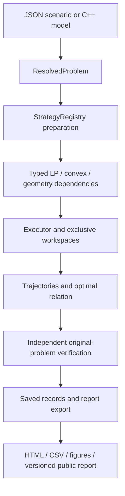

# Current framework composition

The [README quick start](../../README.md#quick-start) runs actual installed C++20
components. It is the first entry point into the framework, not a completed
control-planning application. This page is the current module map; the
[optimal-family architecture](modular-algorithms-and-solution-sets.md) retains the
full mathematical requirements.

## Modules and public seams

| Responsibility | Available public target/interface | Scope |
| --- | --- | --- |
| Owning numerical data | `CSL::numeric`, `numeric/data.hpp` | Immutable dense/CSR snapshots; private native storage stays behind public types. |
| Original dynamics and sets | `CSL::model`, `CSL::sets` | Affine discrete stages, observations and H/V/elementary set data; data support does not imply every set operation. |
| Domains, constraints, original objectives | `CSL::problem`, `CSL::objectives` | Initial/external/control/state/history data; original linear, quadratic and residual-norm evaluation. |
| Mathematical publication | `CSL::resolved_problem`, `problem::resolve` | Deep immutable `ResolvedProblem` and content-bound identity; no feasibility or synthesis inference. |
| File intake | `CSL::input`, `input::load_scenario_file` | [JSON v1](../contracts/scenario-input.md) to the same immutable problem; requested run intent remains distinct from effective selection. |
| Selection and composition | `CSL::registry`, `Registry<LPPort>`, `Registry<ConvexPort>`, `StrategyRegistry` | Pure capability admission, retained preparations, actual ID/version provenance and exclusive workspace factories. |
| Numerical program contracts | `CSL::optimization`, `CSL::convex` | Canonical LP/convex programs, original-coordinate residual evaluation and scoped evidence. |
| Real LP implementations | `CSL::highs_lp`, `CSL::phase_one` | Registered HiGHS optimizer; `phase-one-bland` for zero-objective equality/nonnegative feasibility with basis diagnostics. |
| Real convex implementation | `CSL::highs_convex` | Registered HiGHS convex adapter with declared numerical admission; original norm and squared solver cost remain separate. |
| Task execution | `CSL::execution`, `make_task`, `Executor::run` | Sequential/bounded-parallel retained tasks and actual execution provenance; resource declarations are not hard OS enforcement. |
| Portable run records and collection | `CSL::artifacts`, `artifacts::RunStatistics`, `resolve_configuration`, `encode_run` / `decode_run`, `execution::observability` | Immutable run records, separate configuration identity, closed JSON codec and bounded collection/RUN01 projection; no automatic timer instrumentation or synthesis report exporter. |
| Saved numerical reports | `benchmarks/reporting`, `scripts/reports` | Existing LP/convex drivers, saved-record validation, HTML/CSV/figures and published versioned artifacts. |

Public headers are under `include/csl`. See the authoritative
[resolved-problem](../contracts/resolved-problems.md),
[registry](../contracts/registry.md),
[run-statistics](../contracts/run-statistics.md),
[LP](../contracts/linear-programs.md) and
[report-record](../contracts/algorithm-report-records.md) contracts for details.

## End-to-end destination

The data, backend, registry and execution components exist. Production control
synthesis, full relation construction, independent trajectory/evidence verification
and the synthesis-to-report adapter remain missing glue. Existing program-level
reports do not fill that gap. No test-local strategy is presented as a production
planner in the examples.

The eventual application composes `prepare_strategy(resolved, registry,
configuration, requirements)`, `make_task` and `Executor::run`. It retains the
resolved owner, each returned `SynthesisResult` and actual registry provenance.
Verification consumes the original problem and witnesses, rather than trusting
the synthesis success flag. Export consumes owning saved results and verification
records; rendering never invokes a solver. The existing ports support this
composition without another registry or a new orchestration framework.

## Substitution that runs today

[backend_substitution.cpp](../../examples/backend_substitution.cpp) registers two
real `LPPort` implementations. Its unchanged program is `min 0`, `u0+u1=1`,
`u0,u1>=0`. Only the selected ID changes between `csl.lp.highs` (adapter version
`1.0.0+highs.1.11.0`) and `phase-one-bland` (version `1`). Both use the same
selection, preparation, creation, execution and original-row checks. The output
prints the actual resolved identity/version and accepts any feasible witness;
the backend is not required to return a particular endpoint or basis.

An unknown ID fails before workspace creation with the actual typed registry
rejection, printed as `DiagnosticCode` plus field and explanation (`1` denotes
`unsupported`). Both implementations retain unestablished outcome evidence in
this example. Phase I does not become a general nonzero-objective optimizer, and
this backend substitution is distinct from the agreed two synthesis strategies.
Optional basis capability is not requested because HiGHS does not supply it.

Each preparation owns its program and creates an exclusive workspace. A future
backend implements the existing registration/port contract and declares its
support, without rewriting scenario data or a compatible strategy. A future
strategy makes its own mathematical assumptions explicit and composes typed
dependencies. Unsupported transformations and domains cannot silently disappear.

## Teaching scenario and the next full workflow

The [file template](../../examples/scenarios/two-stage-integrator.json) describes
`x0=0`, `x(k+1)=x(k)+u(k)`, two stages, `0<=u0,u1<=1`, with original cost
`(x2-1)^2`. The C++ scenario example constructs the same mathematical problem.
Both evaluate the specified history `(u0,u1)=(0.25,0.75)`, giving states
`(0,0.25,1)` and cost zero. They do not select these controls or independently
verify all constraint memberships. File source bytes/digest, mathematical identity
and requested run settings have separate roles.

For this scenario, direct arithmetic gives the complete optimal relation
`x0=0, x1=u0, x2=1, u1=1-u0, 0<=u0<=1`. This segment is an independent teaching
oracle; it is not an implemented general family algorithm. Its control marginals
are each `[0,1]`, whose Cartesian product would wrongly admit `(0,0)` and `(1,1)`.

The next complete milestone must implement both approaches on the same immutable
problem and request:

1. Reachability, terminal minimization and backward recovery, retaining the joint
   relation rather than discarding history dependence.
2. Direct joint-trajectory optimization, translating admitted original affine
   stages/constraints/objectives into selected backend programs and retaining
   the relationship between program and problem evidence.

Both need full optimal-family semantics and independent original-problem checks;
an optimizer point, sampled endpoints or two HiGHS calls cannot substitute for
that output. The general implementations must support their declared dimensions,
providers and constraints, rather than hardcode this scalar oracle. SYN06 must
recompute initial/dynamics/control/state/objective checks and keep feasibility,
optimality, completeness and validated assurance separate. Foreign identities,
unsupported evidence and unchecked certificate references cannot become proofs.

Historical fuel-model restoration remains unresolved. Future numerical algorithms
still require the [published-results process](published-algorithm-results.md).
The current example tests make no speedup, validated-certificate or family-completeness
claim and do not close the end-to-end framework milestone.
