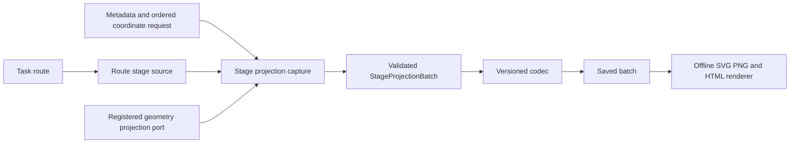

# Stage-resolved reachable-set figures

This note records the current route capabilities and the proposed architecture for issue #708. It describes existing code separately from the future contract. It does not claim that every route currently supplies stage geometry.

## Existing route capabilities

| Route | Existing stage output | Dimension and metadata | Current limit for stage figures |
|---|---|---|---|
| `reachability::nominal_forward` | `ForwardTube::stages` contains the initial marginal and later state marginals. A failure retains its completed prefix and may retain a partial marginal. | The interface is dimension-generic. Scenario labels and units are not attached uniformly to the tube. | The implemented profile is discrete, nominal, open loop, and starts from a known point. It is not a general uncertain or feedback reachability route. |
| `reachability::fixed_plan_disturbance` | `FixedPlanReachable::stages` contains the initial set and generated later-stage vertex descriptions. | `LinearSystem` and `SetData` carry the numerical dimension; this result has no common coordinate-name and unit schema. | This is a finite numerical fixed-plan reference with a point budget. An unsafe successor rejects the plan. It does not represent the union of all plans or an optimal family. |
| `reachability::finite_feedback` | `Game::stages` stores safe-state flags and indexed successor relations. `Policy` stores robustly admissible actions by state and stage. | States are discrete ordinals, not arbitrary coordinate vectors with physical units. | The result is a finite-state policy, not a geometric state set. A geometric plot needs a separate declared state embedding. |
| `reachability::nominal_predecessor` | One predecessor `OperationResult` and its projection lineage. | The request carries ordered state, control, and target set handles. | This is a one-step backward set operation, not a forward stage sequence. |
| Strategy A forward analysis | The route composes nominal forward stages with terminal and recovery operations. | It inherits the nominal route's state profile and metadata limits. | A forward marginal does not certify the complete optimal-history family. Recovery relations and stage marginals have different meanings. |
| Strategy B direct joint analysis | The route retains a coupled state/control relation and source-row lineage. | Coordinates belong to the joint relation and need route-owned mappings. | It does not expose a common `R0..RT` state-set sequence. Do not project unrelated transition columns as stage sets. |
| Terminal minimization | `TerminalSlice` and `TerminalMinimizers` retain a feasible terminal set and terminal minimizer relation. | The resolved problem provides state dimension; the result does not provide a separate coordinate schema. | This is terminal-only geometry. It does not supply prior stages or a trajectory. |
| Hybrid projected reachability | The current adapter builds a coupled relation for one admitted scalar transition and projects its terminal state. | One scalar source and target state, with strict path and relation limits. | It does not currently provide intermediate state marginals for a general hybrid path. |
| `simulation::replay` | `ReplayRecord::states` contains one sampled state per time point for a supplied control history. | The plant declares state/control units and optional time samples. | It is one replayed trajectory. It is not a reachable set and gives no nonlinear optimality guarantee. |

Current report drivers include the `syn01` nominal-forward analytic fixtures, the `ext01` fixed-plan reference, the `issue6` B06/B07/B09 fuel reports, and the `exp04` nonlinear replay example. These routes expose different data. The `syn01` driver receives a `ForwardTube`; `ext01` receives fixed-plan stage vertex descriptions; the issue6 captures preserve terminal fuel sets but not stage histories; `exp04` stores sampled replay states. These examples do not establish support for every task or for every dimension. The child integration issue must refresh the driver list from main before adding adapters.

The report layer has a different responsibility. `PlotData` in `include/csl/artifacts/plot_data.hpp` stores selected trajectories and their evidence. `PlotRequest` in `include/csl/artifacts/plot_request.hpp` handles a single pair and, for set geometry, a single stage. The `csl.plot-document/1` codec records completed plot results. Python validates saved records and renders SVG and PNG. The shared style and offline gallery live under `scripts/reports/`.

The fuel adapters read frozen report records. They do not recover missing stage sets. The visual route inventory covers report producers, not mathematical task routes. Issue #684 owns that report inventory. Issue #686 and PR #700 own saved-data control and witness companions, including the requested fuel flow/flow and stock/stock panels. This note adds no edits to either work package.

## Proposed ownership and data flow

Task routes own the mathematical output and report which stage sets they can supply. A route adapter exposes those actual sets and their identity, relation, assurance, and evidence. It does not invent missing stages or rerun a task. When a user requests figures during a new task run, the driver can capture stage sets from that run. When a saved run lacks stage sets, capture reports that gap.

The generic capture module resolves each requested coordinate reference against a coordinate schema once. It sends an explicit projection request for each available stage and requested pair through the existing `GeometryPort`. It keeps the source set, stage, ordered coordinates, operation identity, provider, relation, assurance, evidence, and query resource record. It does not enumerate full-dimensional vertices as a shortcut.

The batch stores one typed outcome for every pair and every canonical stage from R0 through RT. An outcome can carry a rendered two-dimensional geometry, an empty result, an unsupported or unbounded result, or a typed stopped, failed, or missing-stage status. If one route stage has labelled branches, the record preserves those component identities and does not replace them with a convex hull. Trajectories remain separate series with their own method or policy identity and stage/time axis. A replay can lie outside a linear reachable set and is not clipped or called contained without a separate check.

A versioned domain record is the boundary between capture and rendering. The codec owns validation and schema conversion. The renderer reads only a validated saved record. It calls no task route, solver, geometry provider, or set conversion. The generated figures use the shared quantitative style, preserve coordinate order and units, label R0 and RT, and show negative fuel stock values when present.

## Request and batch contract

A request contains an ordered list of coordinate pairs, an optional trajectory selection, a stage range, and an explicit projection requirement. Each coordinate reference is either an ordinal or a declared coordinate name. Boundary validation rejects unknown, repeated-within-pair, or out-of-range references. The resolver stores the resulting zero-based indices and matching labels and units in the batch. Pair order defines axis order. Duplicate pairs are rejected at the request boundary.

The route adapter supplies a canonical ordered stage grid and the source relation for each stage. A `StageProjectionBatch` binds the source run, problem, route, scenario or model identity, stage identities, and coordinate schema. Each pair contains exactly one outcome for every stage identity. Missing or stopped stages use explicit outcomes; they do not disappear from the record. Relation and assurance remain scoped to the actual source and projection operation. No set marginal implies a complete optimal-history family.

The batch codec uses a new versioned schema unless a reviewed compatibility path can represent the distinct stage-set evidence without changing `csl.plot-document/1` trajectory semantics. Persist concrete two-dimensional geometry needed by the renderer, not a live `SetHandle`. Unsupported output representations remain explicit outcomes rather than scalar bounds, sampled hulls, or zero-valued placeholders.

Projection capture is opt-in. A task without a plot request performs no additional projection. Offline rendering can rerun from a saved batch without repeating task execution or geometry operations. A new scientific calculation or task run requires an explicit capture command and a separately identified artifact.

## Work packages and ownership

1. [#709 route audit and contract reconciliation](https://github.com/butahlecoq/controlled-systems-lab/issues/709). Document route sources, coordinate metadata gaps, evidence limits, and the #91 scope change. Leave `visual-route-inventory.json` to #684 and the #686/#700 report files untouched.
2. [#710 request and capture API](https://github.com/butahlecoq/controlled-systems-lab/issues/710). Add typed ordered pairs, coordinate resolution, route-owned stage sources, and capture through existing geometry ports. Preserve partial and unsupported outcomes. Keep projection cost out of ordinary runs. Blocked by #709.
3. [#711 saved batch schema and codec](https://github.com/butahlecoq/controlled-systems-lab/issues/711). Define the versioned domain record and validated reader/writer. Bind stage geometry to its source relation, request, coordinates, provider, and evidence. Test round trips and reject tampered identities. Blocked by #710.
4. [#712 offline figure renderer](https://github.com/butahlecoq/controlled-systems-lab/issues/712). Render saved batches to SVG, PNG, and offline HTML with the existing quantitative style. Keep trajectory overlays visually and evidentially separate from sets. Blocked by #711.
5. [#713 route adapters, demonstrations, and documentation](https://github.com/butahlecoq/controlled-systems-lab/issues/713). Connect only routes that expose supported stage data. Add a fuel preset and a nonfuel demonstration through the same interface. Record explicit capability limits for other routes. Update the route capability index without editing files owned by active issues. Blocked by #710, #711, and #712.
6. [#714 independent checks and visual review](https://github.com/butahlecoq/controlled-systems-lab/issues/714). Verify analytic projections and reversed coordinate order, stage alignment, route identities, incomplete outcomes, schema integrity, and no geometry calls in rendering. Inspect the actual fuel and nonfuel SVG, PNG, narrow layout, and print output. Blocked by #713.

The live GitHub dependency chain is #709 → #710 → #711 → #712 → #713 → #714 → #708. #713 also names #710, #711, and #712 as direct prerequisites. No package authorizes a benchmark sweep.

## Design history and constraints

Closed issue #91 deliberately limited `PlotRequest` to explicit final-set projection or witness-coordinate selection and excluded all-stage viewers. PR #666 implemented that single-stage contract. Issue #708 changes that scope. The new batch therefore adds stage-sequence data without changing the meaning of `PlotData` or the old plot document.

The design reuses existing geometry projection admission, evidence checks, quantitative figure style, and offline rendering. It preserves operation-specific guarantees, route-specific information patterns, immutable report bundles, and published result identifiers. It does not claim exact arithmetic when evidence is unestablished, infer reachable sets from trajectories, or treat stage marginals as one joint history relation.

## Source map

- Nominal stage results: `include/csl/reachability/nominal_forward.hpp` and `src/reachability/nominal_forward.cpp`.
- Fixed-plan stage sets: `include/csl/reachability/fixed_plan_disturbance.hpp` and `src/reachability/fixed_plan_disturbance.cpp`.
- Generic projection operation: `include/csl/geometry/contracts.hpp` and `include/csl/geometry/polyhedral_projection.hpp`.
- Existing trajectory and final projection data: `include/csl/artifacts/plot_data.hpp` and `include/csl/artifacts/plot_request.hpp`.
- Existing saved-data validator and renderer: `scripts/reports/control_figure_data.py`, `scripts/reports/control_figures.py`, and `scripts/reports/figure_style.py`.
- Route and result evidence boundary: `docs/architecture/published-algorithm-results.md`.
