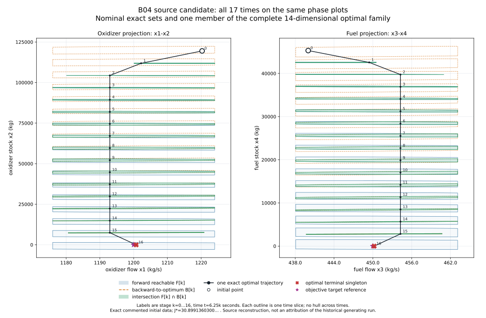

# B04 source-derived exact moment reference

The [2026-11-10 owner decision](owner-reference-decisions-2026-11-10.md) selects the commented precise initialization as the primary working reference and the active rounded initialization as a separate sensitivity case. Historical generating-run identity remains unproved and is no longer an acceptance gate.

The newly accessible dissertation working collection contains a nominal four-state, sixteen-step source model whose exact-decimal reference has minimum **30.8991360300116…**. Its complete optimal state/control family has dimension **14**. The active rounded initialization defines a different problem with minimum **31.1214094505004…**. Both conclusions have exact rational certificates.

These are separately identified source references. They do not designate a canonical historical generator or change the [B04 historical transcription](../../benchmarks/scenarios/b04-historical.json). Source access, mathematical verification, historical attribution and permission to redistribute original software remain different facts. The printed model's earlier invariant contradiction remains valid for its own inputs.

## Source identity and distinct initializations

The owner supplied the original `PhD.zip` collection and a separate dissertation working collection, described as probably newest. All 8,983 extracted archive files passed CRC and read-back SHA-256 checks, and all 45 selected-source identities matched the existing register. That archive identity does not identify changed files in the separate working collection or establish chronology.

The new working `ReachableSets.m` is 8,941 bytes, SHA-256 `1f03dac9f0339dd7b518c9e0f0bae51047b766b1d9342e770b78d1563036e405`. It explicitly sets `T=16`, `h=100/T`, `B=(2208/110,0,-1152/110,0)`, the four flow inequalities and `P=[-1,1]`. Its exact decimal initialization is commented; the active line rounds the initial flows. The [complete input record](evidence/b04-source-moment-inputs.json) preserves both cases:

| Reference ID | Initial state `(q_o,m_o,q_f,m_f)` | Global minimum |
| --- | --- | --- |
| `B04-SOURCE-COMMENTED-X0-V1` | `(1220.28265395983,119500,440.005764648976,45300)` | `30.89913603001161343…` |
| `B04-SOURCE-ACTIVE-X0-V1` | `(1220.283,119500,440.007,45300)` | `31.12140945050040042…` |

The two flow coordinates have units kg/s, the two stock coordinates kg, and the step is 6.25 seconds. Every one of the sixteen scalar controls is free in `[-1,1]`. All seventeen states must satisfy `1176<=q_o<=1224` and `432<=q_f<=468`. There are no stock bounds. These domains also agree with the previously recorded owner clarification.

The new `program.m` is 3,815 bytes, SHA-256 `43fa64b7539d2418512700fdbe83385a741f1615eee114b99cbde400d01dac78`. It selects rows 3, 46, 60 and 101 and takes their control histories directly. This is source selection intent, not recovered original optimizer variables or a proved row-to-figure association. Neither original program was executed for this reference.

## Exact global minimum and complete relation

Let `b_o=2208/110`, `b_f=-1152/110`, `h=25/4`, `r=8/3`, and let the initial state be `(q_o0,m_o0,q_f0,m_f0)`. Define two moments of the complete control history:

```text
S = sum(j=0..15, u_j)
M = sum(j=0..15, (15-j)*u_j)
```

The terminal state is exactly

```text
(q_o0+b_o*S,
 m_o0-100*q_o0-h*b_o*M,
 q_f0+b_f*S,
 m_f0-100*q_f0-h*b_f*M).
```

The sourced squared objective is

```text
J² = (1200-q_o16)² + m_o16²
     + (64/9)*(450-q_f16)² + (64/9)*m_f16²
     + (m_o16-(8/3)*m_f16)².
```

Set `p=(b_o,r*b_f)`, `c=(q_o0-1200,r*(q_f0-450))`, `v=(-h*b_o,-r*h*b_f)`, `d=(m_o0-100*q_o0,r*(m_f0-100*q_f0))` and `G=[[2,-1],[-1,2]]`. The source objective becomes

```text
J² = ||c+p*S||² + (d+v*M)^T G (d+v*M).
S* = -(p·c)/(p·p)
M* = -(v^T G d)/(v^T G v)
J² = J*² + (p·p)*(S-S*)² + (v^T G v)*(M-M*)².
```

Both quadratic coefficients are strictly positive. The [certificate](evidence/b04-source-moment-certificate.json) verifies these identities with rational arithmetic and supplies an exactly feasible strict-interior history at `(S*,M*)` for each initialization. Thus the unconstrained stationary minimum is attained under every source constraint and is the constrained global minimum. The square root is monotone; decimal displays are not used to select the minimizer.

For a prefix sum `S_k=sum(j<k,u_j)`, the four flow inequalities are equivalent to `L<=S_k<=H`, where

```text
L = max((1176-q_o0)/b_o, (468-q_f0)/b_f)
H = min((1224-q_o0)/b_o, (432-q_f0)/b_f).
```

The complete optimal control relation is therefore all histories satisfying the sixteen input intervals, these prefix intervals for `k=1..16`, and the two moment equalities `S=S*`, `M=M*`. The certificate contains all 64 reduced H-inequalities, both equality rows and the affine lift to all seventeen four-state vectors. It does not replace the joint relation by Cartesian products of stage marginals.

The two equality rows have rank two: columns 0 and 15 have determinant -15. An explicitly checked strict feasible history lies in the relative interior, so the family dimension is `16-2=14`. Dynamics assign exactly one complete state history to each control history. All optimal histories share one terminal state, although their intermediate trajectories can differ.

Exact squared comparisons put the first minimum in the printed `30.899` nearest-rounding band `[30.8985²,30.8995²)`. They put the rounded-initialization minimum outside that band. This establishes agreement at reported objective precision for the named source reference, not the identity of the original floating solver run.

## All-stage reachability and backward recovery

At stage `k`, use moments `q_k=(S_k,M_k)`, with `M_k=sum(j<k,(k-1-j)*u_j)`. The exact recurrence is

```text
(S_k,M_k) -> (S_k+u_k, M_k+S_k).
```

The [stage-set record](evidence/b04-source-moment-stage-sets.json) contains all seventeen forward sets from `(0,0)`, backward sets to the unique optimal endpoint, and their intersections. Backward sets are restricted to the stage-specific affine state plane; they are not claimed for arbitrary four-state perturbations. Since the complete relevant state is retained and no additional history coupling is introduced, each intersection is the exact stage-state projection of the full optimal family.

Vertex affine-image/Minkowski/strip-clipping recursions are cross-checked against inequality elimination and pair-intersection vertex extraction. The routes share rational hull canonicalization, so this is not a claim of completely independent geometry engines. Point and segment boundary stages are retained. The constructed exact optimal witness belongs to every forward, backward and intersection set.



Every outline above is a separate time slice. The figure does not hull across times or infer a four-dimensional set from a planar silhouette. The black trajectory is one constructed optimal family member, not an asserted original optimizer sequence. Initial point, optimal terminal singleton and objective target reference are separate markers. [PNG download](evidence/b04-source-moment-figures/b04-all-stage-reachability.png).

## Relation to the saved historical witnesses

The source-commented initial decimal values parse to the same binary64 values as the saved A39 starts. Independently inferring scalar controls from both flow channels agrees within about `7e-15`. Reconstructing from the exact source decimals and one inferred channel gives two complete exactly feasible candidates whose states differ from the stored coordinates by less than `1.58e-11`; their exact objectives round to `30.899`. The first stored candidate retains a tiny flow-bound violation and is not silently snapped into feasibility.

The new `1st_v2.fig` and `CHB.fig` each repeat all 36 A39 plotted arrays. They are presentation variants, not independent runs. A separate rounded-input saved figure agrees with the active rounded initialization and gives approximately `31.1214094610`, distinct from the exact minimum of that named problem. The original FIGs, inferred historical controls and source bodies remain private; the public packet contains the newly constructed exact witness and relation instead.

For the newly sourced coefficient ratio, the terminal stock invariant uses `(12,23)` rather than the printed-model `(12,17)`. The exact commented-input constant is `-565554305551/1250000000`. The reported stock center is `-452.455`, within its `0.0175` rounding radius of that constant. This removes the old plane exclusion for this particular source model. It does not repair or rewrite the printed model.

## Reproduction and delivery scope

From a checkout, the following checks use only Python's standard library and the existing repository exact-geometry helpers:

```sh
python docs/research/tools/check_b04_source_moments.py
python scripts/reports/b04_source_moments/geometry.py
python -m unittest tests.reporting.test_b04_source_moments
```

The optional `--private-source <ReachableSets.m>` checker argument verifies the original source hash without executing it. Figure regeneration additionally uses the existing optional Matplotlib environment; the retained export records Matplotlib 3.11.2, data and producer hashes, deterministic SVG/PNG identities and the shared quantitative axis style. No required dependency, C++ API, installation artifact or solver binary is added. No library release is needed for this research reference.

There is no new optimizer run, historical program execution, performance measurement, nonlinear replay or nonlinear robustness claim in this packet. Original optimizer settings and exact historical generating revision remain unknown. Canonical adoption or an assertion of author intent still requires its evidence disposition under [ADR 0004](../architecture/decisions/0004-source-variant-evidence-standard.md). Issue #10 remains open pending its full acceptance audit and delivery; this reference alone does not change the historical record.
