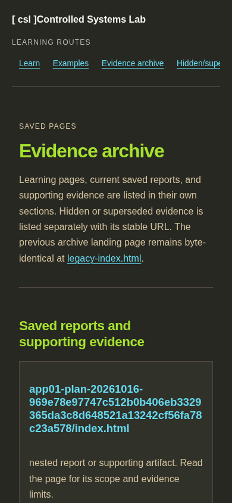
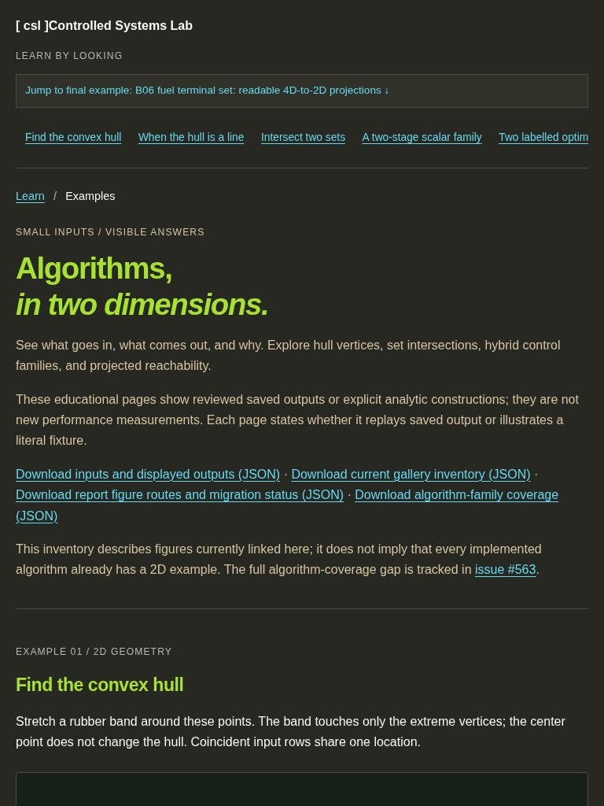
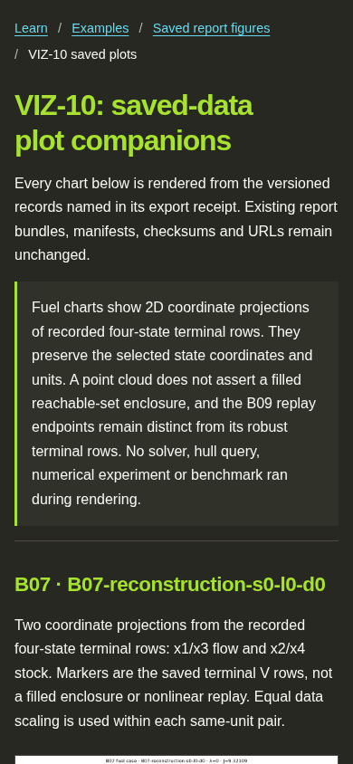

# Shared Pages design browser evidence

These screenshots capture the locally composed Pages preview for issue 939.
The preview started from the last deployed CompletePages tree, regenerated the
gallery from saved inputs with the issue 939 branch, then ran the issue 938
route finalizer and installed the canonical stylesheet from this branch.
Chromium confirmed each capture had no page-wide horizontal overflow.

The screenshots document the local composition. They do not claim that a
deployment has completed.

## Desktop learning home at 1440 × 900

## Evidence archive at 390 × 844

## Examples gallery at 768 × 1024

## VIZ-10 saved plots at 390 × 844

