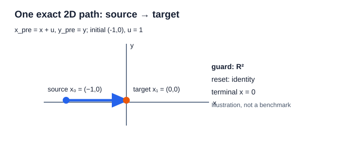

# EXT-07: a two-dimensional hybrid path

This small, exact illustration follows one planned mode switch. It is an example of the composed relation, not a benchmark or a solver performance claim.



## Inputs and answer

The state coordinates are `(x,y)` in both modes. The initial state is `(-1,0)` in `source`, the horizon is one, and the only transition is `source → target`.

```text
source flow:  x_pre = x + u,  y_pre = y
source control set: u = 1
transition guard: all of R²
reset: (x_post,y_post) = (x_pre,y_pre)
target invariant: all of R²
terminal objective: minimize x_post
```

The flow gives `(x_pre,y_pre) = (0,0)`. The guard accepts it, and the reset preserves it, so the exact branch relation contains the joint tuple `(-1,0,1,0,0,0,0)` in the documented order `[x₀,y₀,u₀,x⁻₁,y⁻₁,x₁,y₁]`. The terminal state is exactly `(0,0)` and the objective value is `0`.

The literal input/output record is [ext07-hybrid-2d.json](ext07-hybrid-2d.json). The installed consumer test builds the public hybrid path program and checks every equality against that joint tuple:

```powershell
cmake --build build/ext07-hybrid --config Release
ctest --test-dir build/ext07-hybrid -C Release -R installed_public_client --output-on-failure
```

The public API boundary and its current implementation limits are documented in [the hybrid systems contract](../contracts/hybrid-systems.md). The implementation is still in progress under [issue #156](https://github.com/butahlecoq/controlled-systems-lab/issues/156).
The foundational implementation is in [commit 2614dd20](https://github.com/butahlecoq/controlled-systems-lab/commit/2614dd203081dc9248d6124bf9999edd90073547); the raw input/output record is linked above.
