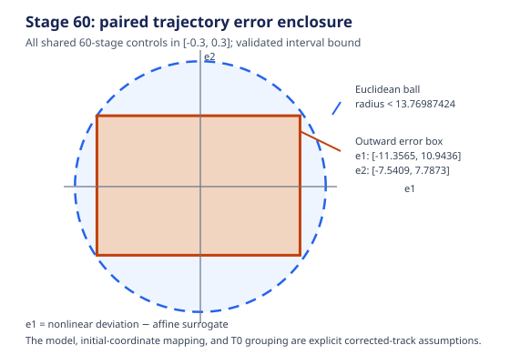

# L05 Example 1: corrected-track nonlinear error enclosure

Date: 2026-10-24. This is an owner-authorized **new corrected-track study** for
[issue #4](https://github.com/butahlecoq/controlled-systems-lab/issues/4). It
does not reproduce or identify the L05 Table 1 run.

## Inputs and explicit assumptions

The locally supplied `papers/papers_for_professor/1063.pdf` (SHA-256
`9327fdc6d4a24258d458d8c80bc5c983ef63b2245eeadce99475e8e66c6942bf`; see its
[publisher article record](https://vestnikmi.bsu.ru/?article=1063&issue=34&rus=)) prints a
discrete Lotka–Volterra recurrence, parameters
`a=.9, b=.003, c=.8, d=.002, e=.85`, 60 stages, a zero-control reference, a
nonlinear start `(410,300)`, and a linear start `(1,2)` (PDF pp. 8–9, printed
pp. 59–60). It does not provide a coordinate transform connecting the two
starts. The paper's typeset `T0` grouping is ambiguous. The ignored local
candidate `papers/Siberia/Volterra.m` records
`T0=(2*pi/sqrt(a*c))/60` (SHA-256
`c26fc2424fa8b3325a864d1afbc67920ba1c05665bfdf4562bed79548b60a4f1`); using
that step here is an explicit assumption, not proof of historical provenance.

To make a shared-coordinate comparison, this corrected track interprets
`(1,2)` as an initial **deviation** from the zero-control reference starting at
`(410,300)`. The compared physical initial point is therefore `(411,302)` for
both systems. Controls range independently over `[-0.3,0.3]` at each stage;
there are no state constraints, since L05 Example 1 supplies no common
state-constraint set. The corrected track compares the printed discrete model
only; it adds no ODE integration or discretization claim.

The nonlinear deviation `q` and affine surrogate `y` use the same control
sequence. With reference `r` following the zero-control recurrence, the
linearization matrix `A(r)` and input vector `B` are those displayed in L05.
The bilinear model remainder is exactly

```text
R(q) = T0 * (-b, d)^T * q1*q2
q_next = A(r) q + B u + R(q)
y_next = A(r) y + B u
e_next = A(r) e + R(q),   e = q - y,   e_0 = 0
```

This recursion bounds all continuous control sequences, not a sample. The
reference, deviation, and error coordinates are propagated with outward
interval arithmetic. The input interval for `pi` is derived in the script from
Machin's identity and consecutive exact alternating-series sums for
`atan(1/5)` and `atan(1/239)`. Square roots are enclosed by integer-square-root
bounds at 80 decimal places. Each interval operation rounds its lower endpoint
down and upper endpoint up. The saved record contains all 60 stage boxes so the
domain used for each remainder is inspectable.

## Result

At stage 60, the nonlinear-deviation and error boxes are finite. The error box is

```text
e1 in [-11.35642369690612384691, 10.94359455970740101356]
e2 in [ -7.54084770087922333532,  7.78723809571480749722]
```

Its corner norm gives the outward Euclidean upper bound
`13.769874231197717604`.
Because every nonlinear control history is paired with the affine history
using that same control sequence (and vice versa), this bounds both directed
distances and therefore the Hausdorff distance between the two stage-60
reachable sets under these assumptions. It is a conservative validated
enclosure for the stated discrete recurrences, not a measured set distance.
The interval nonlinear-deviation box remains finite at every stage; the full
sequence, including separate affine-deviation and physical-state boxes, is in
the [saved evidence](evidence/l05-corrected-track-error-tube.json).



## Reachability method contracts

| Construction | Contract supported by the checked source | Evidence limit |
|---|---|---|
| General L05 polytope recurrence | Exact reachable set of the specified constrained affine linear model under exact set operations (PDF pp. 3–6); the induction is detailed in the [proof audit](reachability-proof-audit.md). | The printed pseudocode seeds `{x0}`; extension to general initial polytopes needs all initial vertices or an equivalent exact representation. Floating hull/conversion is not exact proof. |
| L05 modified LP reduction | Candidate hull reduction / heuristic in L05 (PDF pp. 7–8); the paper supplies no hull-preservation proof for its deletion predicate. | Under the conditional premise that retained points are reachable, their exact convex hull is an inner set. Equality needs a complete deletion proof; floating LP decisions do not certify it. |
| This corrected-track model-error tube | Validated outer enclosure of paired nonlinear-vs-affine trajectory differences for the newly stated discrete model and all shared controls. | It does not identify the Table 1 generator, recover the paper's initial-state transform, establish its stage constraints, or bound a continuous-time plant/integration error. |

The metric is the Euclidean Hausdorff upper bound between the complete
stage-60 reachable sets. This matches the controlled histories and coordinates
by construction. Vertex counts, polygon volumes, finite trajectory samples,
and nearest-vertex distances remain descriptive and are not used as inclusion
evidence.

## Reproduction

From the repository root:

```sh
python3 docs/research/tools/check_l05_corrected_error_tube.py \
  > docs/research/evidence/l05-corrected-track-error-tube.json
```

The checker uses only Python's standard library. Its JSON output is committed
as the saved input-derived evidence record. The calculation is an enclosure
study, not a runtime benchmark. Existing L05 source audits remain authoritative
for the historical Table 1 gaps: no generator identity, physical/deviation
coordinate map, common state constraints, or paper-level nonlinear error
certificate has been recovered.
