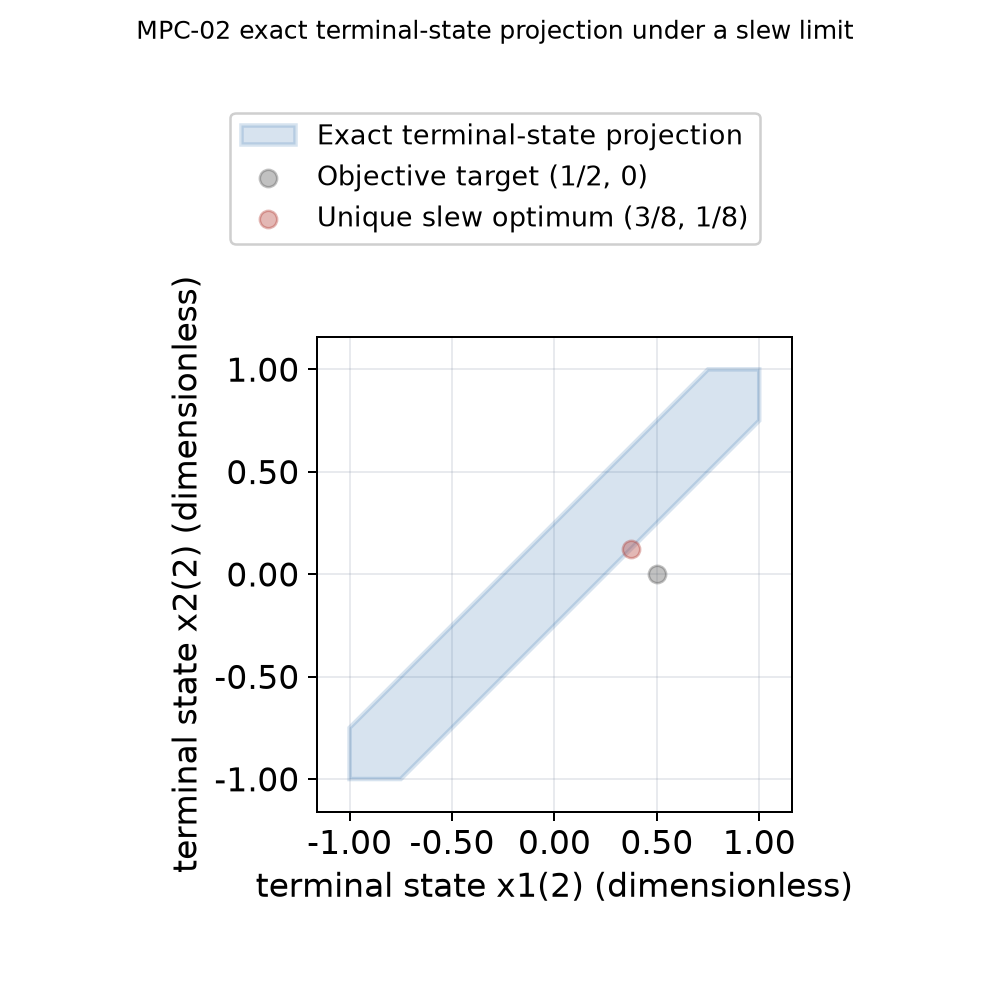
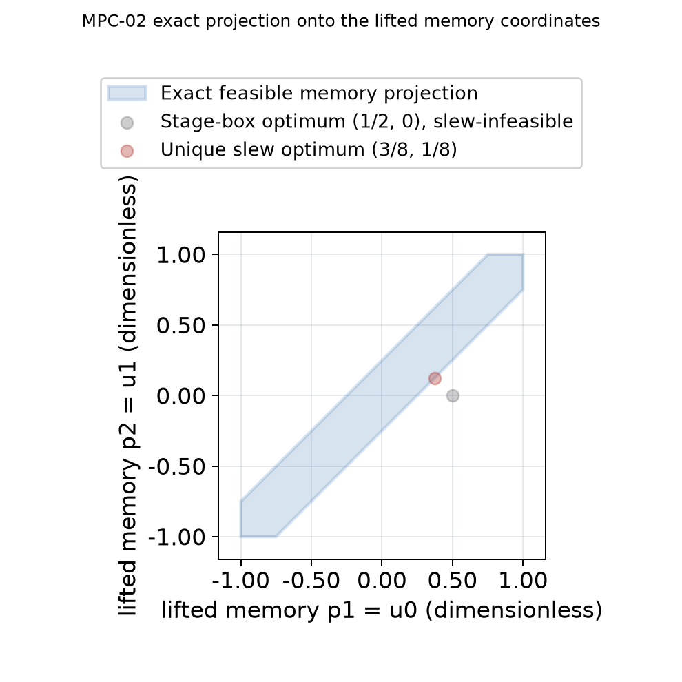

# MPC-02: stage and temporal constraint fixtures

Date: 2026-10-26. Scope: exact authored cases and correctness evidence for
[issue #598](https://github.com/butahlecoq/controlled-systems-lab/issues/598).
No performance measurement or timing comparison is reported.

## One model and objective, four scenario identities

The cases use a new dimensionless, two-state, two-stage discrete model:

\[
x_1=x_0+\begin{bmatrix}1\\0\end{bmatrix}u_0,\qquad
x_2=x_1+\begin{bmatrix}0\\1\end{bmatrix}u_1,\qquad x_0=(0,0).
\]

The stage index is the time unit and the input is zero-order held for one
transition. The shared terminal objective is

\[
J=(x_{2,1}-1/2)^2+x_{2,2}^2,
\]

encoded as `Q=2I`, `linear=(-1,0)`, and `offset=1/4` under the loader's
`1/2 xᵀQx + qᵀx + c` convention. The terminal map is `x₂=(u₀,u₁)`, so the
objective is strictly convex in `(u₀,u₁)` and every case below has a unique minimizer.
These are authored mathematical examples, not physical fuel or historical
models.

| Scenario ID | Additional constraints | Exact unique minimizer `(u₀,u₁)` | Terminal state | Cost |
| --- | --- | ---: | ---: | ---: |
| `mpc02-unconstrained-2d-v1` | No state or input bounds | `(1/2, 0)` | `(1/2, 0)` | `0` |
| `mpc02-stage-box-2d-v1` | `-1 ≤ u₀,u₁ ≤ 1` | `(1/2, 0)` | `(1/2, 0)` | `0` |
| `mpc02-slew-2d-v1` | Stage box and `-1/4 ≤ u₁-u₀ ≤ 1/4` | `(3/8, 1/8)` | `(3/8, 1/8)` | `1/32` |
| `mpc02-l1-budget-2d-v1` | Stage box and `|u₀|+|u₁| ≤ 1/4` | `(1/4, 0)` | `(1/4, 0)` | `1/16` |

The four JSON files are adjacent under [`examples/scenarios`](../../examples/scenarios/README.md).
Each uses the same model and objective; the IDs keep constraint semantics
separate. The L1 budget is represented by four joint-history inequalities.
It is not a slew limit and receives no memory-lift interpretation.

## Direct joint relation and exact memory lift

The direct arm builds the canonical full-history program in coordinate order
`[x₀,x₁,x₂,u₀,u₁]`. For the slew case it has 8 decision coordinates and 11
rows: 2 initial-state equalities, 4 transition equalities, 4 stage input-bound
rows, and 1 temporal interval row.

The equivalent stagewise arm applies the existing
[`lift_one_step_slew`](../../include/csl/problem/temporal_lifts.hpp)
transform. With no stage-zero rate limit it uses bookkeeping `p₀=0`,
`p₁=u₀`, `p₂=u₁`, `v₀=u₀`, and `v₁=u₁-u₀`. Stagewise absolute input bounds
remain on `p₁,p₂`; the actual slew interval applies to `v₁`. The terminal
objective ignores the memory coordinates. This lifted program has 11 decision
coordinates `(z₀,z₁,z₂,v₀,v₁)`, with `z_t=(x_t,p_t)`, and 18 rows. These row
counts describe the current generated programs, not runtime cost.

The affine memory equations give inverse maps between each original feasible
history and its lifted history. The regression fixture checks all six exact
vertices of the bounded slew polygon in both directions: direct vertices are
lifted and checked against the augmented rows, and lifted-projection vertices
are constructed in augmented coordinates, recovered, and checked against the
direct rows. It also checks a stagewise-feasible history rejected by the slew
row in both, exact reconstruction, the boundary-active optimizer, and equal
evaluated original objective values.
It makes no complete-family solver claim. The separate historical
[`temporal-coupling.md`](temporal-coupling.md) note proves why dropping memory
can admit invalid future controls and records the general lift equations.

The terminal-state projection is the exact linear image of the six-vertex
control polygon. The adjacent memory projection labels `p₁=u₀` and `p₂=u₁`
and states that physical coordinates are omitted. Both figures are derived
from exact rational vertices in
[`mpc02-slew-analytic-source.json`](../examples/mpc02-slew-analytic-source.json):





Reproduce these figures with the pinned quantitative-axis renderer from a
configured reporting environment:

```sh
PYTHONPATH=scripts/reports python docs/research/tools/render_mpc02_figures.py
```

These are analytic set projections, not sampled rollouts, solver output,
benchmark measurements, or claims about other strategy support.

## Evidence boundary and open work

`direct_joint_strategy_tests` checks the scenario IDs and compares the generated
direct and lifted linear programs against the exact vertices and objective
values above. The test's direct relation is Strategy B's full-history
formulation; the lifted model is checked through the same relation builder.
These checks establish fixture and transform consistency for this authored
profile. They do not establish relative solver speed, general implementation
equivalence for arbitrary constraints, or complete optimal-family coverage
from Strategy A.

The issue's planning gate does not authorize a benchmark. Accordingly this
note records no solver timing rows or resource/limiter measurements. A future
measured study must use reviewed #94 orchestration, preserve the original and
lifted dimensions separately, report solver/setup/conversion costs, and retain
the exact run configurations and failures. Do not turn a single functional
fixture into a method winner claim.

Release impact: the change adds source-distributed example JSON, documentation,
and analytic figures. It changes no public API, dependency, installation
contract, or package workflow; no release is needed.
