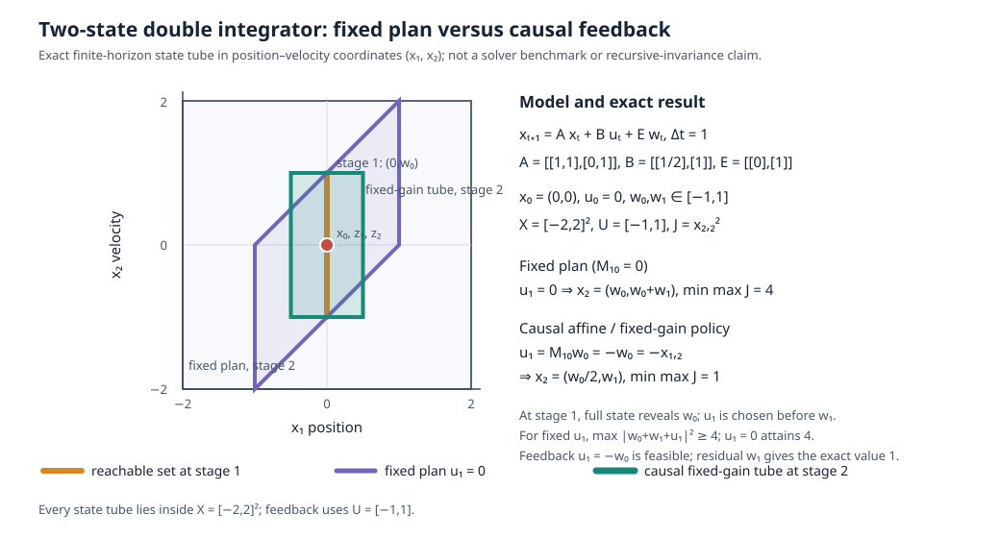

# MPC-07 primary-source audit

Date: 2026-10-28. Scope: close source-qualification gaps for issue [#603](https://github.com/butahlecoq/controlled-systems-lab/issues/603). Research only; no code was copied, dependencies installed, builds run, or benchmarks executed. This is an addendum to [the broader MPC source dossier](mpc-comparison-primary-sources.md), not authorization to implement a continuous-feedback adapter.

## Pins and task boundaries

| Candidate | Audited source | What it represents | Qualification |
|---|---|---|---|
| Affine disturbance feedback (ADF) | Goulart, Kerrigan, Maciejowski (2006), DOI [10.1016/j.automatica.2005.08.023](https://doi.org/10.1016/j.automatica.2005.08.023); [publisher abstract/section preview](https://www.sciencedirect.com/science/article/pii/S0005109806000021) | For known fixed $(A,B)$, full-state information, additive bounded disturbances and mixed polytopic constraints, the paper proves equivalence between admissible affine past-state feedback and $u_i=v_i+\sum_{j<i}M_{ij}w_j$. The previous disturbance is reconstructible after the transition as $w_i=x_{i+1}-Ax_i-Bu_i$; it is not an action-time sensor input. | The objective in the tractable formulation is quadratic on the disturbance-free prediction. Its QP/SOCP and robust-feasibility guarantee are not the repository's exact maximum-terminal-cost minimax objective or an optimum over arbitrary nonlinear causal policies. The stability/ISS guarantee depends on the paper's receding-horizon and terminal design conditions. ADF with $M=0$ is the fixed-plan restriction. |
| SLS-MPC | Chen et al., author paper [arXiv:2203.11375v3](https://arxiv.org/abs/2203.11375v3), version dated 2023-09-26; published as *Automatica* (2024). | The paper's controller is causal LTV full-state feedback $u_t=\pi_t(x_{0:t})$, represented by block-lower-triangular responses satisfying the finite-horizon SLS affine identity. It considers both polytopic additive $w_t$ and polytopic model uncertainty in $(\Delta_A,\Delta_B)$. It exactly parameterizes the nominal response but over-approximates the lumped model/additive uncertainty with a filtered virtual disturbance. | The tightened convex program gives robust feasibility for the stated model and constraints. Its worst-cost option minimizes an **upper bound**, not the true worst-case objective exactly (paper §§5.2, Corollary 2). Do not equate its cost with exact minimax. This is a different candidate from classical ADF: SLS's primary decision is the state-feedback response, with a conservative uncertainty enclosure. |

These claims are from the papers' own formulation and theorem statements. The SLS derivation explicitly allows the dynamics matrices to vary over a polytope and requires additive disturbance membership in a polytope; it does not merely replace unknown model error with an independently measured additive disturbance. See [SLS paper §§2–5.2](https://arxiv.org/html/2203.11375v3#S2), especially its problem formulation, response identity, over-approximation, and Theorem 2/Corollary 2.

## Closed-loop feasibility caveat for SLS-MPC

The paper says its main convex OCP is difficult to prove recursively feasible at a fixed horizon: the uncertainty-bound constraints change after applying the first action, preventing the ordinary shifting proof. The paper's guarantee route is a **shrinking-horizon backup**: solve initially with a robust forward-invariant terminal set, retain the resulting safe policy for up to $N$ steps, then solve the exact one-step robust OCP by enumerating model-uncertainty vertices. The fixed-horizon numerical feasible-domain plots are observations, not that theorem. See [§5.3](https://arxiv.org/html/2203.11375v3#S5.SS3).

For any future comparison, report separately: robust feasibility under the stated enclosure; nominal quadratic value; true worst-case cost if independently computed; and any proven upper/lower bound. A feasible policy from a restricted class can upper-bound the unrestricted causal optimum only when it is soundly feasible for the same model, objective and actuator domain. A finite action catalogue is not ordered against a continuous actuator problem unless the action-set inclusion is established.

## Author implementation qualification

The author repository is pinned for this audit at [`3f6873299ec5d0d2d87630a66486f723788390a4`](https://github.com/ShaoruChen/Polytopic-SLSMPC/commit/3f6873299ec5d0d2d87630a66486f723788390a4), whose commit date is 2024-05-03. The paper's [v3 code link](https://github.com/ShaoruChen/Polytopic-SLSMPC) resolves to the same repository. The pinned tree has example scripts for a two-state system and implementations of SLS and several robust-MPC baselines. Its [README at that commit](https://github.com/ShaoruChen/Polytopic-SLSMPC/blob/3f6873299ec5d0d2d87630a66486f723788390a4/README.md) says examples run in MATLAB and lists YALMIP, MPT3 and MATLABProgressBar, with MOSEK as the default solver. The pinned [`SLS_MPC.m`](https://github.com/ShaoruChen/Polytopic-SLSMPC/blob/3f6873299ec5d0d2d87630a66486f723788390a4/mpc/SLS_MPC.m) sets `mosek` as the solver fallback. The paper reports its experiment environment as MATLAB R2019b, YALMIP and MOSEK.

There are no GitHub releases. The pinned tree contains no `LICENSE` file; GitHub's repository license field is also null at audit time. The latest code commit is from 2024, and no release/CI maintenance commitment is recorded. This is enough to pin a research artifact, not to establish permission to copy, port, redistribute, or rely on it as a maintained dependency. **Do not adopt or port the author code without a license grant.** Any separate implementation from the published equations needs its own provenance and is not a reproduction of that code. A future solver tuple also needs exact versions and platform evidence; the paper's MATLAB R2019b environment and the README's unversioned toolboxes do not pin those dependencies. [Pinned source tree](https://github.com/ShaoruChen/Polytopic-SLSMPC/tree/3f6873299ec5d0d2d87630a66486f723788390a4), [GitHub repository metadata](https://api.github.com/repos/ShaoruChen/Polytopic-SLSMPC).

## Exact two-step analytic reference and 2D policy/tube illustration

This hand-checkable case demonstrates why a causal policy is not the same
optimization as one fixed plan. It is an analytic reference only; no solver or
benchmark was run.

Use the unit-step double integrator

\[
x_{t+1}=Ax_t+Bu_t+Ew_t,\quad
A=\begin{bmatrix}1&1\\0&1\end{bmatrix},\quad
B=\begin{bmatrix}1/2\\1\end{bmatrix},\quad
E=\begin{bmatrix}0\\1\end{bmatrix}.
\]

Set $x_0=(0,0)$, $u_0=0$, independent $w_0,w_1\in[-1,1]$,
$X=[-2,2]^2$, $U=[-1,1]$, horizon two, and terminal objective
$J=x_{2,2}^2$ (squared terminal velocity). The disturbance is realized after
the action at each stage. At stage 1, $x_1=(0,w_0)$ exposes $w_0$ through the
observed velocity; $u_1$ must still be selected before $w_1$.

| Policy class | Parameterization | Exact terminal state | Worst-case $J^*$ |
|---|---|---|---:|
| Fixed plan | $u_1=v_1$ ($M_{10}=0$) | $(w_0+v_1/2,\; w_0+w_1+v_1)$ | $4$, attained at $v_1=0$ |
| Affine disturbance feedback | $u_1=v_1+M_{10}w_0$ | $((1+M_{10}/2)w_0+v_1/2,\; (1+M_{10})w_0+v_1+w_1)$ | $1$, attained at $(v_1,M_{10})=(0,-1)$ |
| Fixed state-feedback gain | $u_1=Kx_1$, $K=[0,-1]$ | $(w_0/2,w_1)$ | $1$ |

For any fixed $v_1$, the adversary can choose $w_0+w_1=\pm2$ with the sign
of $v_1$, so $\max J=(2+|v_1|)^2$ and $v_1=0$ is optimal. For the ADF
class, $\max J=(|1+M_{10}|+|v_1|+1)^2$ before applying action bounds, so
$(0,-1)$ attains the lower bound $1$. More generally, after any causal choice
$u_1(w_0)$, the unseen $w_1\in[-1,1]$ forces
$\max_{w_1}|w_0+u_1(w_0)+w_1|^2\ge1$; therefore the feedback policy is also
globally minimax for this toy objective, not only best within ADF.

The uncertainty containment check is exact: $x_1=(0,w_0)\in[-1,1]\times
[-1,1]$; the fixed-plan terminal set is
$\{(w_0,w_0+w_1):w_0,w_1\in[-1,1]\}\subseteq[-1,1]\times[-2,2]$; and
the feedback tube is
$\{(w_0/2,w_1):w_0,w_1\in[-1,1]\}=[-1/2,1/2]\times[-1,1]$.
All lie inside $X$, and $|u_1|=|w_0|\le1$. These coordinate bounds are exact
support bounds of affine images of boxes; they do not use sampling. The
fixed-plan/ADF choice uses one scalar decision / two scalar decisions
respectively. The horizon-two example has two state-constrained stages (four
scalar box inequalities each), plus one bounded scalar control (two
inequalities); robustifying the ADF control bound is the exact condition
$|v_1|+|M_{10}|\le1$. This arithmetic is a complete tiny reference, not a
solver-performance observation or a reproduction of either paper's example.
Reproduce the exact terminal-vertex costs and state/control containment with
`python docs/research/tools/check_mpc07_policy_reference.py`. The unrestricted
causal lower bound follows directly: for any realized $q=w_0+u_1(w_0)$,
$\max\{(q-1)^2,(q+1)^2\}=(|q|+1)^2\ge1$.

The [position–velocity illustration](figures/mpc07-policy-tube.svg) plots the
stage-1 uncertainty segment and both terminal state sets. Its fixed-gain
cross-sections are a finite-horizon tube; this case does **not** prove
recursive feasibility or a robust positively invariant set. The existing
[MPC-06 RPI tube pilot](../../reports/algorithm-results/mpc06-nilpotent-tube-pilot-v1/index.html)
remains the visual reference for invariant-tube tightening.

No preparation/online latency, memory, or external-solver failure rates are
reported here; the issue gate prohibits the necessary solver run and benchmark.
The paper literature's policy-variable scaling is source-reported and remains
distinct from measurements on this task. SLS's worst-cost output must still be
treated as an upper bound, not substituted for the exact values above.

## 2D policy/tube visual audit

The repo already has two related visuals, with different scopes:

- [`continuous-policy-2d.html`](../examples/continuous-policy-2d.html) shows an affine observation policy mapping a two-dimensional initial set to a terminal parallelogram. It is an explanatory policy picture, but has no disturbance set, error tube, or robust tightening.
- The [MPC-06 exact nilpotent tube pilot](../../reports/algorithm-results/mpc06-nilpotent-tube-pilot-v1/index.html) and its [projection](../../reports/algorithm-results/mpc06-nilpotent-tube-pilot-v1/projection.svg) show a two-state position/velocity RPI tube, the fixed gain $u=v+K(x-z)$, and tightened state/input constraints for a continuous additive-disturbance feasibility case. This is a useful fixed-gain tube baseline picture, not an SLS/ADF result.

The new analytic figure makes the ADF coefficient and observation order visible
for this exact toy case; the older MPC-06 figure remains the fixed-gain RPI/tightening
example. Neither figure visualizes SLS's response matrices or its filtered
uncertainty over-approximation. Any later SLS report must add those elements and
keep each figure tied to its own model and evidence; the two illustrations are
not one measured result.

## Acceptance disposition

The pinned math and software limitations are explicit: ADF and SLS-MPC are different restricted-policy/robustification routes; SLS's worst-cost output is an upper bound; ordinary fixed-horizon recursive feasibility is not established; and author code cannot be adopted without rights. This note supplies an exact two-step policy reference, algebraic containment check, and 2D policy/tube figure. The SLS-specific comparison, policy-variable/scaling report on larger horizons, solver latency/failure data, and report-ready SLS uncertainty-overapproximation figure remain behind the existing #3/#83 capability gates. No benchmark should be reported as completed by this research note.
