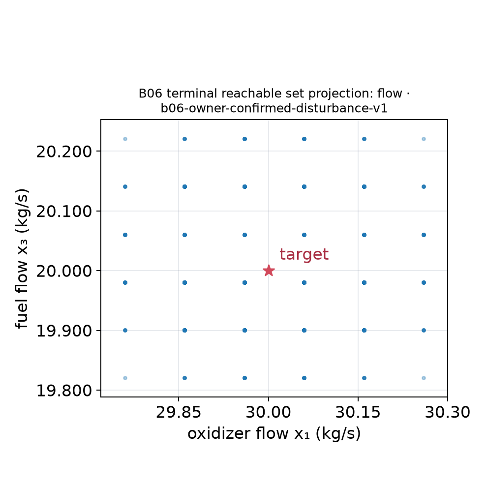
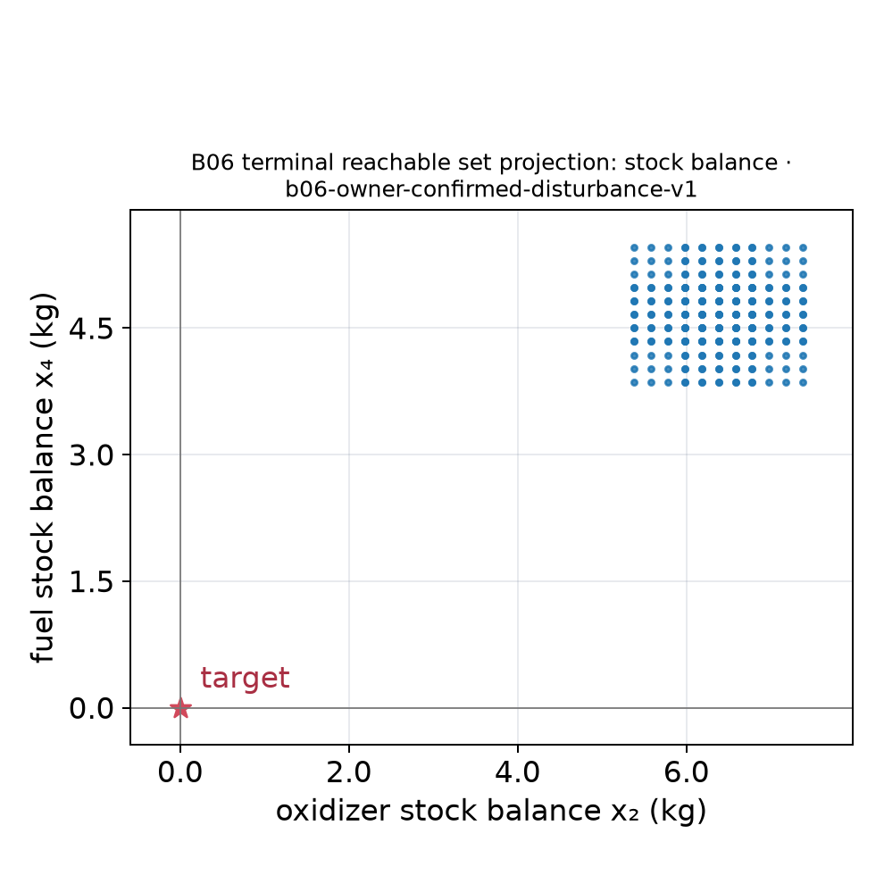

# MPC-11 nonlinear replay and NMPC study design

Date: 2026-10-26. Scope: research and prospective case definitions for [issue #607](https://github.com/butahlecoq/controlled-systems-lab/issues/607). No solver was installed or invoked; no benchmark was run; no acados experiment was performed or authorized. This note proposes new synthetic cases. It reports no computed trajectories, objective values, solver success, or controller winner.

## Finding and boundary

An affine plan replayed on a nonlinear model and a nonlinear model predictive controller do not solve the same mathematical problem. Compare them as a **different-model/controller study**, while preserving three identities:

1. `affine-plan/affine-replay`: optimize and replay with one frozen affine prediction model.
2. `affine-plan/nonlinear-replay`: use the same affine plan, but execute its held inputs on the named nonlinear plant.
3. `nominal-nmpc/nonlinear-replay`: re-solve a finite-horizon nonlinear program from the current full state at each sample, apply only the first held input, and execute on that same nonlinear plant.

The first pair isolates model mismatch for one plan. The third is receding-horizon nonlinear control; it is not a global optimum, robust controller, or a parity comparison with the fixed affine plan. Ipopt's documented algorithm seeks a **local** solution of a generally nonlinear NLP, so retain feasible incumbents, stationarity diagnostics, constraint residuals, failures, and limits without promoting local convergence to global optimality. [Ipopt problem and method description](https://coin-or.github.io/Ipopt/)

The current saved Lotka–Volterra illustration is a different artifact: [its generator](../../scripts/reports/lotka_volterra_sampled.py) declares an explicit Euler recurrence, sampled controls, and unspecified state units. It is not a physical model definition, ODE replay, NMPC case, or reachable-set certificate. The new case below has a separate ID and explicit units. The historical B04/L05 parameter domains and the B06/B07 finite catalogues remain separate; no physical/deviation coordinate transformation is inferred from any saved figure.

## Proposed fuel-adapter case `SYN-NL-FUEL-01`

This is an **authored synthetic actuator-lag model**, not a recovered B04/B06 model and not yet an approved physical fuel model. It provides an explicit candidate four-state case if the fuel adapter can accept these declared semantics.

| Symbol | Meaning | Unit | Initial value | Constraint |
|---|---|---:|---:|---:|
| `m_ox` | oxidizer mass remaining | kg | 100 | 40 to 120 kg |
| `m_f` | fuel mass remaining | kg | 30 | 12 to 36 kg |
| `q_ox` | oxidizer mass-flow state | kg/s | 2.0 | 0 to 3 kg/s |
| `q_f` | fuel mass-flow state | kg/s | 0.6 | 0 to 1 kg/s |
| `u_ox`, `u_f` | dimensionless valve commands | 1 | — | 0 to 1 |

For `i ∈ {ox,f}`, with `Q_ox=3 kg/s`, `Q_f=1 kg/s`, `τ_ox=τ_f=2 s`, and the listed initial mass `m_i0`, propose

\[
\dot m_i=-q_i,\qquad
\dot q_i=\frac{Q_i u_i\sqrt{m_i/m_{i0}}-q_i}{\tau_i}.
\]

The square-root term models a declared pressure-dependent flow surrogate. It is a synthetic assumption, not a claim about a real engine or the archived fuel adapter. Positive lower mass bounds keep the ODE smooth over the declared feasible region. Apply state/input constraints at every optimization collocation point and independently replay the original ODE; a mesh-feasible plan is not a continuous-time safety certificate.

Proposed time grid: `t=0,…,20 s`, `Δt=0.5 s`, 40 piecewise-constant control intervals (zero-order hold). Candidate terminal target: `(m_ox,m_f,q_ox,q_f)=(75 kg,23 kg,1.5 kg/s,0.45 kg/s)`. Candidate dimensionless objective:

\[
J=\left(\frac{m_{ox}(T)-75}{100}\right)^2+
  \left(\frac{m_f(T)-23}{30}\right)^2+
  0.1\left(\frac{q_{ox}(T)-1.5}{3}\right)^2+
  0.1\left(\frac{q_f(T)-0.45}{1}\right)^2+
  \frac{0.02}{40}\sum_{k=0}^{39}\left[(u_{ox,k}-\bar u_{ox,k})^2+(u_{f,k}-\bar u_{f,k})^2\right].
\]

Here `m` values in the denominators are kg, `q` values are kg/s, and `ū` is the explicitly defined nominal command schedule below. These constants are design choices for a new synthetic task, not values copied from a historical paper. Feasibility and numerical conditioning have not been tested.

### Affine model and reference schedule

Use the analytic reference `m̄_ox(t)=100−2t kg`, `m̄_f(t)=30−0.6t kg`, `q̄_ox=2 kg/s`, and `q̄_f=0.6 kg/s`; choose

\[
\bar u_i(t)=\frac{\bar q_i}{Q_i\sqrt{\bar m_i(t)/m_{i0}}}.
\]

This schedule exactly satisfies the proposed ODE for the listed parameters and remains below one on `[0,20 s]`. It gives an explicit time-varying linearization point without using an optimizer or inferred legacy coordinates. For the affine plan, sample the Jacobians at each interval midpoint, freeze them over that interval, and discretize the local affine ODE by a matrix exponential. Choose the affine offset so each reference endpoint is reproduced exactly by the frozen discrete model. Optimize control deviations `δu=u−ū` with bounds `|δu_ox|,|δu_f|≤0.2` and scaled state-deviation bounds `|δm_ox|≤20 kg`, `|δm_f|≤10 kg`, `|δq_ox|≤1 kg/s`, `|δq_f|≤0.3 kg/s` at mesh points. Freeze this schedule for the entire 20-second plan; no relinearization is allowed in the affine-plan variants. The stated trust region is a controller setting, not a certificate that the affine residual is bounded.

For nonlinear replay, apply exactly the affine-plan input vector and initial state to the original ODE. For nominal NMPC, use the same ODE, objective, bounds, full-state measurement, 20-second prediction horizon and 0.5-second update period; re-optimize each update and apply only its first input. Use deterministic initialization and log every NLP status, initial guess policy, and warm-start state. Do not add uncertainty scenarios or call this robust NMPC.

### Required 2D graphical material for the four-state case

Produce labeled state-plane panels from saved, independently replayed trajectory rows, each tied to the mathematical case ID, model hash, strategy/controller ID, trajectory/witness ID, and replay-integrator settings:

- `m_ox (kg)` versus `m_f (kg)` — remaining-mass projection.
- `q_ox (kg/s)` versus `q_f (kg/s)` — flow-state projection.
- `m_ox (kg)` versus `q_ox (kg/s)` — one mass/flow cross-projection.

For every panel, identify the omitted state coordinates and preserve each policy/trajectory identity in its legend. These lines are coordinate projections of **individual numerically integrated trajectories**, not a projection of a reachable set or of a complete feasible/optimal family. Do not draw a convex hull around several trajectories as if it were an exact reachable set. If a later ticket explicitly computes a mathematical set projection, record the geometry operation and guarantee separately and label exact, inner/outer enclosure, or sampled evidence according to the actual result.

These already-published B06 figures demonstrate readable projections of one saved four-coordinate fuel result. They are an **illustration of presentation only**, not data for `SYN-NL-FUEL-01`: the B06 record contains 1,024 numerical V-representation points with binary64 assurance, and its malformed A matrix remains tracked by [#668](https://github.com/butahlecoq/controlled-systems-lab/issues/668). Do not treat these points as a validated real-arithmetic enclosure or as evidence for the synthetic actuator-lag equations above.

*Saved B06 projection onto `(x₁,x₃)` = oxidizer/fuel flow. This is a numerical projection of that saved V-representation, not a projection of the proposed nonlinear fuel case.*

*Saved B06 projection onto `(x₂,x₄)` = oxidizer/fuel stock balance. The zero target shown belongs to that B06 scenario; it is not the target of `SYN-NL-FUEL-01`.*

## Proposed Lotka–Volterra-style case `SYN-NL-LV-01`

Lotka's primary paper presents interacting state quantities with growth and product-interaction terms; Volterra published his independent species-fluctuation treatment in 1926. [Lotka, PNAS 1920](https://www.pnas.org/doi/10.1073/pnas.6.7.410), [Volterra, Nature 1926](https://www.nature.com/articles/118558a0). The following controlled variant and parameter values are **new proposed assumptions**, not a transcription of either paper or of the saved sample figure.

Let `P` and `R` be prey and predator populations in thousands of individuals. Time is in days. Use one bounded prey-removal effort `u` in day⁻¹:

\[
\dot P=(a-bR-u)P,\qquad
\dot R=(dP-c)R.
\]

Choose `a=0.8 day⁻¹`, `b=0.01 (thousand individuals)⁻¹ day⁻¹`, `c=0.6 day⁻¹`, `d=0.006 (thousand individuals)⁻¹ day⁻¹`; these values make the no-control coexistence point `(P*,R*)=(c/d,a/b)=(100,80)` in the declared state units. Start at `(P(0),R(0))=(120,60)`, enforce `0≤P≤200`, `0≤R≤150`, and `0≤u≤0.05 day⁻¹`. Use a 3-day horizon, `Δt=0.1 day`, zero-order-held controls, and direct state observation. Track `(P_T,R_T)=(100,80)` with

\[
J_{LV}=\left(\frac{P_T-100}{100}\right)^2+
       \left(\frac{R_T-80}{80}\right)^2+
       \frac{0.05}{30}\sum_{k=0}^{29}\left(\frac{u_k}{0.05}\right)^2.
\]

Evaluate the same formula on the nonlinear replay for all three variants. Parameters, scales, bounds, horizon, and target are authored choices. Do not state reachability or feasibility until a future run verifies them.

For the affine plan, linearize the nonlinear vector field at the no-control coexistence point and `ū=0`, freeze that one Jacobian over the full prediction horizon, and make no relinearization. Bound scaled deviations by `|δP|≤40` thousand individuals, `|δR|≤30` thousand individuals, and `|δu|≤0.05 day⁻¹`. For nominal NMPC, use the full nonlinear model and re-solve each `0.1 day`. The prey/predator state-plane plot uses axes `P (thousand individuals)` and `R (thousand individuals)` and is a numerically integrated trajectory only, not a set guarantee. Include separate time traces, and never present sampled rollout envelopes as sound reachability bounds.

The original unconstrained predator–prey equations use interaction products and positive growth/decay coefficients; the proposed `−uP` term is a chosen control extension. The source paper's equations and the new experiment must retain separate labels. The source does not set population units or these controller bounds.

## Prospective integration, transcription, and solve settings

For both continuous NMPC cases, propose do-mpc's Radau orthogonal collocation with degree `3`, one finite element per zero-order-held sample interval (`collocation_ni=1`), and hard state/input bounds checked at the collocation points. Use `n_robust=0`: these are nominal, fully observed closed-loop studies, not robust scenario-tree MPC. A collocation transcription has no separate adaptive integrator tolerance; its degree and finite-element mesh define that numerical approximation. Report a mesh-refinement sensitivity case before interpreting a solver difference.

For nonlinear trajectory replay, propose CVODES at each held-input interval with `abstol=1e-10` and `reltol=1e-9`. Scale fuel states by `(100 kg, 30 kg, 3 kg/s, 1 kg/s)` and Lotka–Volterra states by `(100, 80)` thousand individuals before applying the scalar absolute tolerance. Repeat a future replay at `abstol=1e-11`, `reltol=1e-10`; any difference in states, cost or constraint residuals is reported. These are prospective settings, not tested accuracy claims. The versioned do-mpc source exposes CVODES, absolute/relative tolerances and state scaling, while its MPC settings expose Radau degree and finite-element count. [Simulator settings at v5.1.2](https://github.com/do-mpc/do-mpc/blob/v5.1.2/do_mpc/simulator.py), [MPC settings](https://www.do-mpc.com/en/latest/api/do_mpc.controller.MPCSettings.html).

For a deterministic NLP configuration, propose IPOPT `tol=1e-8`, `acceptable_tol=1e-6`, and `max_iter=1000`, with solver/linear-algebra versions pinned in the eventual run record. Initialize fuel controls from `ū`; initialize Lotka–Volterra control to `0.025 day⁻¹`; use the stated reference as the state guess. At each NMPC update, shift the prior input trajectory left by one interval and repeat its last value; reset the initial state guess to the newly observed state. Preserve the full status, termination, stationarity and residual data, including failed or infeasible solves. IPOPT convergence is local and does not certify global optimality.

The eventual evidence report separates controller optimization/setup time, each NLP solve, nonlinear integration/replay time, and artifact rendering/export. No such timings or solution values are produced by this research note.

## Candidate stack and result limits

A current candidate stack, **for a future separately authorized integration**, is do-mpc `5.1.2`, CasADi `3.8.0`, and the Ipopt/MUMPS binaries shipped by that CasADi release. do-mpc `5.1.2`'s release notes say it is tested with CasADi 3.6, 3.7, and 3.8; they also note that CasADi 3.8 changed the Ipopt/MUMPS build and may change solutions in the order of `1e−8`. The CasADi `3.8.0` release records its bundled Ipopt source as `3.14.19.mod` and the MUMPS third-party source revision. [do-mpc 5.1.2 release notes](https://www.do-mpc.com/en/latest/release_notes.html), [CasADi 3.8.0 release/plugin manifest](https://github.com/casadi/casadi/releases/tag/3.8.0).

The official do-mpc API says its MPC NLP uses CasADi's `nlpsol` with the `ipopt` plugin; its implementation selects Ipopt for continuous NLPs and defaults `ipopt.linear_solver` to `mumps`. The documented default continuous discretization is orthogonal collocation with Radau points. [MPC settings](https://www.do-mpc.com/en/latest/api/do_mpc.controller.MPCSettings.html), [versioned MPC implementation](https://github.com/do-mpc/do-mpc/blob/v5.1.2/do_mpc/controller/_mpc.py), [collocation method](https://www.do-mpc.com/en/latest/theory_orthogonal_collocation.html).

License facts from publisher sources: do-mpc v5.1.2 is LGPL-3.0; CasADi describes itself as LGPL and its repository distributes LGPL-3.0; Ipopt is EPL-2.0. A future dependency review still needs to record the selected CasADi wheel and its bundled third-party notices, the exact Python/NumPy versions, MUMPS and BLAS build details, and any platform-specific binary qualifications. No package or public dependency change is proposed here. [do-mpc license](https://raw.githubusercontent.com/do-mpc/do-mpc/v5.1.2/LICENSE.txt), [CasADi license](https://github.com/casadi/casadi/blob/3.8.0/LICENSE.txt), [Ipopt license](https://coin-or.github.io/Ipopt/LICENSE.html).

CasADi supplies symbolic differentiation, integration, and NLP building blocks; its own manual explicitly says it is not itself an OCP solver. Ipopt is a local NLP method, not a global certificate. do-mpc says feasibility for continuous systems means constraints are satisfied pointwise at its discretization. Thus a future result must state local solver status, integration method and tolerances, collocation/mesh settings, original-model constraint residuals, and replays; sampled numerical trajectories alone cannot establish all-time constraints or global nonlinear optimality. [CasADi user guide](https://web.casadi.org/docs/), [Ipopt method guide](https://coin-or.github.io/Ipopt/), [do-mpc MPC formulation and discretization note](https://www.do-mpc.com/en/latest/theory_mpc.html).

## Decisions still required before any run

1. Owner/domain review of `SYN-NL-FUEL-01` state meanings and surrogate square-root flow law. It must not be presented as a B04/B06 physical model without a source-backed coordinate map and engineering validation.
2. Review of all proposed synthetic parameters, targets, objective weights, solver tolerances, trust regions, initial-guess/warm-start rules, maximum iterations, and resource budgets. The values above make a concrete draft, not an authorized scientific result.
3. Pin complete platform-specific software hashes/licenses and validate `do-mpc 5.1.2` with the exact Python/NumPy/CasADi binary combination without changing product dependencies.
4. Separate objective and model IDs for affine prediction, nonlinear execution, and nonlinear receding-horizon optimization. Evaluate each saved result against the original nonlinear equations; retain local stationary/failed/infeasible outcomes.
5. Only after the above, create the projected 2D saved-data figures listed above and visually inspect them. This research-only note contains no solver-generated plots or trajectories.
