# Class-level architecture for optimal control workflows

Status: review draft for scientific and architecture feedback; no new interface is approved for implementation by this document.

Baseline inspected: `main` at `ab1c6ac3087c9df5b79d0852bc790569845b6e10`. The selected language is C++20. Public types and module names below are implementation facts only where marked **Implemented**. **Draft PR** means proposed code is not part of that baseline. **Proposed** describes a role and a contract to refine before coding.

This document adds a class-level workflow map to the [current framework composition](../../architecture/framework-composition.md) and [modular algorithm design](../../architecture/modular-algorithms-and-solution-sets.md). It does not repeat their full scientific background or promise that every representable model has an available algorithm.

## First workflow and proposed solver profile

The first solver profile is `nominal_open_loop`: affine discrete-time stages; a known deterministic initial state; absent or zero process disturbance; continuous controls; convex polyhedral stagewise state/control constraints; and a supported terminal-only linear, convex-quadratic, or weighted Euclidean residual objective. The first profile has no observation-driven policy, nonempty temporal coupling, or uncertain-initial-state quantifier. Those inputs remain representable but must be rejected with a capability diagnostic until a later profile defines their semantics. This is the concrete profile proposed by the consolidated design; the owner must confirm it before implementation tickets freeze.

The first completed application solves this profile and returns the full joint relation of optimal states and controls. It compares reachability with backward recovery against direct joint-trajectory optimization on the same resolved problem, objective, tolerances, output scope, and compatible LP/convex backend wherever both strategies support that backend. A backend exception is recorded and explained; backend substitutions are separate crossed comparisons. Each approach must retain dependence across time; samples or separate per-stage control marginals are not the family.

The two-strategy integration gate passes only when both strategies return the declared complete optimal-family target for a supported case, with independently checked objective and feasible witnesses. A candidate relaxation, partial relation, failed/unsupported run, or absent completeness evidence remains visible in the comparison record but cannot pass the gate or count as a completed first workflow. For performance comparisons, alternate at least five tuned Release repetitions per strategy, retain every raw run, report median and range, and profile the limiter separately from timed runs.

The current problem model has data types for disturbance, observation, continuous/finite/mixed control domains, and temporal constraints; these do not imply support from the first strategies. It does not represent hybrid modes, guards, resets, or permitted mode transitions. Those require a separate future model extension, not another name for finite or mixed-valued controls. The first archival experiments use no process disturbance and no temporal coupling; a strategy must reject unsupported inputs rather than silently discard them. Numerical verification comes first. Validated verification remains an explicit future capability. Whenever any algorithm first produces numerical results, publish an English HTML report with raw data and performance measurements, even before a paired strategy comparison exists. Generate reports from persisted run/comparison data, never by invoking a solver while rendering.

The interface vocabulary follows the repository glossary and the deep-module terms: a **module** has one caller-facing **interface**; an **adapter** implements a replaceable **seam**; depth is the capability callers receive through that interface. Proposed class names below are role names, not settled C++ declarations.

## Compact module seam map

This is the short architectural index; the detailed map below records current status, evidence, tickets, and caveats. The interfaces are domain-level requests and results: framework and backend types remain behind adapters, and each proposed seam is still subject to the open decisions later in this draft.

| Module | Responsibility and caller-facing interface | Main extension seam |
|---|---|---|
| Scenario intake and resolution | Parse a versioned scenario or authored `Problem` into an immutable `ResolvedProblem` with source and mathematical identity. | File-format adapters and model/problem value types. |
| Strategy preparation | Admit a strategy and its complete known dependency requirements before creating workspaces; return a prepared strategy with selected identities and versions. | `StrategyPort`/`StrategyRegistry`, typed backend and geometry registrations, generated-request providers where needed. |
| Dynamics, domains, objectives, and sets | Describe the original controlled system, information pattern, constraints, terminal objective, and set-valued data independently of any algorithm. | Model/domain/objective contracts and set representations with declared capabilities. |
| Mathematical operations | Apply a requested set operation, conversion, approximation, LP, or convex program and return the result with scoped status/evidence. | `GeometryPort`, `ConversionPort`, `ApproximationPort`, `LPPort`, and `ConvexPort` adapters. |
| Synthesis strategy | Solve one admitted problem/request and return an `OptimalFamily` relation plus optimum and family evidence. | Shared `StrategyPort`/`SynthesisWorkspace`; Strategy A composes reachability/backward recovery, Strategy B builds and extracts a direct joint-trajectory relation. |
| Family query and witness selection | Select consistent witnesses or request a supported projection while preserving family identity and evidence. | Capability-admitted query/selector adapters over the opaque joint relation. |
| Verification | Recompute original-problem feasibility and objective for returned witnesses; report evidence scope separately for feasibility, optimality, completeness, and validated claims. | Independent numerical verifier first; later assurance-specific verifier adapters. |
| Execution and observation | Give each task exclusive mutable workspaces under declared resource/cancellation policy and collect actual module/run observations. | Executor policies, coarse task scheduling, instrumentation collectors. |
| Records, comparison, and publication | Persist owning run/comparison data and render tables, plots, and HTML without solver execution. | Versioned record/export adapters and backend-neutral plot/report data. |

The first profile is deliberately a capability-bounded path through these modules. Data being representable does not mean a strategy or operation supports it; admission must reject unsupported domains, couplings, guarantees, or evidence requests before execution.

### Proposed contracts for the high-risk seams

These are recommended defaults for review, not owner-approved implementation interfaces. They close the gaps between the broad module names and the guarantees the first workflow requests.

**Objective to complete family.** `TerminalOptimizer` must return the full terminal minimizer relation and numerical optimum evidence; `OptimalFamilyBuilder::build(feasible_joint_relation, terminal_minimizers)` must lift that relation back to the joint state/control coordinates; `FamilyQuery` initially exposes consistent witness selection and capability-admitted coordinate projection, with membership and secondary optimization kept as later query variants. Under the stated first profile, the feasible joint relation is polyhedral and all three supported terminal objective forms admit polyhedral minimizer conditions. A linear objective uses its complete optimal face. For a PSD quadratic and any one minimizer `x*`, minimizers satisfy `Qx = Qx*` and `qᵀx = qᵀx*`; for a weighted residual norm, convexity of the attainable residual set gives a unique optimal residual `y*`, and minimizers satisfy `Lx-r = y*`. Intersecting these affine terminal conditions with the feasible-history polyhedron gives the full family, retaining all state/control dependencies. This characterization does not itself certify that a numerically computed optimum, affine condition, or family is exact or complete: report numerical optimum evidence and family-completeness evidence as separate claims, and do not call either certified merely because the relation is polyhedral. If the configured representation or evidence cannot establish full coverage for the requested profile, the strategy returns unsupported/partial output and cannot pass the first-workflow gate. Implicit convex/SOC family forms remain an extension for future objectives or relations that require them.

**Family outcome and evidence shape.** Prefer a closed outcome variant over independent status/optional-evidence fields, so “complete” cannot be constructed without completeness evidence and a relation:

```cpp
struct CompleteOptimalFamily {
  JointRelation relation;
  OptimumEvidence optimum;
  CompletenessEvidence completeness;
};
struct PartialOptimalFamily {
  JointRelation relation;
  OptimumEvidence optimum;
  CoverageScope known_scope;
};
using FamilyRelationToTarget = std::variant<OuterCandidateEvidence,
    InnerSubsetEvidence, HeuristicRelationEvidence>;
struct CandidateFamily {
  JointRelation relation;
  FamilyRelationToTarget relation_to_target;
};
using OptimalFamilyOutcome = std::variant<CompleteOptimalFamily,
    PartialOptimalFamily, CandidateFamily>;
using SynthesisOutcome = std::variant<OptimalFamilyOutcome, Infeasible,
    Unbounded, UnattainedInfimum, Unsupported, Cancelled>;
```

This sketch keeps completeness evidence structurally present only in the complete case and makes a candidate's relation direction explicit; it does not prove evidence correctness by construction. At the result boundary, validate problem/objective identity, relation coordinates, transformation bindings, and evidence scope. The independent verifier checks the supported claims. The precise evidence payloads and which methods can produce them remain ticket/review decisions. Query results carry their source family identity and cannot change the family outcome or upgrade its completeness.

**Geometry operation planning.** Keep registered geometry adapters, and add one typed planning seam for representation-dependent operation pipelines. A proposed `GeometryOperationRequest` names the operation, ordered input representation IDs, requested output representation (if constrained), guarantee strength/relation, and required capabilities. `GeometryOperationPlanner` resolves that request to a `PreparedGeometryPlan`: a typed sequence of operation/conversion/approximation registrations with declared intermediate representation IDs, guarantees, assumptions, and provenance. Admission rejects a missing operation, incompatible representation, or weaker guarantee before creating workspaces. Recommended default: compose the planner over the existing geometry, conversion, and approximation registries as the single selection path; exact operations are preferred unless the request explicitly permits a named inner/outer/heuristic relation, and a fallback is admitted only when it satisfies that request. A unified operation-plan registry remains an option only if concrete needs emerge that the composed registries cannot express.

**One bounded-work and cancellation owner.** Recommended default: one execution-owned control object is created per task and borrowed by the selected strategy and all nested algorithms/adapters. It carries the shared resource budget/permit source and cancellation token; strategy fan-out and backend threads must draw from the same declared budget, and nested modules cannot create an independent pool or reset the budget. `SynthesisWorkspace` receives this control object as an execution dependency, not a second scheduler. The owner must decide whether the strategy may request bounded permits for independent internal work, or must return such work to the outer executor. Until that is decided, the first milestone can run strategies sequentially with backend thread counts included in `ResourceUse`; do not claim a global hard limit that the implementation cannot enforce.

## End-to-end flow and dependency direction

```mermaid
flowchart LR
    File[Scenario file or C++ Problem] --> Load[Scenario loader]
    Load --> Resolve[ResolvedProblem]
    Resolve --> Admit[prepare_strategy / StrategyRegistry]
    Admit --> Plan[Strategy planner checks dependencies]
    Plan --> Ports[LP / convex / geometry / generated-request providers]
    Ports --> Strategy[Selected SynthesisWorkspace]
    Strategy --> Family[OptimalFamily relation + evidence]
    Family --> Query[Witness selector and family queries]
    Query --> Verify[Independent verifier]
    Strategy --> Observe[Execution and observations]
    Query --> Observe
    Verify --> Record[Run and comparison records]
    Observe --> Record
    Record --> Export[Offline HTML / tables / figures]
```



Application strategies depend on mathematical ports and immutable problem data. Numerical adapters depend on those port contracts, not on fuel-specific equations, strategy classes, plotting, or report formatting. Execution owns workspaces and resource admission. Verification reads the resolved original problem and returned witnesses/family evidence; it does not trust the strategy's success flag. Report rendering consumes saved records only.

The intended preparation path is `problem::prepare_strategy(resolved, strategy_registry, configuration, requirements)`, followed by `execution::make_task(prepared.preparation(), ...)` and `Executor::run`. `prepare_strategy` returns `PreparedResolvedStrategy`; `make_task` consumes its contained `registry::PreparedStrategy` through `.preparation()`. The prepared strategy retains the selected strategy and provenance; the application retains the `ResolvedProblem` through verification and publication. This is an actual entry path, while the end-to-end diagram still contains proposed synthesis, family-query, verification, and comparison modules.

## Runnable now and the first end-to-end milestone

The [README quick start and examples](../../../README.md#quick-start) are runnable installed-package demonstrations of model construction, scenario-file loading, objective/program execution, and substitution between two real LP adapters. They demonstrate several current modules; they do not yet run a control-planning strategy, construct the full optimal trajectory relation, independently verify that family, or publish a synthesis comparison. The [current composition page](../../architecture/framework-composition.md#substitution-that-runs-today) lists these concrete examples and the missing glue.

The first end-to-end milestone starts when both proposed synthesis strategies can consume the same resolved supported problem and family request, return the same declared complete optimal-family target with consistent witnesses, pass independent original-problem checks, and produce comparable saved run records. A solver point, standalone backend swap, example evaluation of supplied controls, sampled witnesses, or partial/candidate relation is useful runnable progress but does not meet that milestone. Numerical runs are published from persisted data as HTML with raw measurements; rendering does not launch solvers. The owner-confirmed profile, evidence limits, and open design choices below still govern the scope, so this milestone does not claim support for every representable future model or assurance level.

## Class and module map

| Responsibility | Status and public seam | Request → result and evidence | Dependencies, replacement point, tickets |
|---|---|---|---|
| Scenario intake | **Implemented:** `input::load_scenario_file`, `LoadedScenario`, `HistoricalScenario`, `RequestedRun` in `include/csl/input/scenario_loader.hpp` | Versioned input bytes/options → loaded immutable problem description, source digest/provenance, and separately requested run settings; parse/schema/unsupported outcomes remain distinct. | Depends on problem/model value contracts. New file formats replace/add an intake adapter. [INP-01 #44](https://github.com/butahlecoq/controlled-systems-lab/issues/44) is closed; [INP-02 #75](https://github.com/butahlecoq/controlled-systems-lab/issues/75), [INP-03 #72](https://github.com/butahlecoq/controlled-systems-lab/issues/72) remain open. |
| Dynamics, observations, and sets | **Implemented data contracts:** `model::LinearSystem`, `SetData`, `SetHandle`, `HRepresentation`, `VRepresentation`, elementary sets. `SystemModel` supports affine discrete/continuous descriptions and observation schedules. | Authored model/set values → immutable snapshots with dimensions, stage and observation metadata. This publishes data; it does not establish solver support or reachability. | `CSL::model`, `CSL::sets`, `CSL::numeric`. New model classes or set representations need explicit operations and guarantees. [MODEL-01 #15](https://github.com/butahlecoq/controlled-systems-lab/issues/15), [GEO-01 #16](https://github.com/butahlecoq/controlled-systems-lab/issues/16). |
| Domains, initial/external information, and constraints | **Implemented data contracts:** `problem::ControlDomains`, `InitialData`, `ExternalData`, `Constraints`, including temporal data. | Scenario/model data → dimension-checked immutable values; unsupported algorithm profiles must remain a later capability rejection. | Depends on model, sets, numeric snapshots. First strategy profile is nominal continuous control with stagewise constraints; temporal constraints stay representable but are rejected unless supported. [MODEL-02 #20](https://github.com/butahlecoq/controlled-systems-lab/issues/20) and [MODEL-03 #28](https://github.com/butahlecoq/controlled-systems-lab/issues/28) are closed; [TEST-03 #47](https://github.com/butahlecoq/controlled-systems-lab/issues/47) remains open. |
| Problem resolution and identity | **Implemented:** `problem::resolve`, `ResolvedProblem`, `PreparedResolvedStrategy`, `prepare_strategy` in `include/csl/problem/validator.hpp`. | `Problem` plus resolution context/content → resolved immutable problem and stable identity, then selected registry admission; resolution does not claim feasibility or optimality. | Depends on validated model/problem values and `StrategyRegistry`. Original resolved data is the authority for independent checking and saved-run binding. [MODEL-03 #28](https://github.com/butahlecoq/controlled-systems-lab/issues/28), [TEST-03 #47](https://github.com/butahlecoq/controlled-systems-lab/issues/47). |
| Module selection and fixed-request composition | **Implemented:** `Registry<Port>`, typed `Selection`, `CheckedPipeline`, `PreparedPipeline`, `StrategyRegistry`, `StrategyPlan`, `PreparedStrategy` in `include/csl/registry/registry.hpp`. | Concrete typed requests, module ID/version, requirements and producer transitions → checked rejection or owning preparation/workspace factory with actual provenance. Fixed pipeline checks happen before snapshots/factory creation. | Strategy planners declare typed dependencies using existing registrations. Replacement point for LP, convex, set-operation, conversion, approximation, selector, and strategy adapters. [CORE-04 #14](https://github.com/butahlecoq/controlled-systems-lab/issues/14), [REVIEW-01 #59](https://github.com/butahlecoq/controlled-systems-lab/issues/59). |
| Generated-request provider | **Draft PR #143:** `ProviderSelection`, `CheckedProviders`, `PreparedProvider`, and provider-aware strategy composition; absent from inspected `main`. | Selected registration + frozen requirements → owning provider; each later concrete request is admitted before snapshot/factory creation. No raw workspace or per-query requirement override. | Needed when an algorithm generates a sequence of different LP/geometry requests, e.g. candidate membership checks in hull reduction. Root integration must add canonical build/install tests before merge. [OPT-05 #30](https://github.com/butahlecoq/controlled-systems-lab/issues/30); [PR #143](https://github.com/butahlecoq/controlled-systems-lab/pull/143). |
| LP-backed hull reducer | **Draft PR #144:** integrates and hardens LP-backed candidate membership reduction; not part of inspected `main`. Its stated safeguards bind completed solver results to submitted program identities and compose/recheck chained barycentric witnesses against retained points, restoring support when checks fail. | `HullReducer`-level adapter over the selected LP provider → retained support IDs, rechecked barycentric witnesses, and counters. This is the independent-membership baseline, not modified-simplex basis reuse or a general reachability method. | #30 remains open: PR body says independent review/cross-platform CI and required HTML report/raw records/performance/published URL remain outstanding. [PR #144](https://github.com/butahlecoq/controlled-systems-lab/pull/144), [OPT-05 #30](https://github.com/butahlecoq/controlled-systems-lab/issues/30). |
| LP and convex program contracts/adapters | **Implemented:** immutable `LinearProgram`/`ConvexProgram`, primal/dual evaluators, `LPPort`/`ConvexPort`, registry contracts, `highs_lp`, `highs_convex`; `phase-one-bland` is a specialized feasibility adapter. | Program + numerical/evidence requirements → program outcome, primal/dual residuals, optional bound/basis evidence, or unsupported status. | Strategies and geometry algorithms depend on ports; implementations remain replaceable. Phase I is not a general nonzero-objective simplex solver. [OPT-01 #17](https://github.com/butahlecoq/controlled-systems-lab/issues/17), [OPT-02 #18](https://github.com/butahlecoq/controlled-systems-lab/issues/18), [OPT-03 #21](https://github.com/butahlecoq/controlled-systems-lab/issues/21), [OPT-08 #22](https://github.com/butahlecoq/controlled-systems-lab/issues/22). |
| Historical and alternative optimization adapters | **Replaceable inventory; status is per method below.** Keep LP pivot kernels, hull-level candidate-reduction strategies, and smooth convex optimizers as distinct adapter families; “simplex variant” must not collapse these levels. | Same typed LP, hull, or convex request → method-specific result/certificates and counters, with method/version and source lineage in provenance. | `LPPort`, `HullReducer`/geometry operations, and `ConvexPort` are separate substitution seams. Candidate inventory and evidence are detailed below. |
| Saved report adapters and publication | **Partially implemented on `main`:** LP/convex report drivers and production catalogue schema v2; the current catalogue is not deployed. **Under draft PR #150 for issue #148:** `PublicationRecord`, registered report-kind adapters, saved-data HTML projection, and deterministic offline ZIP generation. | Validated LP/convex or typed OPT-05/GEO-03 records plus an immutable catalogue → one staged static site with numeric tables, scope/evidence limits, checked SVG/raw-data links, and per-report offline bundles. Unknown kinds, mismatched summaries, unsafe paths/SVG, and hash or provenance mismatches reject before staging. | `adapt(bundle)` is the typed publication seam; adapters own native schema validation, while one `site.stage` path owns catalogue validation and deployment staging. Rendering reads saved records only and never runs a solver. Keep the common catalogue/envelope and explicit kind registry; do not add per-algorithm deployment pipelines. [REPORTS #148](https://github.com/butahlecoq/controlled-systems-lab/issues/148), [PR #150](https://github.com/butahlecoq/controlled-systems-lab/pull/150), [HTML-01 #123](https://github.com/butahlecoq/controlled-systems-lab/issues/123). |
| Geometry operations and representation conversion | **Implemented contracts, incomplete adapters:** `GeometryPort`, `ConversionPort`, `ApproximationPort`; operation/conversion/approximation request and result/evidence types. Set data supports H/V descriptions, but not every operation or conversion has an implementation. | Operation request → operation/support/containment result; conversion or approximation request → transformed set plus equivalent/inner/outer/heuristic relation and evidence. | Keep representation ID, guarantee direction, assumptions and evidence attached to every transform. Compatible implementations are chosen through typed registries. [GEO-02 #40](https://github.com/butahlecoq/controlled-systems-lab/issues/40), [GEO-03 #31](https://github.com/butahlecoq/controlled-systems-lab/issues/31), [GEO-04 #41](https://github.com/butahlecoq/controlled-systems-lab/issues/41), [GEO-05 #51](https://github.com/butahlecoq/controlled-systems-lab/issues/51). |
| Qhull H/V conversion adapter | **Draft PR #145:** registered `ConversionPort` implementation for bounded native H/V polyhedra; absent from inspected `main`. It uses the caller-selected LP adapter for feasibility, boundedness, and relative-interior queries. Declared unsupported: nonempty V rays, unbounded H sets, ambiguous rank, and unsupported assurance; size policies are optional (no implicit dimension/row caps). Numerical residual audit is not an exact or validated global certificate. | Substitute for bounded H↔V conversion only within that profile; propagate explicit unsupported outcomes and numerical evidence. Do not imply general unbounded-polyhedron conversion. | [PR #145](https://github.com/butahlecoq/controlled-systems-lab/pull/145), [GEO-03 #31](https://github.com/butahlecoq/controlled-systems-lab/issues/31). |
| Reachability and predecessor operations | **Proposed:** `ReachabilityStepper`, `PredecessorAlgorithm`, and a nominal transition/recovery contract. No public strategy-level implementation exists. | Resolved problem, stage, reachable/target relation, and selected exact operation capabilities → next reachable relation or predecessor plus coordinate/evidence mapping. | Depends on stagewise domain checks, geometry operations, selected LP where membership/projection requires it. A fast inverse path must declare nonsingularity; the general relation path must handle singular A. [SYN-01 #53](https://github.com/butahlecoq/controlled-systems-lab/issues/53), [GEO-05 #51](https://github.com/butahlecoq/controlled-systems-lab/issues/51), [TEST-10 #65](https://github.com/butahlecoq/controlled-systems-lab/issues/65). |
| Terminal optimum and minimizer set | **Proposed:** `TerminalOptimizer` returning optimum evidence and the complete supported minimizer relation, not one terminal point. | Reachable terminal relation + original objective → optimum/bounds and minimizer set, with attainment, target representation, and completeness scope. | Depends on objective module, LP/convex capability, and exact relation operations. Constant objectives, exposed faces, and degenerate quadratic/residual objectives must preserve ties or reject full coverage. [SYN-02 #61](https://github.com/butahlecoq/controlled-systems-lab/issues/61), [TEST-11 #69](https://github.com/butahlecoq/controlled-systems-lab/issues/69). |
| Strategy A: reachability and backward recovery | **Proposed adapter of implemented `StrategyPort`/`SynthesisWorkspace`:** compose forward stage reachability, terminal minimization, and backward predecessor/recovery. | Resolved problem + optimal-family request → joint state/control family, optimum evidence, assumptions, and timing spans. It must preserve all histories and terminal minimizers. | Depends on reachability/predecessor, terminal optimizer, family builder, geometry/LP adapters; shares input/output contract with Strategy B. [SYN-03 #66](https://github.com/butahlecoq/controlled-systems-lab/issues/66), [TEST-13 #77](https://github.com/butahlecoq/controlled-systems-lab/issues/77). |
| Strategy B: direct joint-trajectory optimization | **Proposed adapter of `StrategyPort`/`SynthesisWorkspace`:** a trajectory-program builder plus an optimal-relation extractor. | Resolved problem → sparse program for `x0…xT,u0…u(T-1)`, explicit source-to-program coordinate map, optimum relation, and problem/program evidence association. | Depends on immutable model/objective, LP or convex ports, terminal minimizer/family construction, and generated-request providers if the extractor needs additional solves. Must encode every transition and stage constraint and handle singular A. [SYN-04 #67](https://github.com/butahlecoq/controlled-systems-lab/issues/67), [TEST-12 #74](https://github.com/butahlecoq/controlled-systems-lab/issues/74). |
| Joint optimal-family representation | **Partially implemented data shape:** `JointCoordinates`, `JointRelation`, `OptimalFamily`, `FamilyTarget`, `FamilyEvidence`, `Witness` in `include/csl/contracts.hpp`. `JointRelationPayload` is opaque and has no query methods. | A supported relation over canonical `x0…xT,u0…u(T-1)` coordinates → exact optimal relation, partial relation, or candidate relaxation, separately binding feasibility, optimality, and completeness evidence. | Proposed relation adapters must preserve dependencies and be able to answer declared queries without materializing an unnecessarily large projection. A witness sample never proves family completeness. [SYN-02 #61](https://github.com/butahlecoq/controlled-systems-lab/issues/61), [SYN-03 #66](https://github.com/butahlecoq/controlled-systems-lab/issues/66), [SYN-04 #67](https://github.com/butahlecoq/controlled-systems-lab/issues/67). |
| Family queries and witness selection | **Partially implemented:** `WitnessSelectorPort`/`WitnessSelectorWorkspace`, `WitnessRequest`, `WitnessSelection`. **Proposed minimum seam:** capability-admitted `FamilyQuery` with typed witness-selection and projection requests/results; membership and secondary optimization remain later query variants. | Optimal family + query → a consistent witness or explicitly labelled projected relation, target/evidence preservation, query provenance, counts, resource/cancellation outcome. A query never upgrades a partial/candidate family to complete; fewer distinct witnesses does not establish uniqueness. | Query adapters operate on the opaque joint relation and may use replaceable geometry/optimization providers. Report projection and witness selection use the same family identity/evidence contract. [SYN-05 #71](https://github.com/butahlecoq/controlled-systems-lab/issues/71), [TEST-13 #77](https://github.com/butahlecoq/controlled-systems-lab/issues/77), [VIZ-02 #91](https://github.com/butahlecoq/controlled-systems-lab/issues/91). |
| Independent trajectory/evidence verification | **Proposed:** replaceable numerical `TrajectoryVerifier` plus future validated-evidence adapter. Existing residual evaluators cover optimization programs; generic `check_family_evidence` is not a trajectory verifier. | Resolved original problem + witness/family + tolerance/assurance request → named dynamics, initial, control/state/temporal residuals, original objective, evidence-binding diagnostics, and explicit unsupported/validated status. | Must not call back into the synthesis strategy to establish correctness. Feasibility, objective optimality, family completeness, and validated proof are distinct claims. [SYN-06 #43](https://github.com/butahlecoq/controlled-systems-lab/issues/43), [REVIEW-04 #85](https://github.com/butahlecoq/controlled-systems-lab/issues/85). |
| Task execution and workspace isolation | **Implemented:** `execution::Task`, `make_task`, `Executor::run`, `ResourceUse`, `ExecutionContext`, bounded outer admission, cancellation and lifecycle observations. | Prepared typed/strategy work + resource declaration → per-task exclusive workspace, outcome, provenance, timing and enforcement report. Native solver threads are declared; OS-level thread enforcement is not promised. | Suitable for independent batches/scenarios and strategy invocations. No scheduler/task-group is injected into `SynthesisWorkspace`; nested/algorithm-internal parallel fan-out and total solver-thread coordination need a design decision. [RUN-01 #25](https://github.com/butahlecoq/controlled-systems-lab/issues/25) is closed; [RUN-02 #80](https://github.com/butahlecoq/controlled-systems-lab/issues/80), [OBS-02 #60](https://github.com/butahlecoq/controlled-systems-lab/issues/60), [REVIEW-05 #95](https://github.com/butahlecoq/controlled-systems-lab/issues/95). |
| Run observation and artifact publication | **Implemented foundations:** `SynthesisResult.spans`, `execution::observability::CollectionPlan`/`ObservationShard`, `artifacts::RunStatistics`, `FamilyRecord`, attachments, `publish_run`, `encode_run`/`decode_run`. These do not automatically instrument solver internals or create a comparison report. | One resolved problem/configuration/run + final result, collection, resource/execution observations and attachments → validated immutable portable run record and encoded bytes. | Collection consumes explicit observations; record codecs are independent of solver workspaces. Family payload may be an attachment or `FamilyWithoutExporter`, so a synthesis-family exporter remains to implement. [OBS-01 #49](https://github.com/butahlecoq/controlled-systems-lab/issues/49) is closed; [OBS-02 #60](https://github.com/butahlecoq/controlled-systems-lab/issues/60), [OBS-03 #79](https://github.com/butahlecoq/controlled-systems-lab/issues/79). |
| Comparison, visualization, and HTML reports | **Partially implemented:** LP/convex report drivers and static artifacts exist. Proposed seam: comparison-run coordinator/record, backend-neutral plot data, family exporter and offline report renderer. | Same scenario and output request plus paired runs/settings → aligned objective, residual, evidence, strategy/backend provenance, submodule timings/resources, witness differences, selectable 2D views and reproducible report bundle. Preserve every repetition and failed/unsupported/cancelled run. Use the same LP/convex backend and resource limits when compatible; label any exception. Cross-backend substitutions are separate comparisons. Performance comparisons alternate at least five tuned Release repetitions per strategy and report median/range plus separate limiter profiling. | Compare saved records; never rerun the solver during rendering. Raw inputs and schema must allow regeneration, with chart axes and projection guarantee explicit. The named fuel fixture uses state order oxidizer flow (kg/s), oxidizer working-stock balance (kg), fuel flow (kg/s), fuel working-stock balance (kg). It supports every distinct in-range state-coordinate pair. A plotted pair must say whether it shows selected witness coordinates, a sample cloud, or a queried mathematical projection, with scenario/restoration status. Historical B04 remains non-executable until canonical control/bound conventions are restored; any assumed-data fixture has a distinct identity. [EXP-02 #94](https://github.com/butahlecoq/controlled-systems-lab/issues/94), [OBS-04 #83](https://github.com/butahlecoq/controlled-systems-lab/issues/83), [OBS-05 #86](https://github.com/butahlecoq/controlled-systems-lab/issues/86), [VIZ-01 #87](https://github.com/butahlecoq/controlled-systems-lab/issues/87), [VIZ-02 #91](https://github.com/butahlecoq/controlled-systems-lab/issues/91), [VIZ-03 #96](https://github.com/butahlecoq/controlled-systems-lab/issues/96). |

### Replaceable optimization-method inventory

These are candidate adapters, not a claim that every historical listing is a maintained implementation. Archive citations and caveats are collected in [`algorithm-module-inventory.md`](../../research/algorithm-module-inventory.md), especially its sections on phase-I, basis reuse, ordered/grouped filtering, and Zoutendijk. The exact C++ implementation baseline was checked at `ab1c6ac`; source transcriptions are evidence, not executable product dependencies.

| Candidate slot | Repository evidence and status | Intended seam and scope | Ticket |
|---|---|---|---|
| Professor/source simplex lineage | **Archived mathematical description; exact professor-original program not identified.** The 1993 article (source-map L01; `phase-one-lineage.md`) describes a modified-simplex feasibility procedure and control reconstruction; related saved MATLAB/Pascal listings are not proven byte-for-byte or algorithm-for-algorithm to be the professor’s original release. | Baseline LP-feasibility adapter behind `LPPort`, with supported row/bound profile, termination, primal/basis evidence, and deterministic counters stated explicitly. Do not label the current kernel “the original professor implementation.” | [OPT-05 #30](https://github.com/butahlecoq/controlled-systems-lab/issues/30) establishes the LP-backed hull baseline; [OPT-04 #29](https://github.com/butahlecoq/controlled-systems-lab/issues/29) covers the bounded phase-I kernel. |
| Modified simplex / basis-informed hull reduction | **Archived and transcribed as research evidence; not a product adapter.** `algorithm-module-inventory.md` cites L07 §3.4 and archive MATLAB sources A15/A16, distinguishing within-solve bulk classification from cross-query warm starts. The implemented `phase-one-bland` kernel is a separate, bounded zero-objective equality feasibility implementation. | Preserve a replaceable hull-reduction adapter using valid information from a completed LP solve. Expose certificates/counters; verify bulk deletions and do not equate a feasible basis with globally extreme points without proof. | [OPT-06 #37](https://github.com/butahlecoq/controlled-systems-lab/issues/37). |
| Ordered/grouped method historically described as “divide-and-conquer” | **Archived/transcribed variants; none is literal recursive split-and-merge.** `algorithm-module-inventory.md` distinguishes L03/L07 and archive `QLPHULL.m` variants; active ordered/grouped filters end with LP reduction. | Separate hull-level ordering/grouping adapter over the hull-reduction seam. Keep this distinct from LP pivot rules and from recursive divide-and-conquer. | [OPT-07 #38](https://github.com/butahlecoq/controlled-systems-lab/issues/38). |
| Recursive split-and-merge hull strategy | **Proposed extension; no archived implementation claimed.** | Optional hull-level adapter `hull(hull(P₁) ∪ hull(P₂))`, with deterministic partitioning, shared resource budget, and independent hull-equality verification. | [OPT-11 #45](https://github.com/butahlecoq/controlled-systems-lab/issues/45). |
| Zoutendijk / feasible-directions projection | **Archived/transcribed Pascal procedure, not a supported C++ product adapter.** `algorithm-module-inventory.md` identifies A06 `btulshor.pas:766–886` (`ZODENTEK`) and its linearly constrained Euclidean projection role, unresolved dependencies, and step-bound concern. It is not evidence of a general smooth optimizer. | `ConvexPort` adapter initially for projection / equivalent smooth quadratic on a declared linearly constrained profile; report feasibility and stationarity/optimality evidence at the promised assurance level. Generic smooth objectives are a separate extension. | [OPT-09 #39](https://github.com/butahlecoq/controlled-systems-lab/issues/39), then [OPT-10 #50](https://github.com/butahlecoq/controlled-systems-lab/issues/50). |
| General LP backend (HiGHS) | **Implemented adapter:** `highs_lp` under the current LP port; adapter identity and source live in `src/adapters/lp/highs.cpp` and its registration/header. | Interchangeable general LP backend subject to declared capabilities and evidence actually exposed by the selected backend. It is not a historical simplex reproduction. | [OPT-02 #18](https://github.com/butahlecoq/controlled-systems-lab/issues/18); reusable adapter tests [TEST-05 #35](https://github.com/butahlecoq/controlled-systems-lab/issues/35). |
| Archival phase-I Bland feasibility kernel | **Implemented bounded adapter:** `phase-one-bland` in `include/csl/optimization/phase_one.hpp` and `src/optimization/phase_one/simplex.cpp`; code rejects nonzero objectives and profiles outside nonnegative variables/equality rows. | Specialized `LPPort` feasibility method. Keep its narrow profile visible and do not present it as a replacement for a general LP solver or all archived simplex variants. | [OPT-04 #29](https://github.com/butahlecoq/controlled-systems-lab/issues/29); [OPT-03 #21](https://github.com/butahlecoq/controlled-systems-lab/issues/21). |

## Strategy contracts and essential invariants

Both strategies receive the same resolved problem and request. Strategy selection and backend selection remain separate. Each planner first checks the declared method/version/capabilities and every known dependency; it snapshots requests and creates numeric/native work only after the whole plan is admissible. Generated-request providers are required where the algorithm discovers new programs during execution. No strategy receives an unchecked raw workspace or may silently weaken the requested relation.

For the two-stage integrator with `u0+u1=1`, the family must preserve that equation: the Cartesian product `[0,1] × [0,1]` is invalid because it admits `(0,0)` and `(1,1)`. Distinct selected witnesses such as `(0,1)` and `(1,0)` must retain their consistent state histories and equal primary objective. Constant objectives must retain every feasible trajectory. If the implementation only produces witnesses or a numerical candidate enclosure, it must report that target and its incomplete/relaxed evidence honestly.

The verifier recomputes initial conditions, every transition, all declared supported constraints, and the original objective from the immutable problem. Any program result used as evidence must be tied to its source problem and transformation map. Plots show selected witnesses or declared projections; they do not imply the full relation is visualized. Timing totals distinguish nested inclusive spans from additive work and report unavailable metrics explicitly.

## Open design decisions before implementation

These are decisions to resolve in the architecture review and the named tickets, not hidden assumptions in this draft.

1. **Family completeness evidence:** review the polyhedral full-family characterization for the stated profile (linear optimal face; PSD quadratic affine minimizer conditions; weighted residual optimal-residual condition; intersect each with the feasible-history polyhedron) and specify what numerical evidence can support the optimum and coverage claims without labeling them certified. Bind evidence to the problem, objective, coordinates, and transformations; unsupported or unproved cases cannot pass T-X01. Reserve implicit convex/SOC forms for future cases that need them.
2. **Generated-request execution:** integrate and independently test draft PR #143; define cancellation, per-query provenance, bounded concurrency, and provider lifetime in the outer strategy contract.
3. **Geometry selection:** review the proposed default that `GeometryOperationPlanner` composes the existing geometry/conversion/approximation registrations as one selection path. Consider a unified operation-plan registry only if a concrete composition gap emerges. Require representation IDs and guarantee-compatible explicit fallback; unsupported plans fail before workspace creation.
4. **Parallelism:** confirm the single execution-owned budget/cancellation seam and whether strategies may request permits for independent membership/support queries or return that work to the outer executor. Nested executors and a second resource budget are excluded from the proposed default.
5. **Comparison artifact:** choose whether paired comparisons reference RunStatistics or embed records. The first comparison preserves repetitions and every failed/unsupported/cancelled run; use the same compatible LP/convex backend, and label backend exceptions. Comparative performance reports follow the repository repetition protocol.
6. **Visualization/export:** select backend-neutral projection data; name fuel-state coordinate pairs and axis units; decide where optional family payloads are encoded and how size limits/partial exports are represented. Distinguish sampled witness plots from mathematical projections.
7. **Assurance:** choose the initial numerical verification request/result fields and precisely which certificates, if any, can later satisfy validated assurance.
8. **Concrete first exact-set profile:** select the initial H/V operation/capacity profile and analytic acceptance fixtures without implying all polyhedra or dimensions are supported.
9. **Owner confirmation of first solver profile:** confirm known deterministic initial point, nominal open-loop decisions, absent/zero disturbance, affine discrete stages, stagewise polyhedral state/control sets, supported terminal objective forms, and rejection of feedback, uncertain initial quantifiers and nonempty temporal constraints.
10. **Family result types:** review the proposed outcome sum type and boundary validation rules. The default makes `CompleteOptimalFamily` require relation, optimum evidence, and completeness evidence together; partial and candidate relations remain distinct, candidate direction is explicit, and query results cannot promote the family. Decide exact evidence payloads and validation ownership before implementation tickets freeze.

## Ticket alignment and review gates

The main workflow is tracked by [SYN-01 #53](https://github.com/butahlecoq/controlled-systems-lab/issues/53), [SYN-02 #61](https://github.com/butahlecoq/controlled-systems-lab/issues/61), [SYN-03 #66](https://github.com/butahlecoq/controlled-systems-lab/issues/66), [SYN-04 #67](https://github.com/butahlecoq/controlled-systems-lab/issues/67), [SYN-05 #71](https://github.com/butahlecoq/controlled-systems-lab/issues/71), and [SYN-06 #43](https://github.com/butahlecoq/controlled-systems-lab/issues/43). Module contract tests are tracked separately by [TEST-10 #65](https://github.com/butahlecoq/controlled-systems-lab/issues/65), [TEST-11 #69](https://github.com/butahlecoq/controlled-systems-lab/issues/69), [TEST-12 #74](https://github.com/butahlecoq/controlled-systems-lab/issues/74), and [TEST-13 #77](https://github.com/butahlecoq/controlled-systems-lab/issues/77). Independent whole-system reviews are [REVIEW-01 #59](https://github.com/butahlecoq/controlled-systems-lab/issues/59), [REVIEW-03 #82](https://github.com/butahlecoq/controlled-systems-lab/issues/82), and [REVIEW-06 #90](https://github.com/butahlecoq/controlled-systems-lab/issues/90). The architecture agreements remain open in [#7](https://github.com/butahlecoq/controlled-systems-lab/issues/7), [#8](https://github.com/butahlecoq/controlled-systems-lab/issues/8), and user feedback [#140](https://github.com/butahlecoq/controlled-systems-lab/issues/140); this draft is intended to make those reviews concrete, not to close them.

## Self-review against issue #140 and owner decisions

- This map starts from the whole scenario-to-saved-result flow, rather than another individual numerical optimization.
- It keeps the first pair of approaches explicit and distinct, while allowing each strategy and numerical adapter to be replaced independently; fair comparison holds a compatible LP/convex backend fixed.
- It makes a complete joint state/control family an acceptance gate; partial relations and sampled witnesses remain labelled outcomes, not success.
- It is honest about the inspected main baseline, the separate draft PRs #143–#145, and what remains a proposed interface.
- It reserves future domains and guarantees without claiming current solver support; stagewise-only first experiments and numerical-first verification are explicit.
- It identifies open seams and owners through existing issues without changing ticket scope or declaring any ticket complete.
