# Class-level architecture for optimal control workflows

Status: review draft for scientific and architecture feedback; no new interface is approved for implementation by this document.

Baseline inspected: `main` at `d45b0114282045bf6ba96a9d196261f66a9a8372` (including merged PRs #143 and #144). The selected language is C++20. Public types and module names below are implementation facts only where marked **Implemented**. **Draft PR** means proposed code is not part of that baseline. **Proposed** describes a role and a contract to refine before coding.

This document adds a class-level workflow map to the [current framework composition](../../architecture/framework-composition.md) and [modular algorithm design](../../architecture/modular-algorithms-and-solution-sets.md). It does not repeat their full scientific background or promise that every representable model has an available algorithm.

## First workflow and proposed solver profile

The first solver profile is `nominal_open_loop`: affine discrete-time stages; a known deterministic initial state; absent or zero process disturbance; continuous controls; and a supported terminal-only linear, convex-quadratic, or weighted Euclidean residual objective. For initial baseline scenarios, use the working control bound `u ∈ [-1, 1]` as an explicit modeling assumption. This bound is not a source-verified canonical archival input; any scenario using it must remain distinct from the historical B04 record until its original inputs are restored. The first experiments add no other new stagewise or cross-time restrictions. Strategy admission must report unsupported constraints rather than silently discard them. The first profile has no observation-driven policy, nonempty temporal coupling, or uncertain-initial-state quantifier; those inputs remain representable but require a later profile to define their semantics. This revised profile reflects the owner's direction to reserve constraint support without changing the initial experiments.

The first completed application solves this profile and returns the full joint relation of optimal states and controls. It compares reachability with backward recovery against direct joint-trajectory optimization on the same resolved problem, objective, tolerances, output scope, and compatible LP/convex backend wherever both strategies support that backend. A backend exception is recorded and explained; backend substitutions are separate crossed comparisons. The first strategy comparison uses exact operations only; reachable-set approximations are deferred. Each approach must retain dependence across time; samples or separate per-stage control marginals are not the family.

The two-strategy integration gate passes only when both strategies return the declared complete optimal-family target for a supported case, with independently checked objective and feasible witnesses. A candidate relaxation, partial relation, failed/unsupported run, or absent completeness evidence remains visible in the comparison record but cannot pass the gate or count as a completed first workflow. For performance comparisons, alternate at least five tuned Release repetitions per strategy, retain every raw run, report median and range, and profile the limiter separately from timed runs.

The current problem model has data types for disturbance, observation, continuous/finite/mixed control domains, and temporal constraints; these do not imply support from the first strategies. It does not represent hybrid modes, guards, resets, or permitted mode transitions. Those require a separate future model extension, not another name for finite or mixed-valued controls; that scope is tracked in [EXT-07 #156](https://github.com/butahlecoq/controlled-systems-lab/issues/156). The first archival experiments use no process disturbance or newly added state/temporal coupling constraints; only source-documented domain bounds may be present. Numerical verification comes first. Validated verification remains an explicit future capability. Whenever any algorithm first produces numerical results, publish an English HTML report with raw data and performance measurements, even before a paired strategy comparison exists. Generate reports from persisted run/comparison data, never by invoking a solver while rendering.

The interface vocabulary follows the repository glossary and the deep-module terms: a **module** has one caller-facing **interface**; an **adapter** implements a replaceable **seam**; depth is the capability callers receive through that interface. Proposed class names below are role names, not settled C++ declarations.

## Compact module seam map

This is the short architectural index; the detailed map below records current status, evidence, tickets, and caveats. The interfaces are domain-level requests and results: framework and backend types remain behind adapters, and each proposed seam is still subject to the open decisions later in this draft.

| Module | Responsibility and caller-facing interface | Main extension seam |
|---|---|---|
| Scenario intake and resolution | Parse a versioned scenario or authored `Problem` into an immutable `ResolvedProblem` with source and mathematical identity. | File-format adapters and model/problem value types. |
| Strategy preparation | Admit a strategy and its complete known dependency requirements before creating workspaces; return a prepared strategy with selected identities and versions. | `StrategyPort`/`StrategyRegistry`, typed backend and geometry registrations, generated-request providers where needed. |
| Dynamics, domains, objectives, and sets | Describe the original controlled system, information pattern, constraints, terminal objective, and set-valued data independently of any algorithm. | Model/domain/objective contracts and set representations with declared capabilities. |
| Mathematical operations | Apply a requested set operation, conversion, approximation, LP, or convex program and return the result with scoped status/evidence. | `GeometryPort`, `ConversionPort`, `ApproximationPort`, `LPPort`, and `ConvexPort` adapters. |
| Synthesis strategy | Solve one admitted problem/request and return an `OptimalFamily` relation plus optimum and family evidence. | Shared `StrategyPort`/`SynthesisWorkspace`; Strategy A composes reachability/backward recovery, Strategy B builds and extracts a direct joint-trajectory relation. |
| Family query and witness selection | Select consistent witnesses or request a supported projection while preserving family identity and evidence. | Capability-admitted query/selector adapters over the opaque joint relation. |
| Verification | Recompute original-problem feasibility and objective for returned witnesses; report evidence scope separately for feasibility, optimality, completeness, and validated claims. | Independent numerical verifier first; later assurance-specific verifier adapters. |
| Execution and observation | Give each task exclusive mutable workspaces under declared resource/cancellation policy and collect actual module/run observations. | Executor policies, coarse task scheduling, instrumentation collectors. |
| Records, comparison, and publication | Persist owning run/comparison data and render tables, plots, and HTML without solver execution. | Versioned record/export adapters and backend-neutral plot/report data. |

The first profile is deliberately a capability-bounded path through these modules. Data being representable does not mean a strategy or operation supports it; admission must reject unsupported domains, couplings, guarantees, or evidence requests before execution.

### Model equation, policy, and constraint composition

The reusable mathematical model is a discrete-time affine LTV system with continuously valued control in the first solver profile. Keep physical dynamics, observations, admissible data, and decision policy as separate contracts so each omission is a natural specialization, not a second solver-specific model:

| Proposed/implemented role | Contract and composition | Scope and extension |
|---|---|---|
| `LinearDynamics` logical role (`csl::Dynamics` / `csl::SystemModel`, evaluated by `model::LinearSystem`) | `x[t+1] = A[t] x[t] + B[t] u[t] + E[t] w[t] + a[t]`. `A` is free evolution, `B` is control, `E` maps an external/process input, and `a` is the affine offset. The input-channel meaning is supplied by the problem, not inferred from its matrix. | The affine discrete subset is implemented as model data. Continuous-time descriptions are representable separately; they are not the first solver profile. Descriptive channel names avoid relying on archives that call the disturbance matrix `C` or `D`. |
| `ObservationModel` logical role (`csl::Observation` / `ObservationStage` today) | Pre-decision example: `y_pre[t] = C[t] x[t] + F[t] v[t] + b[t]`. Optional post-action/direct-feedthrough observations add declared `D_u[t]u[t]` and `D_w[t]w[t]` terms. Each sample records source stage, measurement event, and availability event. | Scheduled observation data and causality checks are implemented. An absent observation does not grant full-state information. Observation timing and algebraic-loop policy remain explicit capability requirements. |
| `ControlProblem` logical role (`problem::Problem` today), `InitialData`, `Constraints`, and domains | Compose the system with horizon, known point or quantified initial set, stage state/control/external sets, objective, and optional temporal constraints. Continuous, finite, and mixed action domains remain distinct; continuous-valued controls do not imply continuous-time dynamics or convex admissibility. | Problem data and optional temporal constraint values are implemented; a strategy must declare the subset it supports. The first baseline uses continuous controls `u ∈ [-1,1]`, a known initial state, and no added coupling constraints. |
| Proposed `UncertaintyModel` and `InformationPattern` semantic roles | Declare whether an external signal is known, bounded exogenous, stochastic under an explicit law, or adversarial, including temporal dependencies, quantifiers, and what each decision maker knows when acting. These roles refine existing external-input data; they are not claims that these named public classes already exist. | Future strategy semantics, not consequences of adding `Ew` to the state equation. Bounded uncertainty and a two-player objective are different problem classes; robust/adversarial strategy and policy contracts require separate review. |
| Proposed policy-class role | The first profile is nominal open-loop: the full control sequence is chosen without conditioning on future observations. A future feedback policy maps only the declared available observation/history to an action. | Feedback, estimation, partially observed and multi-player policies are not silently accepted by either first strategy; admission reports them unsupported until a compatible strategy exists. |

The equations and event-ordering details live in the [general linear-system contract](../../architecture/linear-system-contract.md). In particular, conventional `C` denotes the state-to-observation map; use a named external-input map such as `E` in the common model instead of overloading `C` as a disturbance matrix. A zero/absent channel can be omitted while preserving the same composition contract.

### Proposed contracts for the high-risk seams

These are recommended defaults for review, not owner-approved implementation interfaces. They close the gaps between the broad module names and the guarantees the first workflow requests.

**Objective to complete family.** `TerminalOptimizer` must return the full terminal minimizer relation and numerical optimum evidence; `OptimalFamilyBuilder::build(feasible_joint_relation, terminal_minimizers)` must lift that relation back to the joint state/control coordinates; `FamilyQuery` initially exposes consistent witness selection and capability-admitted coordinate projection, with membership and secondary optimization kept as later query variants. Under the stated first profile, the feasible joint relation is polyhedral and all three supported terminal objective forms admit polyhedral minimizer conditions. A linear objective uses its complete optimal face. For a PSD quadratic and any one minimizer `x*`, minimizers satisfy `Qx = Qx*` and `qᵀx = qᵀx*`. For a weighted residual objective, write the objective as `||A(Lx-r)||₂`, where `A` already includes the residual weights. The attainable transformed residual set `{A(Lx-r) : x is terminal-feasible}` is convex; minimizing the Euclidean norm over it has a unique transformed residual `y*`, and all minimizers satisfy `A(Lx-r)=y*`. The untransformed residual `Lx-r` need not be unique when `A` has a nontrivial nullspace. Intersecting these affine terminal conditions with the feasible-history polyhedron gives the full family, retaining all state/control dependencies. This characterization does not itself certify that a numerically computed optimum, affine condition, or family is exact or complete: report numerical optimum evidence and family-completeness evidence as separate claims, and do not call either certified merely because the relation is polyhedral. If the configured representation or evidence cannot establish full coverage for the requested profile, the strategy returns unsupported/partial output and cannot pass the first-workflow gate. Implicit convex/SOC family forms remain an extension for future objectives or relations that require them.

**Family outcome and evidence shape (proposed; owner review open).** Prefer a closed outcome variant over independent status/optional-evidence fields, so “complete” cannot be constructed without completeness evidence and a relation. The existing `OptimalFamily { target, evidence }` data shape is deliberately not sufficient as a final contract: its independent fields permit contradictory combinations and remain an implementation gap, not an approved design:

```cpp
struct CompleteOptimalFamily {
  JointRelation relation;
  OptimumEvidence optimum;
  CompletenessEvidence completeness;
};
struct PartialOptimalFamily {
  JointRelation relation;
  OptimumEvidence optimum;
  CoverageScope known_scope;
};
using FamilyRelationToTarget = std::variant<OuterCandidateEvidence,
    InnerSubsetEvidence, HeuristicRelationEvidence>;
struct CandidateFamily {
  JointRelation relation;
  FamilyRelationToTarget relation_to_target;
};
using OptimalFamilyOutcome = std::variant<CompleteOptimalFamily,
    PartialOptimalFamily, CandidateFamily>;
using SynthesisOutcome = std::variant<OptimalFamilyOutcome, Infeasible,
    Unbounded, UnattainedInfimum, Unsupported, Cancelled>;
```

This sketch keeps completeness evidence structurally present only in the complete case and makes a candidate's relation direction explicit; it does not prove evidence correctness by construction. Bind every completeness claim to all of: the resolved-problem content digest; the effective objective and family request (including profile and tolerance identity); the ordered joint-coordinate schema; the strategy ID/version; and the ordered transformation lineage with input/output identities. The verifier rejects a binding mismatch before it checks evidence. A witness, any finite collection of witnesses, objective agreement, or a small floating-point residual alone is never completeness evidence.

The evidence assurance must be a typed distinction, not a boolean: `NumericalToleranceSupport` records the arithmetic, tolerances, coverage procedure and diagnostics that support a numerical claim but does not prove exact set equality or certify coverage; `ValidatedCompletenessCertificate` is reserved for a checked certificate under an explicitly supported validated arithmetic/model profile. Do not label binary64/tolerance evidence exact, certified, or validated. `CompleteOptimalFamily` denotes a completeness claim at the explicitly carried assurance level; callers can require validated assurance and reject numerical support. If a method cannot establish its requested coverage level, it returns `PartialOptimalFamily`, `CandidateFamily`, or `Unsupported`. Exact evidence payloads, numerical acceptance policy, and which methods can produce each assurance remain proposed/open for review. Query results carry their source family identity and cannot change the family outcome or upgrade its completeness.

The intended typed binding is approximately:

```cpp
struct CompletenessBinding {
  ResolvedProblemDigest problem;
  EffectiveFamilyRequestDigest request;
  JointCoordinateSchemaId coordinates;
  StrategyVersion strategy;
  std::vector<TransformStepIdentity> lineage;
};
struct NumericallySupportedCompleteness {
  ArithmeticProfile arithmetic;
  ToleranceProfile tolerances;
  CoverageProcedureId procedure;
  CoverageDiagnostics diagnostics;
};
struct ValidatedCompleteness {
  ValidatedCertificate certificate;
  ValidatedArithmeticProfile arithmetic;
};
using CompletenessAssurance = std::variant<NumericallySupportedCompleteness,
                                           ValidatedCompleteness>;
struct CompletenessEvidence {
  CompletenessBinding binding;
  CompletenessAssurance assurance;
};
```

These names are conceptual and remain proposed; the snippet specifies the required distinctions, not settled C++ declarations or a claim that every strategy can construct either assurance.

**Geometry operation planning (proposed; owner review open).** Keep registered geometry adapters, and add one typed planning seam for representation-dependent operation pipelines. A proposed `GeometryOperationRequest` names the operation, ordered input representation IDs, requested output representation (if constrained), guarantee relation and strength, and required capabilities. `GeometryOperationPlanner` resolves it to a `PreparedGeometryPlan`: a typed sequence of operation/conversion/approximation registrations with intermediate representation IDs, assumptions, provenance, and an operation-specific guarantee transfer for each step and for the composition. There is no generic “best available guarantee” ordering: admission must check whether each specific operation preserves the requested relation and whether the composed result proves the requested claim. A missing transfer rule, incompatible representation, or weakened guarantee rejects the plan before any workspace is created. Every path that may claim a complete optimal family requires exact/equivalent transformations at every step under the declared mathematical contract; an inner, outer, heuristic, or otherwise weaker relation can only produce an appropriately typed partial/candidate result unless a separate reviewed theorem proves coverage. Exact algebraic operations evaluated in floating point still carry numerical support, not a validated exactness certificate. Recommended v1 default is to compose the existing geometry, conversion and approximation registries as the single selection path, preferring exact-compatible plans; a unified operation-plan registry remains open unless composition has a demonstrated gap.

**One bounded-work and cancellation owner (proposed v1 default; owner review open).** One task-level execution owner creates a control object and lends it to the selected strategy and nested algorithms/adapters; `SynthesisWorkspace` receives the shared cancellation/resource context, not a second scheduler. Strategy and algorithm work is serial within each task in v1. The outer executor owns parallelism across independent tasks/scenarios/strategy runs and admits them under its declared task/resource policy. A future internal-fan-out seam may issue permits from that same owner; strategies must not create an independent pool or budget. Report resource policy as separate configured, admitted, observed, and enforced facts for backend threads and memory: a requested/selected thread count or memory estimate is not proof of runtime enforcement, and OS-level thread/memory limits must not be claimed unless the adapter/platform actually enforces them. Record backend-reported or measured use where available, and say “unknown/unavailable” otherwise. This policy avoids oversubscription in v1 without implying a global hard limit that the implementation cannot enforce.

**Strategy A/B joint-history contract (proposed v1 invariant).** Both strategies consume the same immutable resolved problem and effective family request, and both must target the full minimizer locus in canonical joint coordinates `(x0,…,xT,u0,…,u(T−1))`. Strategy A may propagate reachable relations and recover backward, but its recovery result must remain a joint history relation (or equivalent dependency-preserving parameterization); it cannot multiply independent state/control/time marginals. Strategy B may build a joint LP/convex program, but after finding the optimum it must extract the entire optimal face/minimizer locus through the source-to-program coordinate map, including degenerate or constant-objective cases. A primal optimum, tied witness list, or terminal minimizer alone is insufficient. Both outputs carry the same typed completeness/assurance and identity-binding contract above; inability to preserve coordinates, dependencies, or coverage lowers the outcome to partial/candidate/unsupported. The exact internal representations and generated-request composition remain per-strategy design work.

**Comparison identity and immutable run references (proposed v1 contract; owner review open).** Give the normalized comparison definition a content-derived `ComparisonSpecId` over the resolved-problem digest; effective strategy/profile and objective request; tolerances and requested assurance; requested outputs/projections; and selected strategy, algorithm, backend, thread/memory policy and relevant version/configuration identities. Persist every repetition as an immutable content-addressed run record, referenced by a `RunRecordRef` that identifies that exact record. An executed paired comparison has a `ComparisonRunId`, derived from its `ComparisonSpecId` and the ordered full set of `RunRecordRef`s (including repetition identity). Preserve every requested repetition and every terminal outcome, including unsupported, failed, cancelled and incomplete runs; do not form the run identity from successful runs only. This separates “same experiment definition” from “these exact observed runs,” while ensuring that changes in backend configuration, output scope, evidence level, or any run payload cannot silently reuse a comparison identity. Comparison rendering reads those references and never executes a solver.

## End-to-end flow and dependency direction

```mermaid
flowchart LR
    File[Scenario file or C++ Problem] --> Load[Scenario loader]
    Load --> Resolve[ResolvedProblem]
    Resolve --> Admit[prepare_strategy / StrategyRegistry]
    Admit --> Plan[Strategy planner checks dependencies]
    Plan --> Ports[LP / convex / geometry / generated-request providers]
    Ports --> Strategy[Selected SynthesisWorkspace]
    Strategy --> Family[OptimalFamily relation + evidence]
    Family --> Query[Witness selector and family queries]
    Query --> Verify[Independent verifier]
    Strategy --> Observe[Execution and observations]
    Query --> Observe
    Verify --> Record[Run and comparison records]
    Observe --> Record
    Record --> Export[Offline HTML / tables / figures]
```



Application strategies depend on mathematical ports and immutable problem data. Numerical adapters depend on those port contracts, not on fuel-specific equations, strategy classes, plotting, or report formatting. Execution owns workspaces and resource admission. Verification reads the resolved original problem and returned witnesses/family evidence; it does not trust the strategy's success flag. Report rendering consumes saved records only.

The intended preparation path is `problem::prepare_strategy(resolved, strategy_registry, configuration, requirements)`, followed by `execution::make_task(prepared.preparation(), ...)` and `Executor::run`. `prepare_strategy` returns `PreparedResolvedStrategy`; `make_task` consumes its contained `registry::PreparedStrategy` through `.preparation()`. The prepared strategy retains the selected strategy and provenance; the application retains the `ResolvedProblem` through verification and publication. This is an actual entry path, while the end-to-end diagram still contains proposed synthesis, family-query, verification, and comparison modules.

## Runnable now and the first end-to-end milestone

The [README quick start and examples](../../../README.md#quick-start) are runnable installed-package demonstrations of model construction, scenario-file loading, objective/program execution, and substitution between two real LP adapters. They demonstrate several current modules; they do not yet run a control-planning strategy, construct the full optimal trajectory relation, independently verify that family, or publish a synthesis comparison. The [current composition page](../../architecture/framework-composition.md#substitution-that-runs-today) lists these concrete examples and the missing glue.

The first end-to-end milestone starts when both proposed synthesis strategies can consume the same resolved supported problem and family request, return the same declared complete optimal-family target with consistent witnesses, pass independent original-problem checks, and produce comparable saved run records. A solver point, standalone backend swap, example evaluation of supplied controls, sampled witnesses, or partial/candidate relation is useful runnable progress but does not meet that milestone. Numerical runs are published from persisted data as HTML with raw measurements; rendering does not launch solvers. The owner-confirmed profile, evidence limits, and open design choices below still govern the scope, so this milestone does not claim support for every representable future model or assurance level.

## Class and module map

| Responsibility | Status and public seam | Request → result and evidence | Dependencies, replacement point, tickets |
|---|---|---|---|
| Scenario intake | **Implemented:** `input::load_scenario_file`, `LoadedScenario`, `HistoricalScenario`, `RequestedRun` in `include/csl/input/scenario_loader.hpp` | Versioned input bytes/options → loaded immutable problem description, source digest/provenance, and separately requested run settings; parse/schema/unsupported outcomes remain distinct. | Depends on problem/model value contracts. New file formats replace/add an intake adapter. [INP-01 #44](https://github.com/butahlecoq/controlled-systems-lab/issues/44) is closed; [INP-02 #75](https://github.com/butahlecoq/controlled-systems-lab/issues/75), [INP-03 #72](https://github.com/butahlecoq/controlled-systems-lab/issues/72) remain open. |
| Dynamics, observations, and sets | **Implemented data contracts:** `model::LinearSystem`, `SetData`, `SetHandle`, `HRepresentation`, `VRepresentation`, elementary sets. `SystemModel` supports affine discrete/continuous descriptions and observation schedules. | Authored model/set values → immutable snapshots with dimensions, stage and observation metadata. This publishes data; it does not establish solver support or reachability. | `CSL::model`, `CSL::sets`, `CSL::numeric`. New model classes or set representations need explicit operations and guarantees. [MODEL-01 #15](https://github.com/butahlecoq/controlled-systems-lab/issues/15), [GEO-01 #16](https://github.com/butahlecoq/controlled-systems-lab/issues/16). |
| Domains, initial/external information, and constraints | **Implemented data contracts:** `problem::ControlDomains`, `InitialData`, `ExternalData`, `Constraints`, including temporal data. | Scenario/model data → dimension-checked immutable values; unsupported algorithm profiles must remain a capability rejection. | Depends on model, sets, numeric snapshots. The model preserves optional state/control and temporal constraints, while the first experiments add none beyond source-documented domain bounds; strategies declare and enforce their admitted capability profile. [MODEL-02 #20](https://github.com/butahlecoq/controlled-systems-lab/issues/20) and [MODEL-03 #28](https://github.com/butahlecoq/controlled-systems-lab/issues/28) are closed; [TEST-03 #47](https://github.com/butahlecoq/controlled-systems-lab/issues/47) remains open. |
| Problem resolution and identity | **Implemented:** `problem::resolve`, `ResolvedProblem`, `PreparedResolvedStrategy`, `prepare_strategy` in `include/csl/problem/validator.hpp`. | `Problem` plus resolution context/content → resolved immutable problem and stable identity, then selected registry admission; resolution does not claim feasibility or optimality. | Depends on validated model/problem values and `StrategyRegistry`. Original resolved data is the authority for independent checking and saved-run binding. [MODEL-03 #28](https://github.com/butahlecoq/controlled-systems-lab/issues/28), [TEST-03 #47](https://github.com/butahlecoq/controlled-systems-lab/issues/47). |
| Module selection and fixed-request composition | **Implemented:** `Registry<Port>`, typed `Selection`, `CheckedPipeline`, `PreparedPipeline`, `StrategyRegistry`, `StrategyPlan`, `PreparedStrategy` in `include/csl/registry/registry.hpp`. | Concrete typed requests, module ID/version, requirements and producer transitions → checked rejection or owning preparation/workspace factory with actual provenance. Fixed pipeline checks happen before snapshots/factory creation. | Strategy planners declare typed dependencies using existing registrations. Replacement point for LP, convex, set-operation, conversion, approximation, selector, and strategy adapters. [CORE-04 #14](https://github.com/butahlecoq/controlled-systems-lab/issues/14), [REVIEW-01 #59](https://github.com/butahlecoq/controlled-systems-lab/issues/59). |
| Generated-request provider | **Implemented on `main` by merged PR #143:** `ProviderSelection`, `CheckedProviders`, `PreparedProvider`, `check_providers`, and provider-aware `compose_strategy` in `include/csl/registry/provider.hpp`. | A selected registration and frozen requirements produce an owning provider. Each generated concrete request is capability-checked against those frozen requirements before request snapshot/workspace creation. `PreparedProvider::prepare(request)` does not accept per-query requirement overrides. | Used when an algorithm generates different LP/geometry requests during execution. Provider admission is implemented and tested as a reusable module; reducer and strategy integrations are tracked separately. [OPT-05 #30](https://github.com/butahlecoq/controlled-systems-lab/issues/30); [PR #143](https://github.com/butahlecoq/controlled-systems-lab/pull/143). |
| LP-backed hull reducer | **Implemented on `main` by merged PR #144:** `registry::HullReducerPort`, `geometry::HullReducerWorkspace`, and `geometry::make_lp_hull_reducer_registration()` add method selection for `csl.hull.lp-membership@1.0.0`. `registry::RegisteredLPQueryRunner` owns a frozen `PreparedProvider<LPPort>` and admits every generated membership query. | `BoundWorkspace<HullReducerPort>::run_with(context, LPWorkspace&)` delegates to the selected reducer workspace. Passing `RegisteredLPQueryRunner` composes the selected reducer with per-query LP capability checks before each request-specific workspace factory. Closed query records retain request identity, selected provider provenance and bounded outcome metadata; rejection creates no workspace, and accepted execution forwards the caller's context sequentially. The reducer binds completed results to submitted program identities and composes/rechecks barycentric witnesses against retained points, restoring support when checks fail. | The caller-level composition tests cover separate reducer/provider selection, per-query admission, alternative providers, admission rejection, registry destruction before use, workspace isolation, cancellation/deadline and backend resource outcomes. The low-level `LPWorkspaceView` remains for direct borrowed solves; it is not the generated-request path. This is an independent-membership baseline, not modified-simplex basis reuse or general reachability. [PR #144](https://github.com/butahlecoq/controlled-systems-lab/pull/144); [OPT-05 #30](https://github.com/butahlecoq/controlled-systems-lab/issues/30). |
| LP and convex program contracts/adapters | **Implemented:** immutable `LinearProgram`/`ConvexProgram`, primal/dual evaluators, `LPPort`/`ConvexPort`, registry contracts, `highs_lp`, `highs_convex`; `phase-one-bland` is a specialized feasibility adapter. | Program + numerical/evidence requirements → program outcome, primal/dual residuals, optional bound/basis evidence, or unsupported status. | Strategies and geometry algorithms depend on ports; implementations remain replaceable. Phase I is not a general nonzero-objective simplex solver. [OPT-01 #17](https://github.com/butahlecoq/controlled-systems-lab/issues/17), [OPT-02 #18](https://github.com/butahlecoq/controlled-systems-lab/issues/18), [OPT-03 #21](https://github.com/butahlecoq/controlled-systems-lab/issues/21), [OPT-08 #22](https://github.com/butahlecoq/controlled-systems-lab/issues/22). |
| Historical and alternative optimization adapters | **Replaceable inventory; status is per method below.** Keep LP pivot kernels, hull-level candidate-reduction strategies, and smooth convex optimizers as distinct adapter families; “simplex variant” must not collapse these levels. | Same typed LP, hull, or convex request → method-specific result/certificates and counters, with method/version and source lineage in provenance. | `LPPort`, `HullReducer`/geometry operations, and `ConvexPort` are separate substitution seams. Candidate inventory and evidence are detailed below. |
| Saved report adapters and publication | **Partially implemented on `main`:** LP/convex report drivers and production catalogue schema v2; the current catalogue is not deployed. **Under draft PR #150 for issue #148:** `PublicationRecord`, registered report-kind adapters, saved-data HTML projection, and deterministic offline ZIP generation. | Validated LP/convex or typed OPT-05/GEO-03 records plus an immutable catalogue → one staged static site with numeric tables, scope/evidence limits, checked SVG/raw-data links, and per-report offline bundles. Unknown kinds, mismatched summaries, unsafe paths/SVG, and hash or provenance mismatches reject before staging; all dynamic plain text is contextually escaped for HTML, while SVG follows an allowlisted structured schema. | `adapt(bundle)` is the typed publication seam; adapters own native schema validation, while one `site.stage` path owns catalogue validation and deployment staging. Rendering reads saved records only and never runs a solver. Keep the common catalogue/envelope and explicit kind registry; do not add per-algorithm deployment pipelines. [REPORTS #148](https://github.com/butahlecoq/controlled-systems-lab/issues/148), [PR #150](https://github.com/butahlecoq/controlled-systems-lab/pull/150), [HTML-01 #123](https://github.com/butahlecoq/controlled-systems-lab/issues/123). |
| Geometry operations and representation conversion | **Implemented contracts, incomplete adapters:** `GeometryPort`, `ConversionPort`, `ApproximationPort`; operation/conversion/approximation request and result/evidence types. Set data supports H/V descriptions, but not every operation or conversion has an implementation. | Operation request → operation/support/containment result; conversion or approximation request → transformed set plus equivalent/inner/outer/heuristic relation and evidence. | Keep representation ID, guarantee direction, assumptions and evidence attached to every transform. Compatible implementations are chosen through typed registries. [GEO-02 #40](https://github.com/butahlecoq/controlled-systems-lab/issues/40), [GEO-03 #31](https://github.com/butahlecoq/controlled-systems-lab/issues/31), [GEO-04 #41](https://github.com/butahlecoq/controlled-systems-lab/issues/41), [GEO-05 #51](https://github.com/butahlecoq/controlled-systems-lab/issues/51). |
| Qhull H/V conversion adapter | **Implemented on `main`:** registered `ConversionPort` implementation for bounded native H/V polyhedra. It uses the caller-selected LP adapter for feasibility, boundedness, and relative-interior queries. Declared unsupported: nonempty V rays, unbounded H sets, ambiguous rank, and unsupported assurance; size policies are optional (no implicit dimension/row caps). Numerical residual audit is not an exact or validated global certificate. | Substitute for bounded H↔V conversion only within that profile; propagate explicit unsupported outcomes and numerical evidence. Do not imply general unbounded-polyhedron conversion. | [PR #145](https://github.com/butahlecoq/controlled-systems-lab/pull/145) is merged; [GEO-03 #31](https://github.com/butahlecoq/controlled-systems-lab/issues/31) remains open for published evidence and remaining acceptance. |
| Reachability and predecessor operations | **Proposed:** `ReachabilityStepper`, `PredecessorAlgorithm`, and a nominal transition/recovery contract. No public strategy-level implementation exists. | Resolved problem, stage, reachable/target relation, and selected exact operation capabilities → next reachable relation or predecessor plus coordinate/evidence mapping. | Depends on stagewise domain checks, geometry operations, selected LP where membership/projection requires it. A fast inverse path must declare nonsingularity; the general relation path must handle singular A. [SYN-01 #53](https://github.com/butahlecoq/controlled-systems-lab/issues/53), [GEO-05 #51](https://github.com/butahlecoq/controlled-systems-lab/issues/51), [TEST-10 #65](https://github.com/butahlecoq/controlled-systems-lab/issues/65). |
| Terminal optimum and minimizer set | **Proposed:** `TerminalOptimizer` returning optimum evidence and the complete supported minimizer relation, not one terminal point. | Reachable terminal relation + original objective → optimum/bounds and minimizer set, with attainment, target representation, and completeness scope. | Depends on objective module, LP/convex capability, and exact relation operations. Constant objectives, exposed faces, and degenerate quadratic/residual objectives must preserve ties or reject full coverage. [SYN-02 #61](https://github.com/butahlecoq/controlled-systems-lab/issues/61), [TEST-11 #69](https://github.com/butahlecoq/controlled-systems-lab/issues/69). |
| Strategy A: reachability and backward recovery | **Proposed adapter of implemented `StrategyPort`/`SynthesisWorkspace`:** compose forward stage reachability, terminal minimization, and backward predecessor/recovery. | Resolved problem + optimal-family request → joint state/control family, optimum evidence, assumptions, and timing spans. It must preserve all histories and terminal minimizers. | Depends on reachability/predecessor, terminal optimizer, family builder, geometry/LP adapters; shares input/output contract with Strategy B. [SYN-03 #66](https://github.com/butahlecoq/controlled-systems-lab/issues/66), [TEST-13 #77](https://github.com/butahlecoq/controlled-systems-lab/issues/77). |
| Strategy B: direct joint-trajectory optimization | **Proposed adapter of `StrategyPort`/`SynthesisWorkspace`:** a trajectory-program builder plus an optimal-relation extractor. | Resolved problem → sparse program for `x0…xT,u0…u(T-1)`, explicit source-to-program coordinate map, optimum relation, and problem/program evidence association. | Depends on immutable model/objective, LP or convex ports, terminal minimizer/family construction, and generated-request providers if the extractor needs additional solves. Must encode every transition and stage constraint and handle singular A. [SYN-04 #67](https://github.com/butahlecoq/controlled-systems-lab/issues/67), [TEST-12 #74](https://github.com/butahlecoq/controlled-systems-lab/issues/74). |
| Joint optimal-family representation | **Partially implemented, not final:** `JointCoordinates`, `JointRelation`, `OptimalFamily`, `FamilyTarget`, `FamilyEvidence`, `Witness` in `include/csl/contracts.hpp`; `OptimalFamily` currently keeps target and evidence as independent fields and can express contradictions. `JointRelationPayload` is opaque and has no query methods. | Proposed closed outcome variant over canonical `x0…xT,u0…u(T-1)` coordinates: complete claim with explicit numerical-support or validated-certificate assurance; partial relation with known coverage scope; candidate with explicit inner/outer/heuristic relation-to-target. Completeness evidence binds resolved-problem digest, effective objective/request, ordered coordinate schema, strategy/version and transformation lineage. | Proposed relation adapters preserve dependencies and answer declared queries without materializing unnecessarily large projections. A witness sample never proves family completeness. Replacing the current loose shape with validated typed outcomes is an implementation gap; this proposal is not an approved code interface. The shared strategy-boundary contract and tests are tracked in [SYN-07 #155](https://github.com/butahlecoq/controlled-systems-lab/issues/155). [SYN-02 #61](https://github.com/butahlecoq/controlled-systems-lab/issues/61), [SYN-03 #66](https://github.com/butahlecoq/controlled-systems-lab/issues/66), [SYN-04 #67](https://github.com/butahlecoq/controlled-systems-lab/issues/67). |
| Family queries and witness selection | **Partially implemented:** `WitnessSelectorPort`/`WitnessSelectorWorkspace`, `WitnessRequest`, `WitnessSelection`. **Proposed minimum seam:** capability-admitted `FamilyQuery` with typed witness-selection and projection requests/results; membership and secondary optimization remain later query variants. | Optimal family + query → a consistent witness or explicitly labelled projected relation, target/evidence preservation, query provenance, counts, resource/cancellation outcome. A query never upgrades a partial/candidate family to complete; fewer distinct witnesses does not establish uniqueness. | Query adapters operate on the opaque joint relation and may use replaceable geometry/optimization providers. Report projection and witness selection use the same family identity/evidence contract. [SYN-05 #71](https://github.com/butahlecoq/controlled-systems-lab/issues/71), [TEST-13 #77](https://github.com/butahlecoq/controlled-systems-lab/issues/77), [VIZ-02 #91](https://github.com/butahlecoq/controlled-systems-lab/issues/91). |
| Independent trajectory/evidence verification | **Proposed:** replaceable numerical `TrajectoryVerifier` plus future validated-evidence adapter. Existing residual evaluators cover optimization programs; generic `check_family_evidence` is not a trajectory verifier. | Resolved original problem + witness/family + tolerance/assurance request → named dynamics, initial, control/state/temporal residuals, original objective, evidence-binding diagnostics, and explicit unsupported/validated status. | Must not call back into the synthesis strategy to establish correctness. Feasibility, objective optimality, family completeness, and validated proof are distinct claims. [SYN-06 #43](https://github.com/butahlecoq/controlled-systems-lab/issues/43), [REVIEW-04 #85](https://github.com/butahlecoq/controlled-systems-lab/issues/85). |
| Task execution and workspace isolation | **Implemented:** `execution::Task`, `make_task`, `Executor::run`, `ResourceUse`, `ExecutionContext`, bounded outer admission, cancellation and lifecycle observations. | Prepared typed/strategy work + resource declaration → per-task exclusive workspace, outcome, provenance, timing and enforcement report. Native solver threads are declared; OS-level thread enforcement is not promised. | Suitable for independent batches/scenarios and strategy invocations. No scheduler/task-group is injected into `SynthesisWorkspace`; nested/algorithm-internal parallel fan-out and total solver-thread coordination need a design decision. [RUN-01 #25](https://github.com/butahlecoq/controlled-systems-lab/issues/25) is closed; [RUN-02 #80](https://github.com/butahlecoq/controlled-systems-lab/issues/80), [OBS-02 #60](https://github.com/butahlecoq/controlled-systems-lab/issues/60), [REVIEW-05 #95](https://github.com/butahlecoq/controlled-systems-lab/issues/95). |
| Run observation and artifact publication | **Implemented foundations:** `SynthesisResult.spans`, `execution::observability::CollectionPlan`/`ObservationShard`, `artifacts::RunStatistics`, `FamilyRecord`, attachments, `publish_run`, `encode_run`/`decode_run`. These do not automatically instrument solver internals or create a comparison report. | One resolved problem/configuration/run + final result, collection, resource/execution observations and attachments → validated immutable portable run record and encoded bytes. | Collection consumes explicit observations; record codecs are independent of solver workspaces. Family payload may be an attachment or `FamilyWithoutExporter`, so a synthesis-family exporter remains to implement. [OBS-01 #49](https://github.com/butahlecoq/controlled-systems-lab/issues/49) is closed; [OBS-02 #60](https://github.com/butahlecoq/controlled-systems-lab/issues/60), [OBS-03 #79](https://github.com/butahlecoq/controlled-systems-lab/issues/79). |
| Comparison, visualization, and HTML reports | **Partially implemented:** LP/convex report drivers and static artifacts exist. Proposed seams: comparison-run coordinator/record, backend-neutral plot data, family exporter and offline report renderer. | Same resolved problem and normalized effective request plus paired runs/settings → aligned objective, residual, evidence, strategy/backend provenance, submodule timings/resources and witness differences. `ComparisonSpecId` identifies the immutable definition (problem, request/profile/tolerances, assurance/output scope, strategy/backend/resource configuration); `ComparisonRunId` identifies one executed paired comparison and derives from that spec plus its complete ordered `RunRecordRef` set. Each immutable content-addressed `RunRecordRef` retains one repetition and its outcome; preserve every requested repetition and terminal outcome. Use the same compatible backend/resource policy where possible; label exceptions. Performance comparisons alternate at least five tuned Release repetitions per strategy and report median/range plus separate limiter profiling. | Compare saved records; never rerun solvers during rendering. Raw inputs and schema allow regeneration; axes and projection guarantees are explicit. Fuel fixture state order: oxidizer flow (kg/s), oxidizer working-stock balance (kg), fuel flow (kg/s), fuel working-stock balance (kg); support every distinct in-range state-coordinate pair. Label each plot as witness coordinates, sample cloud, or mathematical projection. `u ∈ [-1,1]` is the owner-approved working assumption for baseline scenarios; it remains separate from B04 archival provenance and does not restore other missing historical inputs. [EXP-02 #94](https://github.com/butahlecoq/controlled-systems-lab/issues/94), [OBS-04 #83](https://github.com/butahlecoq/controlled-systems-lab/issues/83), [OBS-05 #86](https://github.com/butahlecoq/controlled-systems-lab/issues/86), [VIZ-01 #87](https://github.com/butahlecoq/controlled-systems-lab/issues/87), [VIZ-02 #91](https://github.com/butahlecoq/controlled-systems-lab/issues/91), [VIZ-03 #96](https://github.com/butahlecoq/controlled-systems-lab/issues/96). |

### Exact geometry and future representation adapters

`SetRepresentation`, `GeometryPort`, `ConversionPort`, and `ApproximationPort` remain separate seams: a mathematical set's representation, an exact operation/conversion, and an enclosure algorithm make different guarantees. The first paired strategy comparison admits only exact/equivalent geometry plans; it does not enable reachable-set approximations. The current bounded Qhull H/V converter is one implemented adapter, not a complete exact polyhedral operation algebra: intersection, projection, predecessor, and any other missing operation must be registered and reviewed before a strategy can claim that profile.

| Adapter family | Proposed role and mathematical scope | Status and gate |
|---|---|---|
| H/V polyhedral representations and operations | Exact reference representation for supported polyhedral intersections, affine images, projections, support/membership, and optimal faces; each operation has declared dimension/boundedness/capability requirements. | H/V data and operation contracts exist; current H/V conversion supports a bounded subset only. Finish and test the operations each strategy actually needs. Admission rejects missing operations; first comparison accepts only supported exact/equivalent plans. |
| Zonotope / constrained-zonotope representation | Preserve generator coordinates and shared factors for exact affine propagation where the input and operation permit it. Constrained zonotopes add equality-constrained factors to retain dependencies through some polytopic restrictions. | Future replaceable adapters. Exact affine propagation may be eligible for the first comparison only if the operation plan preserves the complete-family contract; zonotope reduction or any other reachable-set approximation remains excluded. The recovered fuel paper supports its stated nominal propagation case, not arbitrary intersections or a universal polyhedral solver. Preserve the joint-history dependence needed for optimal-family queries. |
| Parallelotope enclosure adapter | A replaceable `ApproximationPort` method returning a named inner or outer parallelotope and the operation-specific inclusion/evidence; expose orientation, generator reduction and resource/quality policy. | Future approximation family. A parallelotope is not presumed exact for arbitrary reachable sets, and its enclosure direction alone does not prove optimizer-family coverage. Excluded from the first comparison. |
| Ellipsoid and ellipsoidal-family adapters | Proposed `EllipsoidRepresentation` plus `EllipsoidalApproximationStrategy`; support explicit single-ellipsoid or composite directional-family results, with inner/outer direction, degeneracy, assumptions, and membership/support capabilities. | Future research adapter, not first comparison. The historical dossier cites Kurzhanski/Varaiya work; the likely software reference is the Kurzhanskiy/Varaiya Ellipsoidal Toolbox, but the supplied archive does not establish which library/version the owner used. Treat ET as an external, version-pinned comparison/reference only after compatibility review; do not make its MATLAB types the C++ contract. |
| Other inner/outer approximators | Additional methods register behind `ApproximationPort` with representation IDs, error/quality parameters, input-set identity, inclusion direction, and operation-specific evidence. | Extensible future seam, not an enum of built-in approximations. A finite directional sample or heuristic reduction remains labelled approximate; it cannot silently be promoted to an exact family. |

These representation candidates and their scientific caveats are catalogued in the [set-representation and ellipsoidal-toolbox review](../../architecture/set-representations-and-ellipsoidal-toolbox.md). No performance ranking or universal best representation is implied; the strategy planner selects only a method whose operations and guarantee composition satisfy the request.

### Replaceable optimization-method inventory

These are candidate adapters, not a claim that every historical listing is a maintained implementation. Archive citations and caveats are collected in [`algorithm-module-inventory.md`](../../research/algorithm-module-inventory.md), especially its sections on phase-I, basis reuse, ordered/grouped filtering, and Zoutendijk. The exact C++ implementation baseline was checked at `ab1c6ac`; source transcriptions are evidence, not executable product dependencies.

| Candidate slot | Repository evidence and status | Intended seam and scope | Ticket |
|---|---|---|---|
| Professor/source simplex lineage | **Archived mathematical description; exact professor-original program not identified.** The 1993 article (source-map L01; `phase-one-lineage.md`) describes a modified-simplex feasibility procedure and control reconstruction; related saved MATLAB/Pascal listings are not proven byte-for-byte or algorithm-for-algorithm to be the professor’s original release. | Baseline LP-feasibility adapter behind `LPPort`, with supported row/bound profile, termination, primal/basis evidence, and deterministic counters stated explicitly. Do not label the current kernel “the original professor implementation.” | [OPT-05 #30](https://github.com/butahlecoq/controlled-systems-lab/issues/30) establishes the LP-backed hull baseline; [OPT-04 #29](https://github.com/butahlecoq/controlled-systems-lab/issues/29) covers the bounded phase-I kernel. |
| Modified simplex / basis-informed hull reduction | **Archived and transcribed as research evidence; not a product adapter.** `algorithm-module-inventory.md` cites L07 §3.4 and archive MATLAB sources A15/A16, distinguishing within-solve bulk classification from cross-query warm starts. The implemented `phase-one-bland` kernel is a separate, bounded zero-objective equality feasibility implementation. | Preserve a replaceable hull-reduction adapter using valid information from a completed LP solve. Expose certificates/counters; verify bulk deletions and do not equate a feasible basis with globally extreme points without proof. | [OPT-06 #37](https://github.com/butahlecoq/controlled-systems-lab/issues/37). |
| Ordered/grouped method historically described as “divide-and-conquer” | **Archived/transcribed variants; none is literal recursive split-and-merge.** `algorithm-module-inventory.md` distinguishes L03/L07 and archive `QLPHULL.m` variants; active ordered/grouped filters end with LP reduction. | Separate hull-level ordering/grouping adapter over the hull-reduction seam. Keep this distinct from LP pivot rules and from recursive divide-and-conquer. | [OPT-07 #38](https://github.com/butahlecoq/controlled-systems-lab/issues/38). |
| Recursive split-and-merge hull strategy | **Proposed extension; no archived implementation claimed.** | Optional hull-level adapter `hull(hull(P₁) ∪ hull(P₂))`, with deterministic partitioning, shared resource budget, and independent hull-equality verification. | [OPT-11 #45](https://github.com/butahlecoq/controlled-systems-lab/issues/45). |
| Zoutendijk / feasible-directions projection | **Archived/transcribed Pascal procedure, not a supported C++ product adapter.** `algorithm-module-inventory.md` identifies A06 `btulshor.pas:766–886` (`ZODENTEK`) and its linearly constrained Euclidean projection role, unresolved dependencies, and step-bound concern. It is not evidence of a general smooth optimizer. | `ConvexPort` adapter initially for projection / equivalent smooth quadratic on a declared linearly constrained profile; report feasibility and stationarity/optimality evidence at the promised assurance level. Generic smooth objectives are a separate extension. | [OPT-09 #39](https://github.com/butahlecoq/controlled-systems-lab/issues/39), then [OPT-10 #50](https://github.com/butahlecoq/controlled-systems-lab/issues/50). |
| General LP backend (HiGHS) | **Implemented adapter:** `highs_lp` under the current LP port; adapter identity and source live in `src/adapters/lp/highs.cpp` and its registration/header. | Interchangeable general LP backend subject to declared capabilities and evidence actually exposed by the selected backend. It is not a historical simplex reproduction. | [OPT-02 #18](https://github.com/butahlecoq/controlled-systems-lab/issues/18); reusable adapter tests [TEST-05 #35](https://github.com/butahlecoq/controlled-systems-lab/issues/35). |
| Archival phase-I Bland feasibility kernel | **Implemented bounded adapter:** `phase-one-bland` in `include/csl/optimization/phase_one.hpp` and `src/optimization/phase_one/simplex.cpp`; code rejects nonzero objectives and profiles outside nonnegative variables/equality rows. | Specialized `LPPort` feasibility method. Keep its narrow profile visible and do not present it as a replacement for a general LP solver or all archived simplex variants. | [OPT-04 #29](https://github.com/butahlecoq/controlled-systems-lab/issues/29); [OPT-03 #21](https://github.com/butahlecoq/controlled-systems-lab/issues/21). |

## Strategy contracts and essential invariants

Both strategies receive the same resolved problem and request. Strategy selection and backend selection remain separate. Each planner first checks the declared method/version/capabilities and every known dependency; it snapshots requests and creates numeric/native work only after the whole plan is admissible. Generated-request providers are required where the algorithm discovers new programs during execution. No strategy receives an unchecked raw workspace or may silently weaken the requested relation.

### Remaining class-level gaps for the two-strategy comparison

The implemented registry, execution, LP/convex, and request-provider seams do not yet form either synthesis strategy. The following gaps remain explicit; this map does not assign them to unreviewed classes or assume that one strategy's internal representation fits the other.

1. **Strategy-level generated-request composition.** Merged #143 provides frozen `PreparedProvider` admission, and merged #144 composes it per query inside the hull reducer. This does not establish either synthesis strategy end to end. Strategy A/B still need reviewed composition plans for their generated LP and geometry requests, with typed provenance, requirement admission, cancellation/outcome propagation, and explicit workspace lifetime/reuse. The low-level `LPWorkspaceView` remains a direct borrowed-solve adapter, not the generated-request path.
2. **Reachability plus backward recovery.** Strategy A still needs executable forward reachable-set and predecessor operations, a terminal optimizer that preserves all minimizers, and a recovery relation that retains cross-time state/control dependence. `HullReducerPort` only removes redundant points from an already generated candidate cloud; it does not implement those operations. H/V conversion alone does not provide intersection, projection, or predecessor semantics.
3. **Direct joint optimization and complete relation extraction.** Strategy B still needs a source-to-program coordinate map, a trajectory program builder for every admitted constraint, and an extractor for the full optimal relation. Current LP/convex solve results and a single returned primal are not an optimal family. Constant or degenerate objectives must preserve all feasible minimizers, with completeness evidence separate from the optimum claim.
4. **Common verification and comparison path.** Neither strategy implementation currently returns the complete relation target required by the common contract. An independent verifier must check original dynamics, constraints, objective, and evidence binding; a comparison runner must hold request/profile and compatible backend fixed, retain unsupported/failure/cancellation outcomes, and persist the same family/evidence fields from each method. Existing run records and program-level reports do not provide this synthesis layer.

The two strategy tickets and their module tests remain the implementation path: [SYN-03 #66](https://github.com/butahlecoq/controlled-systems-lab/issues/66), [SYN-04 #67](https://github.com/butahlecoq/controlled-systems-lab/issues/67), [SYN-06 #43](https://github.com/butahlecoq/controlled-systems-lab/issues/43), [TEST-12 #74](https://github.com/butahlecoq/controlled-systems-lab/issues/74), and [TEST-13 #77](https://github.com/butahlecoq/controlled-systems-lab/issues/77). These statements record gaps, not a proposed class owner or a promise that either algorithm supports the whole model contract.

For the two-stage integrator with `u0+u1=1`, the family must preserve that equation: the Cartesian product `[0,1] × [0,1]` is invalid because it admits `(0,0)` and `(1,1)`. Distinct selected witnesses such as `(0,1)` and `(1,0)` must retain their consistent state histories and equal primary objective. Constant objectives must retain every feasible trajectory. If the implementation only produces witnesses or a numerical candidate enclosure, it must report that target and its incomplete/relaxed evidence honestly.

The verifier recomputes initial conditions, every transition, all declared supported constraints, and the original objective from the immutable problem. Any program result used as evidence must be tied to its source problem and transformation map. Plots show selected witnesses or declared projections; they do not imply the full relation is visualized. Timing totals distinguish nested inclusive spans from additive work and report unavailable metrics explicitly.

## Open design decisions before implementation

These are decisions to resolve in the architecture review and the named tickets, not hidden assumptions in this draft.

1. **Family completeness evidence and numerical policy:** review the polyhedral full-family characterization for the stated profile (linear optimal face; PSD quadratic affine minimizer conditions; weighted residual optimal-residual condition; intersect each with the feasible-history polyhedron). Specify the numerical support procedure, tolerance policy and acceptance thresholds; none is owner-approved yet. Keep numerical-tolerance support distinct from validated certification, and bind evidence to the resolved problem, effective request/objective, coordinate schema, strategy/version, and transformations. Witnesses/residual checks alone cannot prove coverage; unsupported or unproved cases cannot pass T-X01. Reserve implicit convex/SOC forms for future cases that need them.
2. **Strategy-level generated-request composition:** review merged #143 and #144 together, then specify how each proposed strategy composes its changing LP and geometry requests through prepared providers. The reducer runner in #144 implements sequential per-query admission and request-specific workspaces for hull membership LPs; decide what other operations need workspace reuse or bounded concurrency. Do not infer a general strategy executor from the hull adapter.
3. **Geometry selection and guarantee composition:** review the proposed default that `GeometryOperationPlanner` composes existing geometry/conversion/approximation registrations as one path, with operation-specific guarantee-transfer rules. Exact/equivalent steps are required when claiming a complete-family path unless a reviewed theorem proves otherwise. Consider a unified operation-plan registry only if composition has a demonstrated gap. Require representation IDs and guarantee-compatible explicit fallback; unsupported plans fail before workspace creation.
4. **Parallelism/resource reporting:** review the proposed v1 policy: serial strategy/algorithm work within each task, outer executor owns concurrency, and any future internal fan-out obtains permits from the same execution owner. Confirm how backend configured/admitted/enforced thread counts and memory limits are represented; do not claim hard enforcement where the adapter/platform does not provide it.
5. **Comparison identity/artifact:** review the proposed `ComparisonSpecId` for the immutable comparison definition, `ComparisonRunId` for the executed paired comparison, and `RunRecordRef` for every immutable repetition record. The run identity binds the spec to the complete ordered reference set and all outcomes, including failures/unsupported/cancellation/incomplete records. Use the same compatible LP/convex backend when available; label exceptions. Comparative performance reports follow the repository repetition protocol.
6. **Visualization/export:** select backend-neutral projection data; name fuel-state coordinate pairs and axis units; decide where optional family payloads are encoded and how size limits/partial exports are represented. Distinguish sampled witness plots from mathematical projections.
7. **Assurance:** choose the initial numerical verification request/result fields and precisely which certificates, if any, can later satisfy validated assurance.
8. **Concrete first exact-set profile:** select the initial H/V operation/capacity profile and analytic acceptance fixtures without implying all polyhedra or dimensions are supported.
9. **Owner confirmation of remaining first solver profile:** the working baseline control bound is `u ∈ [-1, 1]` for initial baseline scenarios as an explicit assumption; it is not verified canonical B04 input. Keep the historical scenario non-executable until its original bound/convention is sourced. Confirm any remaining profile details for known deterministic initial point, nominal open-loop decisions, absent/zero disturbance, affine discrete stages, supported terminal objectives, and no added state or temporal coupling constraints. Feedback, uncertain initial quantifiers, and nonempty temporal constraints remain unsupported until separately reviewed.
10. **Future disturbance/observation profile:** after the nominal workflow, choose which semantics to support first: known exogenous input, bounded exogenous disturbance, open-loop robust control, adversarial/minimax control, or observation-driven feedback. For the selected case, define input/history dependence, quantifiers, player objective where relevant, observation timing, and policy information before claiming the profile is admitted. This does not gate the nominal zero-disturbance open-loop experiment.
11. **Future geometry expansion:** after the exact polyhedral workflow, select which exact generator representation or approximation adapter to prioritize (for example zonotope/CZ, parallelotope enclosure, or ellipsoidal families). Specify the supported operations and direction/evidence guarantees per adapter. The Kurzhanskiy/Varaiya Ellipsoidal Toolbox remains a possible pinned external reference; its historical use by the owner and current compatibility are unverified. None of these choices enables approximations in the first comparison.
12. **Family result types:** review the proposed outcome sum type and boundary validation rules. `CompleteOptimalFamily` requires relation, optimum evidence, and completeness evidence together, with an explicit numerical-support versus validated-certificate assurance. Partial and candidate relations remain distinct, candidate direction is explicit, and query results cannot promote a family. Exact evidence payloads, validation ownership, and numerical acceptance policy remain open before implementation tickets freeze.

## Ticket alignment and review gates

The main workflow is tracked by [SYN-01 #53](https://github.com/butahlecoq/controlled-systems-lab/issues/53), [SYN-02 #61](https://github.com/butahlecoq/controlled-systems-lab/issues/61), [SYN-03 #66](https://github.com/butahlecoq/controlled-systems-lab/issues/66), [SYN-04 #67](https://github.com/butahlecoq/controlled-systems-lab/issues/67), [SYN-05 #71](https://github.com/butahlecoq/controlled-systems-lab/issues/71), and [SYN-06 #43](https://github.com/butahlecoq/controlled-systems-lab/issues/43). Module contract tests are tracked separately by [TEST-10 #65](https://github.com/butahlecoq/controlled-systems-lab/issues/65), [TEST-11 #69](https://github.com/butahlecoq/controlled-systems-lab/issues/69), [TEST-12 #74](https://github.com/butahlecoq/controlled-systems-lab/issues/74), and [TEST-13 #77](https://github.com/butahlecoq/controlled-systems-lab/issues/77). Independent whole-system reviews are [REVIEW-01 #59](https://github.com/butahlecoq/controlled-systems-lab/issues/59), [REVIEW-03 #82](https://github.com/butahlecoq/controlled-systems-lab/issues/82), and [REVIEW-06 #90](https://github.com/butahlecoq/controlled-systems-lab/issues/90). The architecture agreements remain open in [#7](https://github.com/butahlecoq/controlled-systems-lab/issues/7), [#8](https://github.com/butahlecoq/controlled-systems-lab/issues/8), and user feedback [#140](https://github.com/butahlecoq/controlled-systems-lab/issues/140); this draft is intended to make those reviews concrete, not to close them. Hybrid-system extension work is separately tracked by [EXT-07 #156](https://github.com/butahlecoq/controlled-systems-lab/issues/156).

## Self-review against issue #140 and owner decisions

- This map starts from the whole scenario-to-saved-result flow, rather than another individual numerical optimization.
- It keeps the first pair of approaches explicit and distinct, while allowing each strategy and numerical adapter to be replaced independently; fair comparison holds a compatible LP/convex backend fixed.
- It makes a complete joint state/control family an acceptance gate; partial relations and sampled witnesses remain labelled outcomes, not success.
- It distinguishes merged GEO-03 conversion, draft provider/reducer implementations #143/#144, their unproven generated-provider composition, and proposed end-to-end strategy modules.
- It reserves future domains and guarantees without claiming current solver support; the first experiment adds no constraints beyond source-documented domain bounds, and verification is numerical-first.
- It identifies open seams and owners through existing issues without changing ticket scope or declaring any ticket complete.
