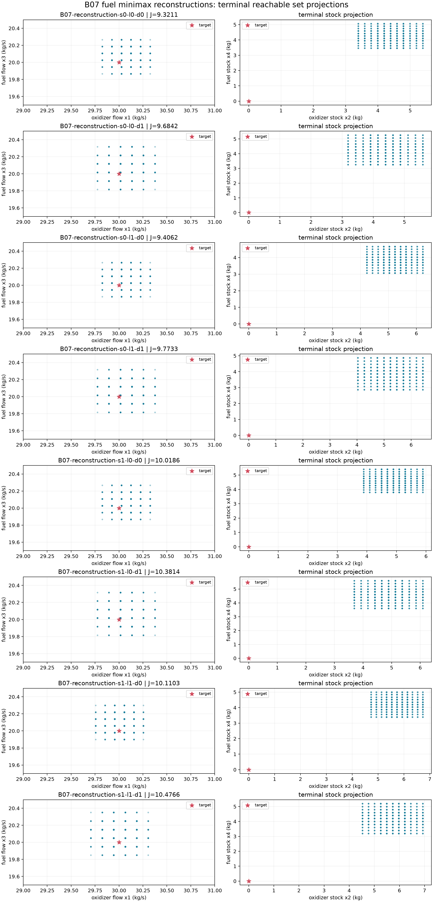

# B07 owner-approved reconstruction cases

These eight cases are executable reconstructions, not historical reproductions. They preserve the paper's printed 100-second duration and printed initial stocks `(302,207)` as discrepancies. This run uses the owner's explicit five 2-second depletion steps (10 modeled seconds), and compares the printed stocks with the initialization-table stocks `(305,205)`. Nothing was tuned to the paper's reported `9.77`.

The source article is inventory item `L10`, SHA-256 `146ec36e96be4c779158541420eac1e242825262b5981d47b61ba86a9e2126a8`. The paired planning and nonlinear replay files have SHA-256 values `c6af20858e505563c16a9a28a04dbd84dbb70a8d9c25e2e88630bf5493adb644` and `90a979fea6f492bb9669f1f20d3a6ae2cd420a84b71145d268e1d845426e28e0`. Their paper/archive differences and the eight-case cross-product were approved by the owner in the issue #6 decision record.

Each case enumerates all 3,125 fixed control plans. At each stage it supplies the four corners of the independently selected continuous disturbance box `[-1,1]^2`, giving up to 1,024 terminal disturbance histories per plan. Stage constraints cover the paper's flow bounds and the owner-approved nonnegative stock bounds. The objective is

```text
J_lambda(x) = sqrt((30-x1)^2 + x2^2 + 2.25(20-x3)^2 + 2.25x4^2
                   + lambda*(x2-1.5*x4)^2)
```

with `lambda` set to 0 or 1. The runner uses numerical assurance with a `1e-9` near-optimal tolerance so tied minimizing plans survive binary64 rounding. The independent NumPy verifier re-enumerates the control plans and all disturbance histories, checks stagewise feasibility, and compares the full minimizing-plan family and objective value.

## Results

| Initial stocks `(oxidizer,fuel)` kg | `lambda` | Disturbance coefficients `(a,b)` | Feasible plans | Minimizing plan indices | Worst-case objective | Median solver call | Range |
|---|---:|---|---:|---|---:|---:|---:|
| `(305,205)` | 0 | paper `(0.05,-0.04)` | 493 | `188` | 9.32109 | 416.384 ms | 413.467–426.170 ms |
| `(305,205)` | 0 | archive `(0.06,-0.05)` | 365 | `188` | 9.68423 | 339.471 ms | 336.433–353.205 ms |
| `(305,205)` | 1 | paper `(0.05,-0.04)` | 493 | `212, 292, 308` | 9.40619 | 413.249 ms | 412.116–419.525 ms |
| `(305,205)` | 1 | archive `(0.06,-0.05)` | 365 | `212, 292, 308` | 9.77333 | 339.482 ms | 336.331–351.855 ms |
| `(302,207)` | 0 | paper `(0.05,-0.04)` | 442 | `1336` | 10.01862 | 396.968 ms | 391.056–401.456 ms |
| `(302,207)` | 0 | archive `(0.06,-0.05)` | 328 | `1336` | 10.38144 | 325.552 ms | 323.451–329.294 ms |
| `(302,207)` | 1 | paper `(0.05,-0.04)` | 442 | `831, 911, 1407` | 10.11031 | 400.027 ms | 391.977–417.726 ms |
| `(302,207)` | 1 | archive `(0.06,-0.05)` | 328 | `831, 911, 1407` | 10.47661 | 327.423 ms | 326.054–343.019 ms |

Every row completed without solver failure. The medians and ranges are seven measured calls per case after one excluded warmup. Each timing includes request construction and one public minimax call. This is one Release build on one adapter; there is no limiter profile, resource cap, cross-adapter comparison, or speedup claim. Exact source, scenario, executable and build hashes are in `run-provenance.json` and each raw result row.

Build host evidence: GCC 16.2.1, CMake 3.31.6, Release configuration, 4 parallel build jobs. Cases ran sequentially. The environment load average was not captured during the run; raw timings and ranges are retained so the measurements can be repeated.

## Graphical material



The left column projects the winning terminal disturbance set onto `(x1,x3)` and marks the target `(30,20)`. The right column projects it onto `(x2,x4)` and marks `(0,0)`. Each plot shows terminal disturbance vertices, not the full 4D boundary or a nonlinear replay.

## Files and reproduction

- `results.jsonl` contains the measured records and terminal vertices used for the projections.
- `index.html` is a local English report page generated from the saved results.
- `run-provenance.json` binds the capture to the clean source commit, compiler, Release flags, CMake cache, executable, and result-file hashes.
- `independent-oracle-verification.json` records per-case agreement with the independent enumeration.
- `projections.png` and `projections.svg` are the visual outputs.
- `SHA256SUMS` lists the bundle file digests; run `sha256sum -c SHA256SUMS` from this directory.
- Source driver: [`benchmarks/reporting/issue6/b07_reconstruction.cpp`](../../../benchmarks/reporting/issue6/b07_reconstruction.cpp).
- Scenario: [`benchmarks/scenarios/b07-owner-approved-eight-case-v1.json`](../../../benchmarks/scenarios/b07-owner-approved-eight-case-v1.json).

Configure a clean Release build with `CSL_BUILD_ISSUE6_B07_REPORT=ON`, then build `csl_issue6_b07_report`. Run `b07_capture.py --source-root <repo> --build-dir <release-build> --output-dir <capture-dir>` with a missing or empty capture directory outside the source tree. The capture refuses symlink paths, nonempty destinations, and existing output files. Then run `b07_independent_oracle.py <capture-dir>/results.jsonl` and `b07_render_projection.py <capture-dir>/results.jsonl --output-directory <capture-dir>`. The NumPy and Matplotlib versions are pinned in `scripts/reports/requirements.txt`.

This PR is a preparatory evidence bundle, not the final published report route. The English HTML is saved here for review. Registering it with the schema-3 report catalogue and verifying the main-only Pages deployment remains required follow-up work; B07 reporting is not complete until that route and its deployed bytes are checked.

Historical paper outputs and the old `B07-historical` transcription remain unchanged. The article's reported results are observations to investigate, not acceptance targets for these explicitly parameterized cases.
