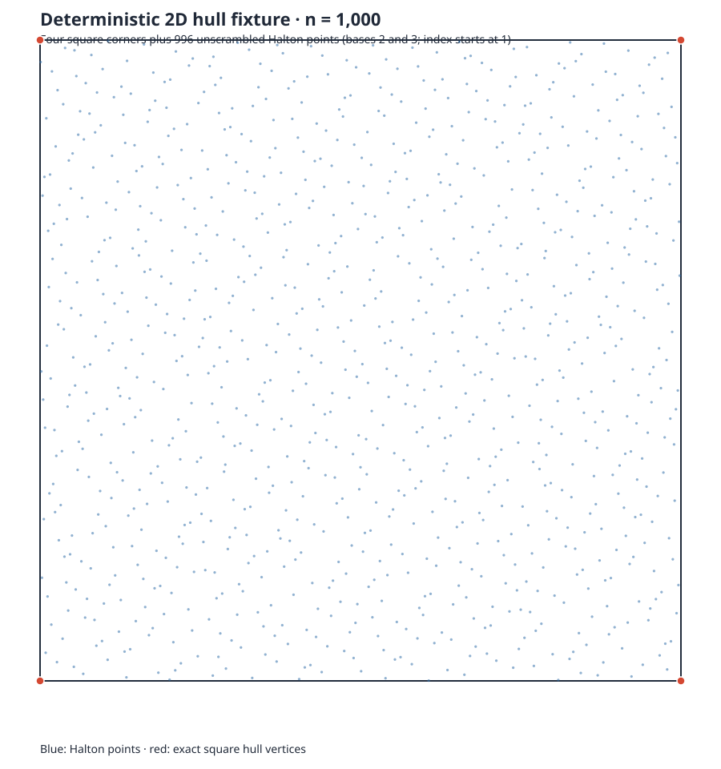

# EXP-02 exploratory ITIS17 hull ladder

This artifact records an exploratory 2D benchmark for issue #94. The native dependency #86 is still open, so these measurements do not satisfy the full EXP-02 acceptance criteria and do not resolve that dependency.

## Workload and execution

The workload is a deterministic square: four exact corners followed by unscrambled Halton points in bases 2 and 3, starting at index 1. The three fixtures contain 250, 1,000, and 5,000 points. Each method received one warmup and seven interleaved measured repetitions per size. A fresh HiGHS workspace is created before each reducer timing; the measured interval covers the reducer call and excludes workspace creation and independent output checking. QuickHull's interval covers the QuickHull call. HiGHS is pinned to 1.11.0 and configured for single-thread operation.

The process ran on an AMD Ryzen 5 3550H laptop CPU (8 logical CPUs, Omarchy Linux). Runs were serial. The raw host load, memory, elapsed process time, and stderr diagnostics are retained with the raw observations. Memory was observed in host snapshots only; no per-attempt or suite memory cap was enforced. The binaries were tuned Release builds (`-O3 -DNDEBUG`), without profiler instrumentation.

The 5,000-point workload exceeded the first 300-second run cap after emitting 26 rows. The driver was then used to continue at round 4, without rerunning warmups. It emitted 24 rows; two round-4 rows duplicate observations already in the first log. The summarizer validates and deduplicates on fixture, method, warmup flag, and round, keeping the first observation. The resulting table has all 144 unique planned rows: 18 warmups and 126 measured observations.

The row `source_commit` is emitted from the CMake configure-time Git hash. Both the initial 5,000-point run and its continuation report `45cf065`; the continuation used the committed resume option from `f217396`. The measured algorithm and workload code were otherwise unchanged. The 250- and 1,000-point observations were run from `45cf065`.

## Results

See [`summary.csv`](summary.csv) for medians, ranges, pass counts, and retained/removed counts; [`validated-rows.jsonl`](validated-rows.jsonl) contains the deduplicated rows. The six method identities distinguish geometric QuickHull, the production baseline, basis reuse, ordered LP, and the two ITIS17 paper adaptations.

QuickHull and basis reuse passed all 21 measured trials each. QuickHull retained the four square corners. Basis reuse retained 148, 658, and 3,255 points at sizes 250, 1,000, and 5,000, respectively, and its reductions passed the exact source-index hull checker. The baseline, ordered LP, A43 adaptation, and A44 adaptation produced incomplete reductions on this fixture; their elapsed values are failed attempts, not valid successful-performance comparisons. A43 retained the same counts as basis reuse but did not complete its final recheck. The baseline and ordered LP retained every point. A44 retained every point at 250 and 1,000; at 5,000 it removed two points but remained incomplete.

The successful rows show QuickHull's median call time increasing from 0.553 ms to 11.225 ms across this size ladder; basis reuse increases from 2.497 ms to 47.977 ms. These are single-host exploratory numbers. No speedup claim is made: four compared methods did not produce complete verified reductions, and no usable sampled CPU limiter profile was available. The `gprof` probe was unusable because it accumulated no timing samples; `perf` and `/usr/bin/time` were unavailable on this host. The timed-reducer comparison therefore remains incomplete as a performance study.



## Reproduction and files

The workload driver is `benchmarks/reporting/it17_hull/preliminary_driver.cpp`; the report target is `csl_it17_hull_comparison_report`. Run it with `--ladder-size 250|1000|5000 --measure 7`. `--from-round N` resumes at an interleaved round and skips warmups. The deterministic workload generator and geometry are shown in the figure.

Raw JSONL streams, stderr validation diagnostics, shell elapsed times, host load, and memory snapshots are retained under `raw/`. The reducer script validates the expected method/fixture/repetition matrix and creates the summary files:

```sh
python scripts/reports/summarize_exp02_hull_ladder.py \
  --raw-dir reports/algorithm-results/exp02-it17-hull-ladder-20261024-r1/raw \
  --output-dir reports/algorithm-results/exp02-it17-hull-ladder-20261024-r1
```

