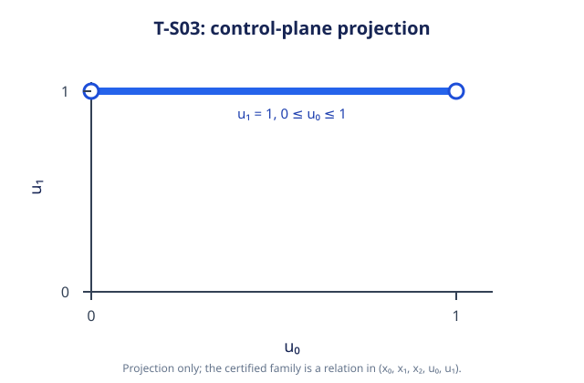

# SYN-04 Strategy B slice

This is a **partial implementation of issue #67**. It constructs and solves the
full sparse joint-history program and retains a coupled optimal-level candidate.
The reviewed coverage and program-to-original-problem equivalence procedures are
not available. It therefore never publishes a complete or partial optimal family,
never promotes program lower bounds or solver optimal status to a synthesis
optimality claim, and rejects those requested targets and validated assurance.

## Supported assumptions

- Immutable resolved discrete nominal open-loop problem; known initial point;
  continuous controls; no external port/input.
- Native H, singleton, empty, and universal stage constraints. Every initial,
  state, control, transition, and authored temporal row is retained in canonical
  `x0,...,xT,u0,...,u(T-1)` order. Singular/time-varying dynamics and affine offsets
  are supported without inverses.
- Linear, convex quadratic, and rectangular residual-norm terminal objectives.
  The original objective is lifted unchanged onto the terminal coordinates;
  residual squaring is delegated to the existing convex program contract.
- Effective profile `nominal_open_loop`, native family representation
  `csl.polyhedron.h`, numerical candidate target. The context numerical policy
  must equal the effective request. `materialization_limit` counts H rows.

The strategy registration composes injected LP and convex registries through the
existing provider/StrategyPort path. Generated concrete programs are admitted
before a native workspace is created. No fallback registry or implicit geometry
conversion is created. Both LP and convex providers are required at preparation
in this initial registration.

## Evidence and limitations

The typed payload retains CSR constraints, source row and coordinate lineage,
the lifted objective, the immutable generated program, provider provenance, valid
program-scoped results, and construction diagnostics. The candidate initially
contains the feasible history relation. When an admitted optimal result has an
independently feasible anchor, extraction restricts the joint relation by:

- Linear: `c'z=c'a`.
- Quadratic: `Hz=Ha` and `q'z=q'a`, where `H=(Q+Q')/2`.
- Residual norm: `Lz=La`.

These characterize the mathematical argmin on a convex feasible set when `a` is
a true global optimizer. A binary64 anchor and residual check do not establish
that premise or family coverage. The public result remains a heuristic candidate
with an undetermined synthesis mathematical outcome. Constant objectives impose
no effective restriction; nullspaces and multiple histories remain coupled.

Original-problem trajectory verification may supply a numerical feasible
incumbent and witness-scoped upper bound. Program lower bounds remain in their
original program scope. A valid stopped solve can retain program evidence,
incumbent, upper bound, and candidate independently of execution termination.
Rejected generated requests, invalid solver bindings, and extraction resource or
arithmetic stops retain already completed lineage and strongest supported data.

Constraints and programs are sparse CSR; the public objective storage and
materialized H relation currently use dense buffers. This is not a performance
claim or an unbounded-capacity guarantee. No numerical coverage threshold or
global dimension/row cap is introduced.

## Direct build and tests

The slice-local harness is intentionally separate from the production root
build until the integrator adds library/test targets. It includes the root once
and builds this slice with C++20 and `/W4 /WX /permissive-` on MSVC (or
`-Wall -Wextra -Wpedantic -Werror` elsewhere).

From the repository root, with CMake 3.31 or later available:

```powershell
cmake -S tests/synthesis/strategy_b -B ../syn04-family-build -G 'Visual Studio 17 2022'
cmake --build ../syn04-family-build --config Release --parallel 4
ctest --test-dir ../syn04-family-build -C Release --output-on-failure
```

The session used the following exact executable and dependency-source overrides
to reuse the pinned dependency archives already unpacked on this workstation:

```powershell
$taskCMake = 'C:/Program Files/Microsoft Visual Studio/2022/Community/Common7/IDE/CommonExtensions/Microsoft/CMake/CMake/bin/cmake.exe'
& $taskCMake -S tests/synthesis/strategy_b -B D:/work/PhD/worktrees/syn04-family-build -G 'Visual Studio 17 2022' `
  -DFETCHCONTENT_SOURCE_DIR_CSL_HIGHS=D:/work/PhD/agent-work/syn53-syn61/syn02-build/_deps/csl_highs-src `
  -DFETCHCONTENT_SOURCE_DIR_CSL_OBJECTIVES_EIGEN=D:/work/PhD/agent-work/syn53-syn61/syn02-build/_deps/csl_objectives_eigen-src `
  -DFETCHCONTENT_SOURCE_DIR_CSL_QHULL=D:/work/PhD/agent-work/syn53-syn61/syn02-build/_deps/csl_qhull-src `
  -DFETCHCONTENT_SOURCE_DIR_CSL_JSON=D:/work/PhD/agent-work/syn53-syn61/syn02-build/_deps/csl_json-src `
  -DFETCHCONTENT_SOURCE_DIR_DOCTEST=D:/work/PhD/agent-work/syn53-syn61/syn02-build/_deps/doctest-src
& $taskCMake --build D:/work/PhD/worktrees/syn04-family-build --config Release --target syn04_tests --parallel 4
& D:/work/PhD/worktrees/syn04-family-build/Release/syn04_tests.exe
& $taskCMake --build D:/work/PhD/worktrees/syn04-family-build --config Release --parallel 4
& 'C:/Program Files/Microsoft Visual Studio/2022/Community/Common7/IDE/CommonExtensions/Microsoft/CMake/CMake/bin/ctest.exe' --test-dir D:/work/PhD/worktrees/syn04-family-build -C Release --output-on-failure
```

Test-first observations: the initial builder scaffold failed the four builder
cases; the initial workspace scaffold failed seven extraction/boundary cases;
the initial registration scaffold and missing cancellation provenance failed
their registered execution and cancellation cases before implementation.
Analytic provider fixtures use literal independently derived anchors and values,
not the production builder or an optimization residual as the oracle. A native
HiGHS registered-provider test covers public execution and provider lifetime.

Release verification on MSVC 19.44: the slice executable passed **19 test cases
and 344 assertions**. The full project build succeeded. Full CTest ran **69
tests: 67 passed, 2 failed** (`convex_report_smoke`, `report_smoke`) with
`ValueError: CMake file API reply missing`. The nested harness records report
ownership in its `csl` child binary directory while CMake file API replies are
generated at the harness root. These report checks were not disabled or changed;
production root registration must be followed by fresh top-level verification.
The first broad build also hit an object-file permission error from an overlapping
targeted build; the subsequent single broad build succeeded.

### Production integration and stop-contract review follow-up

Production library/test registration was added in commit `002c75a`. Review fixes
keep pre-expired deadlines as `Termination::cancelled` with the distinct typed
`StopReason::deadline_expired`, represent early materialization exhaustion as
`Termination::resource_limit` with `ScopedOperationStopped(resource_limit)`, and
use `ContractValidationFailure` for validation failures. Registered execution
tests exercise the shared result validation/sanitization boundary for all three.
No mathematical claim is strengthened by these stop-contract fixes.

The follow-up focused Release executable passed **23 cases / 431 assertions**.
The full production Release build and **69/69 CTest tests** passed after refreshing
CMake build metadata. An initial production CTest attempt failed
`convex_report_smoke` because its executable had a stale source-commit identity;
reconfiguration and rebuilding corrected that provenance mismatch.

Exact follow-up commands from the repository root (using `$taskCMake` above):

```powershell
& $taskCMake --build D:/work/PhD/worktrees/syn04-production-build --config Release --target direct_joint_strategy_tests --parallel 4
& D:/work/PhD/worktrees/syn04-production-build/Release/direct_joint_strategy_tests.exe
& $taskCMake -S . -B D:/work/PhD/worktrees/syn04-production-build
& $taskCMake --build D:/work/PhD/worktrees/syn04-production-build --config Release --parallel 4
& 'C:/Program Files/Microsoft Visual Studio/2022/Community/Common7/IDE/CommonExtensions/Microsoft/CMake/CMake/bin/ctest.exe' --test-dir D:/work/PhD/worktrees/syn04-production-build -C Release --output-on-failure
```

### GCC13 provider-reference compilation follow-up

After rebasing onto Strategy A integration, GCC13 rejected the temporary lambda
used to select an LP/convex provider reference with `-Werror=dangling-reference`.
The implementation now passes the owned provider directly into a typed runner
through compile-time branches. Existing LP, convex, rejected-provider and provider
lifetime behavior tests are retained; mathematical and candidate scope is
unchanged. The exact strict compilation command reproduced the warning before
the change and succeeded after it:

```powershell
wsl -d Ubuntu -- g++-13 -std=c++20 -O3 -DNDEBUG -Wall -Wextra -Wpedantic -Werror -I /mnt/d/work/PhD/worktrees/syn04-family/include -c /mnt/d/work/PhD/worktrees/syn04-family/src/synthesis/strategy_b/direct_joint.cpp -o /tmp/syn04-direct-joint.o
```

This is a GCC13 translation-unit compilation check, not a claim of a local full
Linux suite. Production MSVC Release verification using the commands above
passed **23 cases / 431 assertions** and **71/71 full CTest tests** on the rebased
branch. The additional full-suite tests come from merged Strategy A integration.

### Registered T-S02 constant-objective profile

Strategy B now supports one exact analytic profile, `ts02_constant_integrator`,
for the discrete two-step scalar integrator `x0=0`, `x(t+1)=x(t)+u(t)`,
`u(t) in [0,1]`, universal state constraints, and no temporal/external inputs.
Its admitted terminal objectives are a zero linear objective with offset 3, a
zero quadratic objective with offset 3, or the residual norm `||0*x-3||2`.
For this profile the optimal relation equals the complete feasible joint-history
polyhedron. Strategy B builds that H-relation and returns its analytic proposal
without consulting solver status or witness samples. The compiled shared proof
authority independently checks the immutable resolved source, effective request,
strategy lineage, exact objective, canonical H coefficients and objective bounds.
Both Strategy A and Strategy B use the payload
`csl::synthesis::Ts02ConstantIntegratorRelation` and verifier
`csl.verifier.ts02-constant-integrator@1`.

This is an exact-fixture result, not a general completeness procedure for
constant objectives, arbitrary integrator dimensions, nontrivial state sets,
other control bounds, external inputs, or temporal constraints. The remaining
#67 acceptance criteria are still open. Direct focused test command:

```powershell
& D:/work/PhD/worktrees/syn04-ts02-direct-build/Release/syn04_tests.exe --test-case='Strategy B registers the exact T-S02 constant-objective history family'
```

## Unmet acceptance criteria

Complete-family publication and cross-strategy complete-relation acceptance
remain blocked on the reviewed coverage/provenance procedures. This slice does
not close #67 and does not satisfy T-X01's complete-family acceptance merely by
matching sampled histories or objective values. Paired strategy integration and
full-family independent verification remain for integration/review. Production
CMake registration and top-level Release verification are now in place.

### Registered T-S03 singular-integrator profile

Strategy B also admits the exact T-S03 singular-integrator fixture: `x0=0`,
`x1=u0`, `x2=u1`, controls in `[0,1]`, and objective `(x2-1)^2`. Its complete
optimal joint-history relation is `x0=0`, `x1=u0`, `x2=1`, `u1=1`, and
`0<=u0<=1`. The registered verifier only admits that exact source, request,
objective, and Strategy B lineage. It requires successful direct-program
completion, optimal-level extraction, and a zero-cost anchor before publishing
the family. Other singular systems and request profiles remain candidates.

The following figure shows the projection onto the `(u0,u1)` control plane;
the full certified relation also includes `(x0,x1,x2)`.



Focused test command:

```powershell
& D:/work/PhD/worktrees/syn04-ts03-profile-build/Release/syn04_tests.exe --test-case='registered Strategy B publishes the exact T-S03 singular-dynamics family'
```
